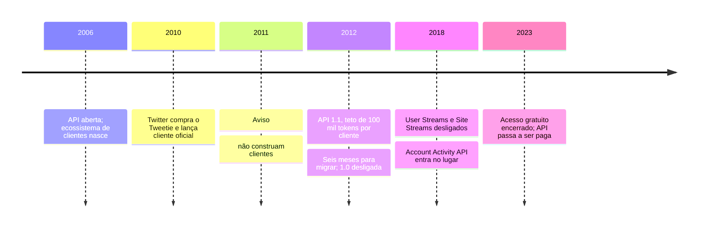

# Caso Twitter e o fechamento progressivo da API pública

Boa parte do vocabulário do Twitter surgiu fora da empresa. O termo *tweet* apareceu num cliente de terceiro chamado Twitterrific. A resposta com arroba, a repostagem e a marcação com cerquilha nasceram do uso e foram incorporadas depois pela empresa. Durante alguns anos, a plataforma foi moldada por desenvolvedores externos que usavam a API aberta do Twitter.

Depois a empresa restringiu o acesso à API em três ocasiões, com onze anos de intervalo entre a primeira e a última. Cada restrição eliminou uma categoria inteira de *software* construída sobre a API.

O caso examina a situação das empresas que construíram produtos sobre o contrato publicado pelo Twitter.

## A API como estratégia de produto entre 2006 e 2010

O Twitter abriu a API cedo e ela se tornou o principal motor de adoção da plataforma. Os clientes de terceiros disputavam usuários entre si, de modo que a competição produziu mais inovação de interface do que a empresa conseguiria produzir sozinha. Os aplicativos Tweetie, Twitterrific, TweetDeck e Echofon eram a forma de acesso ao Twitter para muitos usuários.

A consequência arquitetural é o aspecto relevante para este módulo. O Twitter tinha um contrato público e milhares de consumidores independentes, cada um com o próprio ciclo de entrega. Nesse cenário, a API deixa de ser um detalhe de integração e passa a ser a fronteira que define o produto.

Em 2010 a empresa comprou o Tweetie e o transformou no cliente oficial para iPhone. A partir dessa compra, o dono do contrato passou a competir com os consumidores do contrato.

## Aviso aos desenvolvedores em março de 2011

Ryan Sarver, então responsável pela plataforma, enviou à lista de desenvolvedores uma mensagem amplamente divulgada. O trecho reproduzido pela cobertura da época diz que os desenvolvedores não deveriam construir aplicativos clientes que imitassem ou reproduzissem a experiência de consumo principal do Twitter.

A mensagem era apenas um aviso e o contrato técnico continuou funcionando exatamente como antes. A mudança estava na declaração pública sobre o que a empresa toleraria a partir de março de 2011.

As equipes com um cliente em produção nesse momento enfrentaram uma decisão difícil de fundamentar. Elas precisavam decidir se continuariam investindo numa base de código cuja permissão de existir tinha sido posta em dúvida por um aviso informal.

## Restrição implementada na versão 1.1 em agosto de 2012

A versão 1.1 da API tornou a intenção executável. As mudanças anunciadas em 16 de agosto de 2012 incluíam autenticação obrigatória em cada *endpoint*, isto é, em cada endereço exposto pela API. O anúncio também trouxe limites de taxa recalculados por *endpoint* no lugar dos limites globais e uma regra nova dirigida a uma categoria específica de aplicativo.

Os clientes de terceiros passaram a ter um teto de **100 mil tokens de usuário**. Um aplicativo que atingisse cem mil usuários precisava negociar diretamente com o Twitter para crescer. Os aplicativos que já estavam acima do teto podiam crescer até o dobro da base que tinham na data do anúncio.

O desenho do controle merece atenção. O teto limita o número de **usuários** e protege o modelo de negócio, enquanto um limite de requisições protegeria a infraestrutura. Na documentação, o limite de taxa e o teto de tokens parecem o mesmo tipo de mecanismo, embora resolvam problemas de natureza diferente.

O prazo de migração da versão 1.0 para a versão 1.1 foi de seis meses, ao fim dos quais a versão 1.0 foi desligada.

**Texto alternativo:** linha do tempo do Twitter de 2006 a 2023. A linha marca a abertura da API com o surgimento do ecossistema, a compra do Tweetie e o aviso de 2011. Em seguida marca o teto de tokens da versão 1.1 em 2012, o desligamento das APIs de fluxo contínuo em 2018 e o fim do acesso gratuito em 2023.

*Figura 9 — Dezessete anos de decisões sobre a fronteira pública do Twitter. Fonte: curso, a partir dos anúncios oficiais e da cobertura de imprensa da época.*

**Leitura textual da figura:** a sequência mostra três fechamentos sucessivos, cada um dirigido a uma classe diferente de consumidor. O fechamento de 2012 atingiu os clientes de leitura e o de 2018 atingiu os aplicativos que dependiam de fluxo contínuo de eventos. O fechamento de 2023 atingiu qualquer consumidor sem orçamento para pagar pelo acesso. Entre um fechamento e outro passaram anos, prazo suficiente para que uma nova geração de produtos fosse construída sobre a mesma fronteira.

## Mudança do estilo de interação em agosto de 2018

O segundo fechamento foi mais técnico e, para os consumidores externos, mais caro que o primeiro.

As APIs de fluxo contínuo conhecidas como User Streams e Site Streams foram desligadas em 16 de agosto de 2018 e substituídas pela Account Activity API. A mudança alterou o **estilo de interação** entre a plataforma e os consumidores. Uma conexão persistente que enviava eventos ao consumidor foi substituída por um modelo em que a plataforma chama um endereço do consumidor.

A adaptação exigia mais do que a troca da URL. Um aplicativo que recebia eventos por conexão aberta não precisava de endereço público, de certificado nem de disponibilidade permanente para receber chamadas de entrada. Depois da mudança, o aplicativo passou a precisar desses três elementos. Produtos como o Favstar encerraram as atividades por não conseguirem arcar com esse custo.

## Fim do acesso gratuito em fevereiro de 2023

O terceiro fechamento ocorreu sem período de transição. Em 2 de fevereiro de 2023 a empresa anunciou que o acesso gratuito à API terminaria nas versões 1.1 e 2 a partir do dia 9, o que deu aos consumidores sete dias de prazo.

Desta vez os produtos encerrados pertenciam a outra categoria, descrita na lista abaixo. Nenhum deles tinha receita para migrar para um plano pago.

- *Bots* públicos de utilidade.
- Ferramentas de acessibilidade.
- Projetos de pesquisa acadêmica.
- Serviços gratuitos mantidos por uma única pessoa.

## A lição que o caso ensina sobre contratos

Uma API pública tem dois aspectos e o módulo trata de ambos ao longo das suas páginas. Para quem a publica, a API é um contrato que precisa ser versionado, documentado e testado. Para quem a consome, ela é uma **dependência que o consumidor não controla**, como mostram os três fechamentos do Twitter.

A decisão de consumir uma API de terceiro é uma aposta sobre o comportamento futuro de outra empresa. O contrato técnico não protege contra mudança de estratégia. O histórico do Twitter mostra que o aviso costuma preceder a restrição, às vezes com anos de antecedência, como ocorreu entre 2011 e 2012.

O histórico recomenda tratar a integração com API de terceiro como decisão arquitetural registrada, com o custo de saída estimado antes do início da integração.

## Questões para discussão

As questões abaixo examinam o caso com a lente do arquiteto e pedem a recuperação dos fatos, a explicação dos mecanismos e a comparação das escolhas descritas no próprio caso.

**1.** A página descreve três fechamentos sucessivos da fronteira pública. Diga o ano de cada um e que classe de consumidor cada um atingiu.

**2.** Limite de taxa por *endpoint* e teto de tokens de usuário aparecem no mesmo anúncio. Explique o que cada um mede e diga qual protege a infraestrutura e qual protege o modelo de negócio.

**3.** Em 2018, as APIs de fluxo contínuo foram trocadas por um modelo em que a plataforma chama o consumidor. Explique o que um consumidor passou a precisar ter e que antes não precisava.

**4.** Compare o aviso de março de 2011 com a mudança de agosto de 2012 quanto ao efeito prático sobre quem já mantinha um cliente em produção.

**5.** No anúncio de 2012, aplicativos já acima do teto podiam crescer até o dobro da base daquele momento. Compare a situação de um aplicativo com 90 mil usuários e a de outro com 300 mil no dia do anúncio.

## Fontes

- Twitter, **Changes coming in Version 1.1 of the Twitter API**. Anúncio oficial de 16 de agosto de 2012, origem das mudanças de autenticação, dos limites por *endpoint* e do teto de tokens. A página é instável no domínio atual e deve ser consultada na [cópia arquivada](https://web.archive.org/web/20240416135831/https://blog.twitter.com/developer/en_us/a/2012/changes-coming-to-twitter-api).
- Twitter, [Delivering a consistent Twitter experience](https://blog.x.com/developer/en_us/a/2012/delivering-consistent-twitter-experience). Postagem de junho de 2012 que antecede e justifica as mudanças da versão 1.1.
- X, [Account Activity API — guia de migração a partir de User Streams e Site Streams](https://developer.x.com/en/docs/x-api/enterprise/account-activity-api/migration/us-ss-migration-guide). Documentação oficial da substituição de 2018, que inclui o que o consumidor passou a operar.
- Fontes secundárias, identificadas como tais. A mensagem de Ryan Sarver de março de 2011 à lista de desenvolvedores é conhecida pela reprodução na imprensa técnica, como no [O'Reilly Radar](http://radar.oreilly.com/2011/03/twitter-developers.html). O encerramento do acesso gratuito em fevereiro de 2023 foi noticiado por [Forbes](https://www.forbes.com/sites/jenaebarnes/2023/02/03/twitter-ends-its-free-api-heres-who-will-be-affected/) e [Engadget](https://www.engadget.com/twitter-shutting-off-free-api-prepare-174340770.html). O fechamento do Favstar em 2018 foi noticiado pelo [TechCrunch](https://techcrunch.com/2018/05/14/favstar-twitter/).
