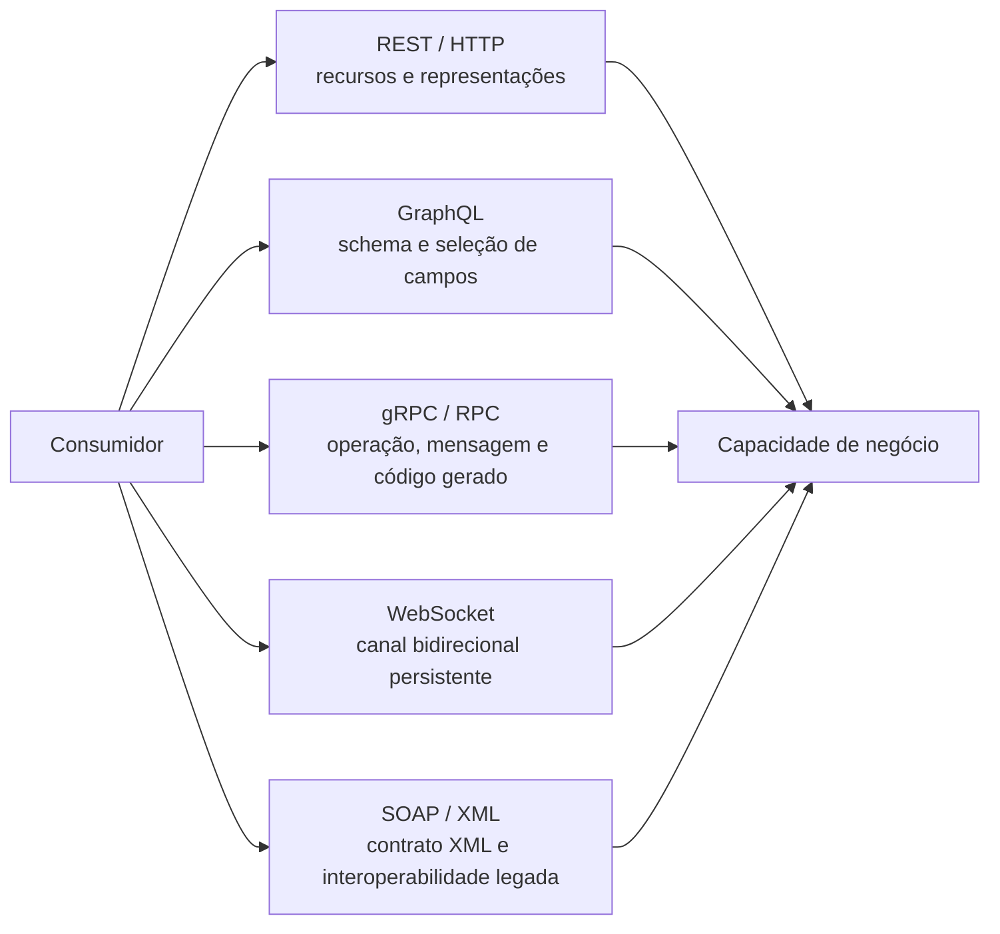
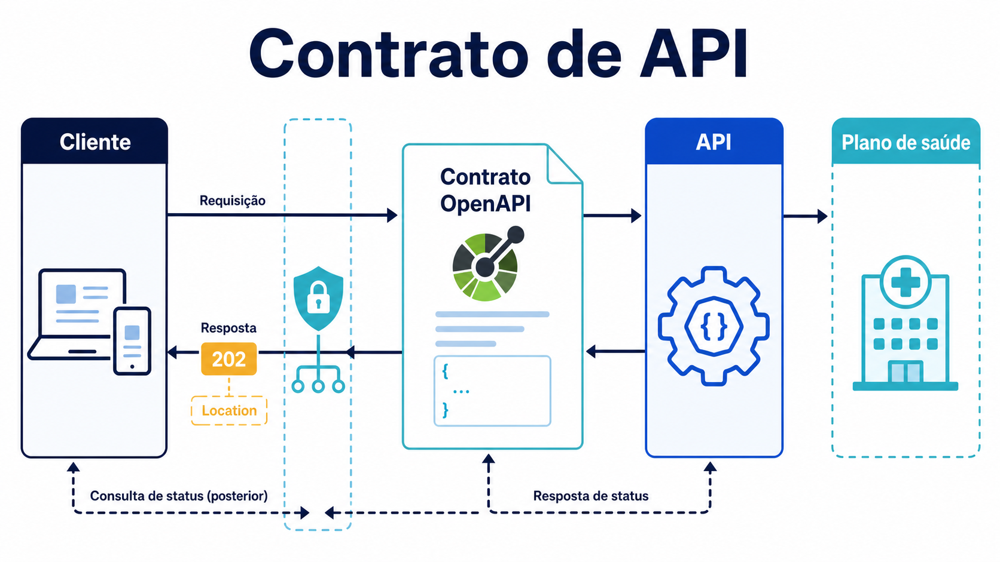

# Conceitos fundamentais de APIs

## O Estilo de APIs

A sigla API designa a *Application Programming Interface*, elemento central no desenvolvimento de software porque conecta sistemas, aplicações e serviços e permite que eles se comuniquem de maneira estruturada. A API define o conjunto de regras e protocolos que governa a interação entre componentes de software, o que promove a interoperabilidade e o reaproveitamento de funcionalidades.

A web é o exemplo mais difundido de uso de APIs, com o estilo REST e o protocolo HTTP como base da maior parte das integrações publicadas.

**Leitura textual da figura:** o infográfico tem três blocos. O primeiro bloco apresenta a web como uma biblioteca digital de documentos HTML interligados por *hyperlinks* e localizados por URLs. O segundo bloco compara o HTTP a um carteiro que transporta mensagens com os métodos GET, POST, PUT/PATCH e DELETE num protocolo sem estado. As respostas trazem códigos de status como 200 OK e 404 Not Found, além de 403 Forbidden e 500 Error. O terceiro bloco apresenta as APIs como ligação entre sistemas, com a analogia do garçom que leva o pedido à cozinha. Esse bloco cita integrações cotidianas como o *login* com Google e a previsão do tempo e lista os tipos REST, SOAP, GraphQL e WebSocket.

As APIs viabilizam o desenvolvimento modular porque permitem que desenvolvedores integrem recursos de sistemas externos ou exponham os próprios serviços para consumo por terceiros. A integração de aplicativos com serviços de mapas, pagamentos, redes sociais e plataformas de comércio eletrônico ou de IoT ilustra esse uso. Com isso, os desenvolvedores concentram o esforço na lógica da própria aplicação e reutilizam a funcionalidade básica que outros sistemas já criaram e expuseram.

Uma característica essencial das APIs é o encapsulamento da complexidade interna de um sistema, que expõe apenas o necessário para a interação com outros sistemas. Essa abstração protege os detalhes do funcionamento interno e contribui para a segurança. Ela também permite mudanças internas sem efeito sobre os sistemas conectados, desde que os contratos da API sejam mantidos.

No mercado atual, as APIs sustentam ecossistemas digitais complexos e viabilizam modelos de negócio baseados em plataformas, como a oferta de serviços nos modelos *as-a-service* SaaS e PaaS. Uma empresa pode, por exemplo, abrir APIs públicas para que desenvolvedores externos criem soluções complementares ao seu produto principal e ampliem o valor do ecossistema.

As APIs são amplamente utilizadas em sistemas móveis, em aplicativos web e na comunicação entre microsserviços em arquiteturas distribuídas. Elas também são fundamentais para a transformação digital das organizações, pois possibilitam a integração entre sistemas legados e sistemas novos e aceleram a inovação nos processos.

## API como fronteira de colaboração

Uma **interface de programação de aplicações** (API) permite que aplicações web e móveis, serviços de nuvem, parceiros ou dispositivos usem uma capacidade sem conhecer as tabelas ou os algoritmos internos. A tabela abaixo separa as três camadas dessa fronteira.

| Camada        | Pergunta que responde                 | Exemplo na plataforma hospitalar                                   |
| ------------- | ------------------------------------- | ------------------------------------------------------------------ |
| Interface     | O que está disponível para interação? | `POST /elegibilidades` e `GET /elegibilidades/{protocolo}`         |
| Contrato      | Que promessa é observável?            | campos obrigatórios, `202`, `Location`, `422` e schemas publicados |
| Implementação | Como a promessa é cumprida hoje?      | FastAPI, Pydantic e armazenamento em memória                       |

O **consumidor** depende somente do contrato publicado, sem acesso ao código nem ao banco de dados. A troca de biblioteca ou de armazenamento pode permanecer interna ao provedor. Renomear um campo, mudar um status ou remover uma operação exige uma transição combinada com os consumidores. A API se torna reutilizável quando contrato, governança e evidência de funcionamento estão presentes.

## Necessidades de cada tipo de consumidor

A escolha de um estilo de API parte das necessidades do consumidor e não da popularidade do estilo. A tabela abaixo resume o que cada tipo de consumidor tende a valorizar.

| Consumidor                     | O que tende a valorizar                          |
| ------------------------------ | ------------------------------------------------ |
| Aplicação web                  | semântica HTTP e documentação                    |
| Aplicação móvel                | tamanho do *payload* e uso da rede               |
| Integração entre organizações  | contrato durável e tradução de vocabulário       |
| Canal em tempo real            | reconexão e ritmo de entrega                     |

Uma API multicanal pode entregar representações diferentes a cada consumidor. Ela precisa preservar o significado de negócio em todas as representações e declarar as diferenças entre elas no contrato.

## Exemplo - A semância do HTTP

O HTTP é um protocolo com semântica própria e não apenas um túnel para chamar funções remotas. Uma requisição combina método, alvo e cabeçalhos com um conteúdo opcional. Uma resposta combina status e cabeçalhos com o conteúdo devolvido ao cliente. Clientes, *proxies*, *caches* e ferramentas de terceiros compreendem essa semântica sem acordo prévio com o servidor.

Na chamada `POST /elegibilidades`, o método comunica que o cliente submete uma representação para processamento pelo servidor. A resposta `202 Accepted` informa a aceitação do pedido sem afirmar que a operadora de plano de saúde já decidiu sobre ele. O cabeçalho `Location: /elegibilidades/{protocolo}` comunica ao consumidor o endereço de acompanhamento do recurso aceito, de modo que cada elemento da mensagem elimina uma ambiguidade diferente.

| Método   | Intenção comum                              | Propriedade relevante           |
| -------- | ------------------------------------------- | ------------------------------- |
| `GET`    | recuperar uma representação                 | seguro e idempotente            |
| `POST`   | submeter dados ou criar sob uma coleção     | não é idempotente por definição |
| `PUT`    | substituir o estado conhecido de um recurso | idempotente                     |
| `PATCH`  | aplicar alteração parcial                   | depende do formato da alteração |
| `DELETE` | remover a associação de um recurso          | idempotente na intenção         |

Um método **seguro** é aquele em que o consumidor não pede mudança de estado, embora o servidor ainda possa registrar *logs* e métricas. Um método **idempotente** é aquele em que repetir a mesma intenção produz o mesmo efeito pretendido no servidor, embora a resposta ou os metadados possam variar. A idempotência do método HTTP não equivale à deduplicação automática de uma transação distribuída.

## Recursos, representações e erros

Em REST, um **recurso** é algo identificado e manipulado por meio de representações. A URI identifica o recurso e o JSON é o retrato de uma representação naquele instante. A elegibilidade aceita não se confunde com o dicionário Python que a oficina guarda, pois ela pode passar a vir de um banco de dados ou de outro serviço sem mudança no identificador público.

As rotas tendem a usar substantivos do vocabulário do consumidor, como `/elegibilidades`, `/agendamentos` e `/autorizacoes`. Os verbos continuam presentes nos métodos e nas transições de estado. Uma rota como `/aprovarAutomaticamente` pode ser uma operação RPC coerente, que não deve ser chamada de REST apenas por usar JSON e HTTP.

Uma representação inclui somente os dados necessários à tarefa do consumidor e omite as tabelas internas, de modo que o laboratório retorna apenas os campos `protocolo`, `situacao` e `criado_em`. As famílias de status `2xx`, `4xx` e `5xx` distinguem sucesso, problema do consumidor e falha do servidor. Os códigos `200`, `201` e `202` refinam a semântica de sucesso. Os códigos `404`, `409` e `422` refinam a semântica de problema do consumidor. O schema `ErroAPI` usa um `codigo` estável, uma `mensagem` legível e `detalhes` por campo para que o consumidor não dependa de texto livre.

## Restrições REST de Fielding

O estilo REST definido por Roy Fielding não se reduz a JSON sobre HTTP. As restrições **cliente-servidor**, **sem estado** e **cache** delimitam a colaboração entre as partes da interação. A **interface uniforme** reúne a identificação de recursos e as representações, além das mensagens autodescritivas e da hipermídia. O **sistema em camadas** admite intermediários entre cliente e servidor, enquanto o **código sob demanda** é a única restrição opcional do conjunto. Uma API HTTP não é automaticamente REST, pois uma rota com substantivo pode ser **RPC com aparência de recurso**. O laboratório usa recursos e mensagens HTTP sem demonstrar a totalidade das restrições de Fielding.

## Além do HTTP - Estilos de APIs

Os estilos REST, RPC e GraphQL resolvem interações distintas entre si. As alternativas gRPC, WebSocket e SOAP também atendem a interações próprias. A avaliação do protocolo e do estilo parte da necessidade do consumidor e considera topologia, volume e latência, além da evolução e da operação.

**Texto alternativo:** um consumidor alcança a mesma capacidade de negócio por cinco formas de interação. As formas são REST sobre HTTP, GraphQL e gRPC ou RPC, além de WebSocket e SOAP com XML.

*Figura 3 — Formas de interação entre um consumidor e a mesma capacidade de negócio. Fonte: curso.*

**Leitura textual:** as cinco formas de interação convergem na mesma capacidade de negócio. O REST usa recursos e representações, enquanto o GraphQL permite ao consumidor selecionar os campos da resposta. O gRPC e o RPC expõem operações e mensagens com código gerado a partir do contrato. O WebSocket mantém um canal bidirecional persistente e o SOAP com XML atende contratos de interoperabilidade legada.

| Alternativa | Quando ajuda                             | Cuidado arquitetural                       |
| ----------- | ---------------------------------------- | ------------------------------------------ |
| REST/HTTP   | recursos em integrações web heterogêneas | não reduzir REST a nomes de URL            |
| RPC/gRPC    | comandos ou colaboração interna tipada   | evolução de métodos, mensagens e toolchain |
| GraphQL     | leituras com seleção variável            | custo, autorização e cache nos resolvers   |
| WebSocket   | atualização bidirecional em tempo real   | reconexão, ordenação e pressão de consumo  |
| SOAP/XML    | contrato de parceiro legado              | isolar tradução do domínio                 |

O GraphQL exige um *schema* e uma política para consultas de alto custo. O gRPC não resolve por si só a lentidão de uma dependência externa. O WebSocket mantém o canal aberto, porém a durabilidade de eventos ou a mensageria exigem outro mecanismo. O uso de SOAP com um parceiro não obriga a plataforma moderna a adotar XML internamente. Em cada caso, o arquiteto registra a força que motivou a escolha e a evidência que permitirá revisá-la.

## O contrato verificável e a sua evolução

Os cabeçalhos transportam metadados da interação, conforme a lista abaixo.

- `Content-Type` descreve a representação enviada.
- `Accept` expressa os formatos que o cliente aceita.
- `Location` aponta um recurso relacionado.
- `ETag` identifica a versão de uma representação para *cache* ou controle de concorrência.
- Um identificador de correlação conecta os registros técnicos de uma mesma interação.

A especificação OpenAPI descreve em YAML ou JSON os caminhos e as operações da API com seus parâmetros, corpos, respostas e *schemas*. No laboratório, o arquivo `contratos/openapi.yaml` é a promessa explícita e versionada da API. Um arquivo válido ainda pode representar um contrato fraco, com tipos sem significado, erros ausentes ou exemplos incompatíveis. Por isso o laboratório combina verificações complementares em que o Spectral examina o documento, o Bruno examina o consumo e o `TestClient` examina a execução HTTP.

*Figura 4 — Anatomia de um contrato de API. Fonte: curso.*

**Leitura textual da figura:** um cliente consulta o contrato OpenAPI e envia uma requisição à API. A API responde `202 Accepted` com o cabeçalho `Location` para informar a aceitação e o endereço de acompanhamento. Outro consumidor, como uma operadora de plano de saúde, pode usar a mesma promessa sem conhecer a implementação do servidor.

A evolução do contrato envolve três decisões recorrentes. Na **paginação**, o modelo por `offset/limit` pode repetir ou omitir itens numa coleção que muda durante a leitura. Um cursor opaco lida melhor com essa mudança e exige uma política mais detalhada, que declare ordenação, continuação e filtros. Para a repetição segura de um `POST`, a chave de **idempotência** precisa de escopo e prazo de retenção, além de uma regra de comparação e de uma resposta definida para pedidos divergentes. O **versionamento** identifica uma linha de evolução incompatível com a anterior. Antes de abrir uma nova versão, recomenda-se adicionar campos opcionais e preservar o significado dos existentes. A remoção de campo, a nova obrigatoriedade ou a mudança de unidade tendem a quebrar consumidores.
