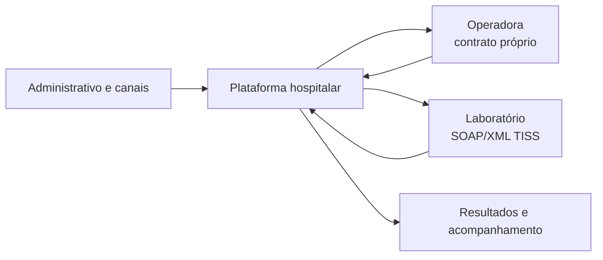
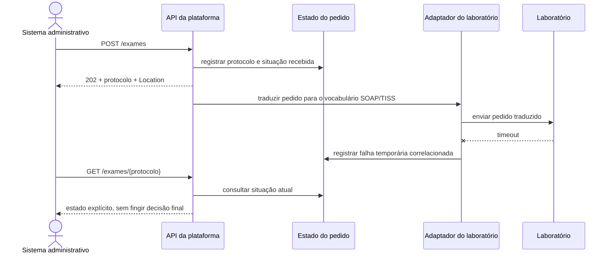

# Estudo de caso

## O problema que a arquitetura precisa resolver

O caso trata da integração entre um hospital, uma operadora de plano de saúde e um laboratório. O hospital mantém agenda, elegibilidade, autorização e pedidos de exame. A operadora e o laboratório são organizações independentes, cada uma com versões, disponibilidade e modelos de dados próprios. A plataforma hospitalar precisa rastrear os processos sem transformar a integração externa no seu modelo interno. Os dados do caso são sintéticos, de modo que o cenário representa forças de arquitetura sem reproduzir informações reais de nenhuma organização.

**Texto alternativo:** os canais administrativos acessam a plataforma hospitalar, que troca solicitações e respostas com a operadora e com o laboratório e produz o acompanhamento dos resultados.

*Figura 7 — A plataforma hospitalar como fronteira entre canais internos e parceiros com contratos próprios. Fonte: curso.*

**Leitura textual:** os canais usam a plataforma hospitalar, que se comunica com a operadora e com o laboratório por meio dos contratos próprios de cada parceiro. As setas indicam solicitações e respostas que ocorrem em momentos distintos.

## Mapa de interações antes da escolha técnica

| Interação | Resultado que o consumidor precisa | Necessidade temporal | Risco que não pode ficar implícito |
| --- | --- | --- | --- |
| Consultar horários | opções de agenda ordenadas | resposta rápida para escolher | páginas mudam enquanto se navega |
| Pedir elegibilidade | confirmação de recebimento e acompanhamento | aceitação rápida, com decisão que pode demorar | repetição após perda de resposta |
| Solicitar autorização | estado atual e histórico da solicitação | processo externo variável | estado externo diverge do interno |
| Enviar pedido ao laboratório | pedido traduzido e rastreável | entrega confiável | perda de significado na conversão |
| Receber resultado | resultado disponível ao profissional | minutos, horas ou dias | autenticidade, repetição e ordenação |

O mapa de interações não impõe REST, mensageria ou *gateway*. A consulta de agenda pede paginação e o pedido de elegibilidade pede protocolo, enquanto o resultado posterior pode exigir *polling*, *webhook* ou evento.

## Decisão 1 sobre a integração sem acoplamento ao banco do parceiro

A solicitação de exames ao laboratório admite três famílias de alternativas, comparadas na tabela abaixo.

| Alternativa | Ganho inicial | Consequência e crítica |
| --- | --- | --- |
| Acesso direto ao banco | reduz integração inicial | acopla ao modelo externo e fragiliza evolução |
| Contrato oficial SOAP/XML | respeita interface do parceiro | mantém dependência temporal e pede tradução e observabilidade |
| Mensagem posterior | desacopla tempo e permite retomada | introduz consistência eventual, duplicidade e operação |

Neste estágio, o consumo do contrato oficial por meio de um adaptador é uma *baseline* possível. A mensageria exige uma necessidade demonstrada de entrega desacoplada e de retomada. A escolha depende da criticidade e da disponibilidade do parceiro, da janela temporal do processo e da capacidade de operação da equipe.

## Decisão 2 sobre a coexistência de REST interno e SOAP/TISS externo

O laboratório oferece apenas uma interface SOAP/XML aderente ao padrão TISS, enquanto a plataforma expõe REST/JSON aos seus próprios consumidores. A tabela abaixo distingue as três escolhas comuns nessa situação.

| Alternativa | O que preserva | O que prejudica |
| --- | --- | --- |
| Padronizar plataforma em SOAP | pilha uniforme aparente | transfere restrição externa sem necessidade |
| Converter no gateway | fachada REST | pode esconder perda semântica |
| Adaptador/ACL | contrato interno e tradução isolada | pede componente, testes e observabilidade |

O adaptador conhecido como ***anti-corruption layer*** (ACL) traduz respostas, erros, estados e identificadores entre os dois vocabulários. Ele localiza a complexidade da tradução e concentra as mudanças do parceiro numa fronteira que a equipe consegue revisar e testar.

**Texto alternativo:** o sistema administrativo envia um pedido de exame e a API cria o protocolo e responde `202` com o cabeçalho `Location`. O adaptador traduz o pedido para SOAP/TISS, recebe um *timeout* do laboratório e registra uma falha temporária. Uma consulta posterior por `GET /exames/{protocolo}` devolve o estado conhecido pela API da plataforma.

*Figura 8 — A plataforma registra o pedido antes de consultar o laboratório e preserva o estado conhecido após um timeout. Fonte: curso.*

**Leitura textual:** a plataforma cria o protocolo antes da chamada externa ao laboratório. O adaptador traduz o pedido para SOAP/TISS e recebe um *timeout* do laboratório, que ele registra como falha temporária correlacionada ao protocolo. A consulta posterior devolve o estado conhecido pela plataforma sem apresentá-lo como decisão do laboratório.

O mesmo formato se aplica à operadora quando ela também exigir um protocolo diferente de REST/JSON. O protocolo é registrado antes da chamada externa e o adaptador isola a tradução, de modo que a plataforma mantém um estado explícito sem presumir a decisão do parceiro. Na integração com a operadora, mudam apenas o parceiro e o vocabulário que a ACL traduz.

## Decisão 3 sobre os papéis do gateway e da ACL

Um *gateway* pode centralizar TLS, roteamento e autenticação técnica. Ele também pode centralizar limites de uso, correlação e métricas e compor respostas nos casos justificados. O *gateway* não resolve diferenças semânticas entre a plataforma e o laboratório. A conversão TISS no *gateway* parece reduzir o número de componentes, porém espalha decisões de domínio num componente destinado apenas a políticas técnicas.

O critério de alocação é a propriedade do mapeamento entre `matricula_plano` e o identificador externo, que pode pertencer à plataforma ou a uma operadora específica. Quando o mapeamento pertence à operadora, ele deve ficar no adaptador. Um estado externo desconhecido permanece explícito e não pode ser convertido na situação `negada` por conveniência de roteamento.

## Decisão 4 sobre o aviso de exame pronto

Alguns resultados de exame ficam prontos em minutos e outros levam horas ou dias. A tabela abaixo apresenta as alternativas de acompanhamento, que devem ser avaliadas segundo volume, segurança e operação.

| Forma de acompanhamento | Quando ajuda | Limite que precisa ser assumido |
| --- | --- | --- |
| Polling frequente | parceiro só oferece consulta e o volume é pequeno | chamadas repetidas, custo e atraso entre consultas |
| Polling adaptativo | prazo esperado muda com o tempo | continua sendo consulta periódica, com política que precisa ser documentada |
| Webhook ou evento | parceiro consegue notificar conclusão | endpoint autenticado, repetição, ordenação, confirmação e recuperação precisam existir |

O WebSocket não substitui o *webhook*, pois é um canal persistente destinado a um consumidor conectado, enquanto o resultado de exame pode exigir processamento sem nenhuma tela aberta no hospital. O Módulo 5, dedicado a arquiteturas de eventos, retoma os temas de entrega e reprocessamento.

## Decisão 5 sobre a identidade de processamento na confiabilidade

Uma chamada REST síncrona com *retry* é simples de implementar, porém pode reenviar um pedido quando a resposta se perde. A mensageria sem idempotência desacopla as partes no tempo, embora possa repetir efeitos. A mensageria com idempotência trata reprocessamentos com segurança quando existem identificador de negócio, retenção, auditoria e comportamento definido para duplicidades.

A API mínima do laboratório comprova somente o status `202`, o cabeçalho `Location`, a consulta e a validação. A arquitetura futura precisa registrar o tratamento de duplicidade, de resposta externa tardia e de reinício. A adoção de *retry* ou de fila sem contrato apenas desloca a ambiguidade para outro componente da integração.

## Baseline recomendada e limites honestos

A *baseline* recomendada é composta de uma aplicação com REST/HTTP interno e respostas `202` com `Location`, além do contrato OpenAPI e do adaptador planejado. O *gateway* e a entrega assíncrona permanecem condicionais a necessidades demonstradas. O ADR-002 registra o contrato validado com exemplos e testes, a sequência e as alternativas, além dos limites e dos gatilhos de revisão.

## O que fazer com este caso

Leia as cinco decisões e responda por escrito, com uma frase de justificativa para cada uma:

1. Para o pedido ao laboratório, você escolheria acesso direto, contrato oficial por adaptador ou mensageria? Que evidência mudaria essa escolha?
2. A tradução entre SOAP/TISS e o vocabulário da plataforma deveria ficar no gateway ou no adaptador? Por quê?
3. O mapeamento entre `matricula_plano` e o identificador da operadora pertence à plataforma ou à operadora?
4. Para avisar que um exame ficou pronto, você escolheria polling, polling adaptativo ou webhook? Qual risco você aceita explicitamente com essa escolha?
5. Que identificador de negócio, retenção e comportamento de duplicidade o ADR-002 precisa registrar antes de introduzir mensageria com idempotência?

As respostas alimentam o `ADR-002` do [incremento 2 do projeto integrador](../projeto-integrador/incrementos.md#incremento-2-contratos-de-apis-e-integracoes-externas). Cada decisão tomada neste caso deve aparecer no ADR como alternativa registrada, com consequência e gatilho de revisão.
