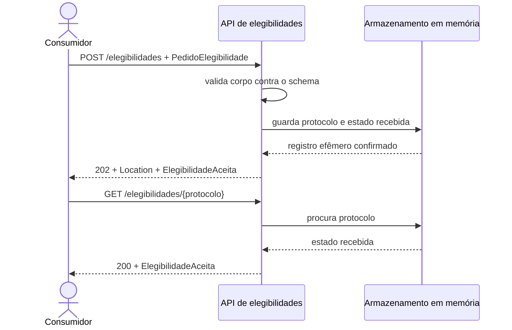
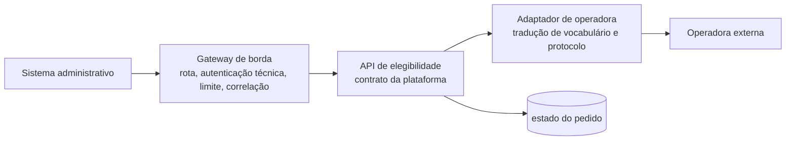

# Exemplo arquitetural

## Objetivo do exemplo

A equipe administrativa do hospital consulta a elegibilidade do paciente junto à operadora do plano de saúde antes do atendimento. A operadora externa responde com demora e nem sempre está disponível. Neste incremento, a API de elegibilidades ainda não se comunica com a operadora. Ela recebe o pedido e registra um protocolo com a situação `recebida`, que o consumidor consulta depois pelo endereço informado na resposta. O incremento exercita um contrato HTTP com resposta de sucesso, consulta e erro.

## Sequência das chamadas



**Texto alternativo:** o consumidor envia `POST /elegibilidades` à API, que valida o corpo, guarda o protocolo com a situação `recebida` em memória e responde `202` com o cabeçalho `Location`. Um `GET` posterior ao endereço informado devolve `200` com a representação aceita.

*Figura 5 — Sequência de aceitação e consulta de uma elegibilidade armazenada em memória. Fonte: curso.*

**Leitura textual:** o consumidor envia o pedido de elegibilidade à API, que valida o corpo, guarda o estado em memória e responde `202` com o endereço de consulta. Uma chamada posterior a esse endereço devolve `200` com a mesma representação aceita.

A situação `recebida` indica somente que a plataforma aceitou o pedido, sem nenhuma decisão da operadora sobre a cobertura do paciente.

O código desta página usa o *framework* FastAPI, que constrói APIs HTTP em Python. A validação dos dados fica a cargo da biblioteca Pydantic, que verifica cada campo pelo tipo declarado na classe. Os trechos das quatro seções seguintes formam uma versão reduzida do serviço, executada por completo na seção Execução do exemplo completo. O código integral do serviço está no laboratório, na pasta `src/hospital/api/`.

## Contrato do pedido em classes Pydantic

O corpo do pedido enviado pelo consumidor tem os três campos mostrados abaixo.

```json
{
  "cpf": "12345678901",
  "codigo_operadora": "OPS-001",
  "matricula_plano": "MAT-2026-001"
}
```

O arquivo `models.py` declara o contrato do pedido e o da resposta como classes Pydantic. O tipo de cada campo funciona como regra de validação. Quando o corpo da requisição não corresponde aos tipos declarados, o FastAPI recusa o pedido antes da execução da rota.

```python
# models.py
from datetime import datetime
from pydantic import BaseModel, Field

class PedidoElegibilidade(BaseModel):         # o que o consumidor envia
    cpf: str = Field(pattern=r"^\d{11}$")     # 11 dígitos, sintético
    codigo_operadora: str
    matricula_plano: str

class ElegibilidadeAceita(BaseModel):         # o que a API devolve
    protocolo: str
    situacao: str                             # neste incremento, sempre "recebida"
    criado_em: datetime
```

O `cpf` do exemplo é um identificador sintético de onze dígitos, sem validação cadastral. Os campos `codigo_operadora` e `matricula_plano` usam o vocabulário da plataforma, de modo que o contrato não expõe XML, tabelas ou códigos internos da operadora.

## Rota de criação da elegibilidade

A rota `POST /elegibilidades` recebe o pedido já validado pelo tipo `PedidoElegibilidade`. Ela gera um protocolo, guarda a elegibilidade num dicionário em memória e responde `202 Accepted` com o cabeçalho `Location`, que indica o endereço de consulta.

```python
# main.py
from uuid import uuid4
from datetime import datetime, timezone
from fastapi import FastAPI, Response, status
from models import ElegibilidadeAceita, PedidoElegibilidade

app = FastAPI(title="API de elegibilidades da plataforma hospitalar")
_elegibilidades: dict[str, ElegibilidadeAceita] = {}   # dados apagados ao reiniciar o processo

@app.post("/elegibilidades", status_code=status.HTTP_202_ACCEPTED)
def criar_elegibilidade(pedido: PedidoElegibilidade, response: Response) -> ElegibilidadeAceita:
    aceita = ElegibilidadeAceita(
        protocolo=str(uuid4()),
        situacao="recebida",
        criado_em=datetime.now(timezone.utc),
    )
    _elegibilidades[aceita.protocolo] = aceita
    response.headers["Location"] = f"/elegibilidades/{aceita.protocolo}"
    return aceita
```

A resposta recebida pelo consumidor contém a linha de status, o cabeçalho `Location` e o corpo mostrados abaixo.

```http
HTTP/1.1 202 Accepted
Location: /elegibilidades/550e8400-e29b-41d4-a716-446655440000
```

```json
{
  "protocolo": "550e8400-e29b-41d4-a716-446655440000",
  "situacao": "recebida",
  "criado_em": "2026-07-17T13:30:00Z"
}
```

A rota responde `202` porque a API aceitou o pedido sem tomar decisão sobre ele, situação que os códigos `200` e `201` não descrevem. O dicionário em memória mantém os dados apenas enquanto o processo do servidor está em execução. Uma reinicialização apaga todas as elegibilidades registradas, limitação que precisa constar da documentação entregue ao consumidor.

## Rota de consulta por protocolo

A rota `GET /elegibilidades/{protocolo}` devolve a representação registrada enquanto o processo do servidor estiver em execução. Um protocolo que a API não emitiu recebe a resposta `404` com o corpo de erro padronizado da API.

```python
# main.py (continuação da rota de criação)
from fastapi.responses import JSONResponse

@app.get("/elegibilidades/{protocolo}")
def consultar_elegibilidade(protocolo: str):
    encontrada = _elegibilidades.get(protocolo)
    if encontrada is None:                                  # protocolo inexistente
        return JSONResponse(status_code=404, content={
            "codigo": "elegibilidade_nao_encontrada",
            "mensagem": "Protocolo de elegibilidade não encontrado.",
            "detalhes": [],
        })
    return encontrada
```

## Tratamento do erro de validação

Quando o corpo do pedido não contém o campo `cpf`, o Pydantic detecta a violação antes da execução da rota. O tratador abaixo converte o erro técnico na representação pública `ErroAPI`, cujo campo `codigo` serve à automação no consumidor e cujos campos `mensagem` e `detalhes` servem à leitura por pessoas.

```python
# main.py (continuação da rota de consulta)
from fastapi.exceptions import RequestValidationError

@app.exception_handler(RequestValidationError)
async def tratar_erro_de_validacao(_request, error) -> JSONResponse:
    detalhes = [
        {"campo": ".".join(map(str, e["loc"])), "mensagem": e["msg"], "tipo": e["type"]}
        for e in error.errors()
    ]
    return JSONResponse(status_code=422, content={
        "codigo": "dados_invalidos",
        "mensagem": "A requisição não atende ao contrato.",
        "detalhes": detalhes,
    })
```

O consumidor recebe o corpo de erro mostrado abaixo quando o pedido chega sem o campo `cpf`.

```json
{
  "codigo": "dados_invalidos",
  "mensagem": "A requisição não atende ao contrato.",
  "detalhes": [
    { "campo": "body.cpf", "mensagem": "Field required", "tipo": "missing" }
  ]
}
```

O status `422 Unprocessable Entity` indica um corpo que chegou ao servidor sem cumprir o contrato da API.

## Execução do exemplo completo

A execução local usa uma pasta com os três arquivos descritos na lista abaixo.

- `models.py` contém o bloco da seção Contrato do pedido em classes Pydantic.
- `main.py` contém os blocos das seções de criação, de consulta e de tratamento do erro na ordem da página. As rotas e o tratador ficam no mesmo arquivo porque usam o mesmo objeto `app`.
- `demo.py` contém o programa de demonstração mostrado abaixo, que importa o `main.py`.

As bibliotecas necessárias são `fastapi`, `pydantic` e `httpx`, as mesmas declaradas em `laboratorios/plataforma-hospitalar/pyproject.toml`. A instalação usa o comando `pip install fastapi pydantic httpx`.

O `demo.py` usa o `TestClient` do FastAPI, que faz as chamadas HTTP dentro do próprio processo sem iniciar um servidor. O programa substitui o gerador de UUID e o relógio do `main.py` por valores fixos, para que o protocolo e o horário impressos sejam iguais em todas as execuções. Depois do fluxo principal, com `202` no `POST` e `200` no `GET`, o programa provoca os três erros tratados nesta página. O comando de execução na pasta dos três arquivos é `python3 demo.py`.

```python
# demo.py
import json
from datetime import datetime
from fastapi.testclient import TestClient
import main

# Protocolo e horário fixos tornam a saída igual em cada execução.
main.uuid4 = lambda: "550e8400-e29b-41d4-a716-446655440000"

class RelogioFixo:
    @staticmethod
    def now(fuso):
        return datetime(2026, 7, 17, 13, 30, tzinfo=fuso)

main.datetime = RelogioFixo

def mostrar(metodo, rota, resposta):
    print(f"{metodo} {rota} -> {resposta.status_code}")
    if "location" in resposta.headers:
        print(f"Location: {resposta.headers['location']}")
    print(json.dumps(resposta.json(), ensure_ascii=False, indent=2))
    print()

if __name__ == "__main__":
    cliente = TestClient(main.app)
    pedido = {
        "cpf": "12345678901",
        "codigo_operadora": "OPS-001",
        "matricula_plano": "MAT-2026-001",
    }

    # 1. Fluxo principal: o pedido é aceito e guardado em memória.
    resposta = cliente.post("/elegibilidades", json=pedido)
    mostrar("POST", "/elegibilidades", resposta)

    # 2. A consulta usa o endereço devolvido no cabeçalho Location.
    endereco = resposta.headers["location"]
    mostrar("GET", endereco, cliente.get(endereco))

    # 3. Protocolo que a API nunca emitiu devolve 404.
    mostrar("GET", "/elegibilidades/protocolo-inexistente",
            cliente.get("/elegibilidades/protocolo-inexistente"))

    # 4. Pedido sem cpf é recusado antes da execução da rota.
    sem_cpf = {"codigo_operadora": "OPS-001", "matricula_plano": "MAT-2026-001"}
    mostrar("POST", "/elegibilidades (sem cpf)",
            cliente.post("/elegibilidades", json=sem_cpf))

    # 5. Pedido com cpf fora do padrão de onze dígitos também é recusado.
    cpf_curto = dict(pedido, cpf="123")
    mostrar("POST", "/elegibilidades (cpf com 3 dígitos)",
            cliente.post("/elegibilidades", json=cpf_curto))
```

A execução do `demo.py` imprime a saída abaixo, com uma resposta por chamada na ordem em que o programa as faz.

```text
POST /elegibilidades -> 202
Location: /elegibilidades/550e8400-e29b-41d4-a716-446655440000
{
  "protocolo": "550e8400-e29b-41d4-a716-446655440000",
  "situacao": "recebida",
  "criado_em": "2026-07-17T13:30:00Z"
}

GET /elegibilidades/550e8400-e29b-41d4-a716-446655440000 -> 200
{
  "protocolo": "550e8400-e29b-41d4-a716-446655440000",
  "situacao": "recebida",
  "criado_em": "2026-07-17T13:30:00Z"
}

GET /elegibilidades/protocolo-inexistente -> 404
{
  "codigo": "elegibilidade_nao_encontrada",
  "mensagem": "Protocolo de elegibilidade não encontrado.",
  "detalhes": []
}

POST /elegibilidades (sem cpf) -> 422
{
  "codigo": "dados_invalidos",
  "mensagem": "A requisição não atende ao contrato.",
  "detalhes": [
    {
      "campo": "body.cpf",
      "mensagem": "Field required",
      "tipo": "missing"
    }
  ]
}

POST /elegibilidades (cpf com 3 dígitos) -> 422
{
  "codigo": "dados_invalidos",
  "mensagem": "A requisição não atende ao contrato.",
  "detalhes": [
    {
      "campo": "body.cpf",
      "mensagem": "String should match pattern '^\\d{11}$'",
      "tipo": "string_pattern_mismatch"
    }
  ]
}
```

Conforme a versão instalada do Starlette, um aviso de descontinuação sobre o `httpx` pode aparecer antes dessa saída sem alterar o resultado.

## Contrato escrito e contrato gerado

A API de elegibilidades tem duas descrições do mesmo contrato. O arquivo `contratos/openapi.yaml` é o contrato explícito, escrito por uma pessoa. O FastAPI gera a segunda descrição, o documento `/openapi.json`, a partir do código. Os testes do laboratório comparam operações, campos e exemplos dos dois documentos e encontram divergências pontuais, sem garantir a equivalência completa entre eles.

Os testes usam `TestClient(app)`, que simula requisições HTTP dentro do processo de teste sem um servidor separado. Com ele, cada teste verifica status, cabeçalhos e formato da resposta sem depender de rede.

## Elegibilidade em quatro estilos de API

As seções anteriores expõem a elegibilidade como recurso REST. Esta seção expõe a mesma capacidade de negócio por gRPC, GraphQL e WebSocket, com programas Python curtos cuja saída mostra o que muda para o consumidor em cada estilo. Os programas de REST e de gRPC recebem o mesmo pedido de elegibilidade e devolvem um protocolo com a situação `recebida`. Os programas de GraphQL e de WebSocket trabalham sobre elegibilidades já registradas, porque esses dois estilos tratam da consulta com seleção de campos e do aviso de mudança de situação.

O código executável está no [repositório das ODAs da disciplina](https://github.com/aulas-marco/odas-arquitetura-software), na pasta `codigo/oda-03` para REST e gRPC e na pasta `codigo/oda-04` para GraphQL e WebSocket. Cada pasta tem um `requirements.txt` com as versões das bibliotecas e um `demo.py` que não depende de servidor externo. As bibliotecas são instaladas uma única vez num ambiente virtual com o comando `pip install -r requirements.txt`. Cada exemplo é executado com `python demo.py` dentro da pasta do respectivo estilo.

### Elegibilidade como recurso REST

No exemplo REST, a elegibilidade é um recurso com endereço próprio, `/elegibilidades/{protocolo}`. O método HTTP declara a intenção da chamada e o código de status declara o resultado. O cabeçalho `Location` informa o endereço de consulta do recurso aceito. A regra dos onze dígitos do `cpf` faz parte do contrato, porque o Pydantic recusa o corpo inválido com `422` antes da execução da rota. O `demo.py` da pasta `codigo/oda-03/rest` repete as chamadas desta página e mede o tamanho do corpo do pedido, valor usado na comparação com o gRPC.

```text
Corpo do pedido em JSON: 83 bytes
```

### Elegibilidade como operação gRPC

O gRPC é um *framework* de chamada remota de procedimento, conhecido pela sigla RPC, criado pelo Google. O contrato gRPC é um arquivo `.proto` escrito na linguagem do Protocol Buffers, com a declaração das operações do serviço e das mensagens trocadas. O consumidor chama cada operação pelo nome, na forma de uma chamada de função local, por meio de mensagens binárias transmitidas sobre HTTP/2.

```protobuf
// elegibilidade.proto
syntax = "proto3";

package hospital.elegibilidade.v1;

service Elegibilidades {
  rpc SolicitarElegibilidade (PedidoElegibilidade) returns (ElegibilidadeAceita);
  rpc ConsultarElegibilidade (ConsultaElegibilidade) returns (ElegibilidadeAceita);
}

message PedidoElegibilidade {
  string cpf = 1;
  string codigo_operadora = 2;
  string matricula_plano = 3;
}

message ConsultaElegibilidade {
  string protocolo = 1;
}

message ElegibilidadeAceita {
  string protocolo = 1;
  string situacao = 2;
  string criado_em = 3;
}
```

O número que acompanha cada campo é o número do campo, usado para identificar o campo dentro da mensagem binária. A mensagem binária não contém o nome do campo. Por isso, a renomeação de um campo mantém a compatibilidade com consumidores antigos. A troca do número ou a reutilização de um número removido impede a leitura das mensagens já em circulação. A versão `v1` no nome do pacote identifica a linha de evolução do contrato, no mesmo sentido do versionamento descrito na página de conceitos.

O compilador `protoc` lê o contrato e gera o código Python usado pelo cliente e pelo servidor. O comando abaixo, executado na pasta do `.proto`, produz os dois arquivos descritos na lista que o segue.

```bash
python -m grpc_tools.protoc -I. --python_out=. --grpc_python_out=. elegibilidade.proto
```

- `elegibilidade_pb2.py` contém as classes das mensagens.
- `elegibilidade_pb2_grpc.py` contém o *stub* do cliente e a classe base do servidor.

O *stub* é o objeto que o cliente usa para chamar as operações remotas. O servidor herda da classe base gerada e implementa um método Python para cada operação declarada no contrato.

```python
# servidor.py
class ServicoElegibilidades(pb_grpc.ElegibilidadesServicer):

    def SolicitarElegibilidade(self, pedido, context):
        # O .proto declara apenas o tipo string. A regra dos onze dígitos fica no servidor.
        if not (len(pedido.cpf) == 11 and pedido.cpf.isdigit()):
            context.abort(grpc.StatusCode.INVALID_ARGUMENT, "cpf deve ter onze dígitos")
        aceita = pb.ElegibilidadeAceita(
            protocolo=self._gerar_protocolo(),
            situacao="recebida",
            criado_em=self._agora().strftime("%Y-%m-%dT%H:%M:%SZ"),
        )
        self._elegibilidades[aceita.protocolo] = aceita
        return aceita

    def ConsultarElegibilidade(self, consulta, context):
        encontrada = self._elegibilidades.get(consulta.protocolo)
        if encontrada is None:
            context.abort(grpc.StatusCode.NOT_FOUND, "Protocolo de elegibilidade não encontrado.")
        return encontrada
```

O gRPC tem uma tabela própria de códigos de status, distinta da tabela do HTTP. No exemplo, o servidor encerra a chamada com `NOT_FOUND` quando o protocolo não existe e com `INVALID_ARGUMENT` quando o pedido viola uma regra. A regra dos onze dígitos, declarada no REST pelo `Field(pattern=...)` do Pydantic, precisa ser escrita no código do servidor gRPC porque o Protocol Buffers declara tipos sem padrões de texto. O `demo.py` da pasta `codigo/oda-03/grpc` inicia o servidor numa porta livre, chama as duas operações pelo *stub* e imprime a saída abaixo.

```text
SolicitarElegibilidade -> OK
  protocolo: "550e8400-e29b-41d4-a716-446655440000"
  situacao: "recebida"
  criado_em: "2026-07-17T13:30:00Z"

ConsultarElegibilidade -> OK
  protocolo: "550e8400-e29b-41d4-a716-446655440000"
  situacao: "recebida"
  criado_em: "2026-07-17T13:30:00Z"

ConsultarElegibilidade (protocolo inexistente) -> NOT_FOUND
  detalhe: Protocolo de elegibilidade não encontrado.

SolicitarElegibilidade (cpf com 3 dígitos) -> INVALID_ARGUMENT
  detalhe: cpf deve ter onze dígitos

Corpo do pedido em JSON: 83 bytes
Corpo do pedido em Protocol Buffers: 36 bytes
Primeiros bytes da mensagem binária: b'\n\x0b12345678901\x12\x07O'
```

O mesmo pedido ocupa 83 bytes em JSON e 36 bytes em Protocol Buffers, porque a mensagem binária substitui o nome de cada campo por um número e um tamanho. Os bytes iniciais `\n` e `\x0b` indicam o campo de número 1 com 11 bytes de conteúdo, que correspondem ao texto `12345678901`.

Uma mensagem binária não é legível num registro de rede sem o arquivo `.proto` que a descreve. Um navegador também não chama um serviço gRPC diretamente, o que exige a variante gRPC-Web e um *proxy* na borda da plataforma. O gRPC oferece ainda operações com fluxo contínuo de mensagens numa mesma chamada, recurso que o exemplo da elegibilidade não utiliza.

### Seleção de campos com GraphQL

O GraphQL é uma linguagem de consulta para APIs baseada num *schema* tipado, que declara os tipos e os campos disponíveis. Cada consulta enviada pelo consumidor indica quais desses campos ele quer receber. Todas as operações usam o mesmo endereço, em geral `POST /graphql`. O corpo da requisição indica o tipo de operação, que pode ser uma *query* para leitura ou uma *mutation* para alteração de dados.

```graphql
# schema.graphql
type Query {
  elegibilidade(protocolo: ID!): Elegibilidade
  elegibilidades: [Elegibilidade!]!
}

type Mutation {
  solicitarElegibilidade(pedido: PedidoElegibilidade!): Elegibilidade!
}

input PedidoElegibilidade {
  cpf: String!
  codigoOperadora: String!
  matriculaPlano: String!
}

type Elegibilidade {
  protocolo: ID!
  situacao: String!
  criadoEm: String!
  matriculaPlano: String!
  operadora: Operadora!
}

type Operadora {
  codigo: String!
  nome: String!
  prazoRespostaHoras: Int!
}
```

O sinal de exclamação marca um campo que nunca vem nulo. Como o campo `elegibilidade` não tem esse sinal, um protocolo inexistente produz o valor `null` nesse campo, com status `200` e sem entrada na lista de erros da resposta.

O valor de cada campo é produzido por um *resolver*, que é a função executada quando a consulta pede aquele campo. No exemplo, as operadoras ficam num cadastro separado das elegibilidades, consultado pelo *resolver* do campo `operadora`.

```python
# api.py
@elegibilidade.field("operadora")
def resolver_operadora(registro, info):
    # Executa uma vez para cada elegibilidade que a consulta devolve.
    print(f"  [resolver] cadastro de operadoras consultado para {registro['codigoOperadora']}")
    return OPERADORAS[registro["codigoOperadora"]]
```

O `demo.py` da pasta `codigo/oda-04/graphql` usa a biblioteca Ariadne e envia seis operações ao mesmo endereço, das quais a saída abaixo reproduz quatro.

```text
--- Consulta do aplicativo móvel
POST /graphql -> 200 (50 bytes na resposta)
{
  "data": {
    "elegibilidade": {
      "situacao": "recebida"
    }
  }
}

--- Consulta do painel administrativo
  [resolver] cadastro de operadoras consultado para OPS-001
POST /graphql -> 200 (165 bytes na resposta)

--- Lista com a operadora de cada elegibilidade
  [resolver] cadastro de operadoras consultado para OPS-001
  [resolver] cadastro de operadoras consultado para OPS-002
  [resolver] cadastro de operadoras consultado para OPS-001
POST /graphql -> 200 (205 bytes na resposta)

--- Campo inexistente no schema
POST /graphql -> 400 (125 bytes na resposta)
{
  "errors": [
    {
      "message": "Cannot query field 'senhaDoPaciente' on type 'Elegibilidade'.",
      "locations": [
        {
          "line": 1,
          "column": 50
        }
      ]
    }
  ]
}
```

A consulta do aplicativo móvel pediu apenas a situação e recebeu 50 bytes, sem execução do *resolver* da operadora. A consulta do painel administrativo pediu mais campos e os dados da operadora na mesma chamada e recebeu 165 bytes. Na lista de três elegibilidades, o *resolver* da operadora executou três vezes, uma para cada item. O campo `senhaDoPaciente` não existe no *schema*, de modo que a consulta foi recusada com `400` antes da execução de qualquer *resolver*.

O problema N+1 é o efeito em que uma consulta que devolve N itens dispara N consultas adicionais a outra fonte de dados. A mitigação usual agrupa numa única busca os acessos feitos durante a mesma consulta, técnica difundida pela biblioteca DataLoader.

Quando todas as consultas usam `POST /graphql`, o cache HTTP baseado em endereço e método não distingue uma consulta de outra. O guia oficial do GraphQL descreve o envio de consultas por `GET` como forma de recuperar esse cache. A autorização precisa ser decidida por campo ou por tipo, porque uma mesma chamada pode pedir dados de sensibilidades diferentes. Consultas com muitos níveis de aninhamento podem ter custo alto para o servidor, o que exige limite de profundidade ou de custo por consulta.

### Aviso de mudança por WebSocket

O WebSocket é um protocolo, definido pela RFC 6455, que mantém aberta uma conexão entre cliente e servidor. A conexão começa com uma requisição HTTP que contém o cabeçalho `Upgrade: websocket`, à qual o servidor responde com `101 Switching Protocols`. A partir dessa resposta, cliente e servidor enviam mensagens a qualquer momento, sem a correspondência entre requisição e resposta do HTTP.

No exemplo, o cliente envia uma mensagem com o pedido de acompanhamento de um protocolo. O servidor passa então a enviar uma mensagem a cada mudança de situação informada pela operadora. O protocolo WebSocket transporta mensagens de texto ou binárias sem definir o formato delas. O formato JSON com os campos `tipo`, `protocolo` e `situacao` é uma decisão da aplicação.

```python
# servidor.py
async def publicar(self, protocolo: str, situacao: str):
    """Chamado quando a operadora responde. Envia a mudança às conexões abertas."""
    self._situacoes[protocolo] = situacao
    destinos = list(self._conexoes.get(protocolo, ()))
    print(f"  [servidor] {protocolo} mudou para {situacao}, {len(destinos)} conexão(ões) aberta(s)")
    mensagem = json.dumps({"tipo": "mudanca", "protocolo": protocolo, "situacao": situacao})
    for conexao in destinos:
        try:
            await conexao.send(mensagem)
        except ConnectionClosed:
            pass  # a mensagem não é guardada para quem caiu
```

O `demo.py` da pasta `codigo/oda-04/websocket` usa a biblioteca `websockets` para executar dois cenários. No primeiro cenário, um painel e um aplicativo acompanham a mesma elegibilidade durante uma mudança de situação. O segundo cenário registra uma mudança de situação ocorrida quando nenhum cliente está conectado ao servidor.

```text
--- Cenário 1: painel e aplicativo acompanham ELG-001
  [painel] enviou: {"acao": "acompanhar", "protocolo": "ELG-001"}
  [painel] recebeu: {"tipo": "estado_atual", "protocolo": "ELG-001", "situacao": "recebida"}
  [aplicativo] enviou: {"acao": "acompanhar", "protocolo": "ELG-001"}
  [aplicativo] recebeu: {"tipo": "estado_atual", "protocolo": "ELG-001", "situacao": "recebida"}
  [servidor] ELG-001 mudou para em_analise, 2 conexão(ões) aberta(s)
  [painel] recebeu: {"tipo": "mudanca", "protocolo": "ELG-001", "situacao": "em_analise"}
  [aplicativo] recebeu: {"tipo": "mudanca", "protocolo": "ELG-001", "situacao": "em_analise"}
  [painel] e [aplicativo] fecharam a conexão

--- Cenário 2: mudança de situação sem nenhuma conexão aberta
  [servidor] ELG-001 mudou para elegivel, 0 conexão(ões) aberta(s)
  [painel] enviou: {"acao": "acompanhar", "protocolo": "ELG-001"}
  [painel] recebeu: {"tipo": "estado_atual", "protocolo": "ELG-001", "situacao": "elegivel"}
  O painel recebeu o estado atual. A mensagem de mudança para elegivel não foi entregue.
```

No primeiro cenário, os dois clientes receberam a mudança para `em_analise` sem enviar nova requisição. No segundo cenário, a mudança para `elegivel` ocorreu sem conexão aberta. O WebSocket não guarda mensagens para entrega posterior, de modo que essa mensagem não chegou a nenhum cliente. O painel conheceu a situação nova porque o servidor do exemplo envia o estado atual a cada cliente que pede o acompanhamento de um protocolo, inclusive depois de uma reconexão.

A entrega de cada transição de situação ao consumidor exige um mecanismo durável de mensageria, tema do Módulo 5. Cada conexão aberta ocupa memória no servidor que a mantém. Quando o serviço executa em várias instâncias, a instância que recebe a resposta da operadora pode ser diferente da instância que mantém a conexão do painel. Nesse caso, a mudança precisa circular entre as instâncias por um canal compartilhado. Um cliente lento acumula mensagens pendentes no servidor, que precisa de uma política para esse acúmulo, como limite de fila ou descarte das mensagens mais antigas.

### Comparação dos quatro estilos no caso hospitalar

| Aspecto | REST | gRPC | GraphQL | WebSocket |
| --- | --- | --- | --- | --- |
| Unidade do contrato | recurso `/elegibilidades/{protocolo}` | operação `SolicitarElegibilidade` | campo `elegibilidade` do *schema* | mensagem trocada no canal |
| Documento do contrato | `openapi.yaml` | `elegibilidade.proto` | `schema.graphql` | definido pela aplicação, sem formato no protocolo |
| Endereço | uma URI por recurso | um método por operação | `POST /graphql` para todas as operações | uma conexão aberta por cliente |
| Formato no exemplo | JSON | Protocol Buffers sobre HTTP/2 | JSON | JSON escolhido pela aplicação |
| Quem inicia a troca | cliente | cliente | cliente | as duas pontas, depois da conexão |
| Protocolo inexistente | `404` | `NOT_FOUND` | `null` no campo, com `200` | definido pela aplicação |
| Onze dígitos do `cpf` | regra no contrato, `422` | regra no servidor, `INVALID_ARGUMENT` | regra no *resolver* | regra na aplicação |
| Consumidor indicado no caso | sistema administrativo e parceiros web | serviços internos da plataforma | telas com necessidades de dados diferentes | painel que acompanha a situação |

A tabela da seção [Além do HTTP](conceitos.md#alem-do-http-estilos-de-apis) da página de conceitos indica quando cada estilo é adequado e qual cuidado arquitetural cada um exige.

## Gateway e adaptador de operadora

O laboratório executa uma única aplicação FastAPI, no endereço `http://127.0.0.1:8000`, sem gateway. Com o crescimento da plataforma e o aumento do número de capacidades, a borda pública e a integração com sistemas externos passam a ter responsabilidades distintas, representadas na figura abaixo.



**Texto alternativo:** o sistema administrativo chama o gateway, que encaminha a chamada à API. A API mantém o estado do pedido e usa o adaptador para chamar a operadora.

*Figura 6 — Evolução possível com políticas técnicas na borda, tradução no adaptador e estado na plataforma. Fonte: curso.*

**Leitura textual:** o gateway aplica políticas técnicas na borda e o adaptador traduz o vocabulário e o protocolo da operadora. O estado do pedido pertence à API de elegibilidade, numa hipótese de evolução sem componente correspondente no laboratório.

O gateway autentica, limita o tráfego e encaminha as chamadas para a API correspondente. A tradução do campo `beneficiaryKey` da operadora para `matricula_plano` é responsabilidade do adaptador, assim como a interpretação de estados que a operadora devolve sem correspondência no vocabulário da plataforma. No adaptador, essas traduções são testadas e observadas isoladamente, o que mantém o formato SOAP/XML e as regras específicas da operadora fora do restante da plataforma.
