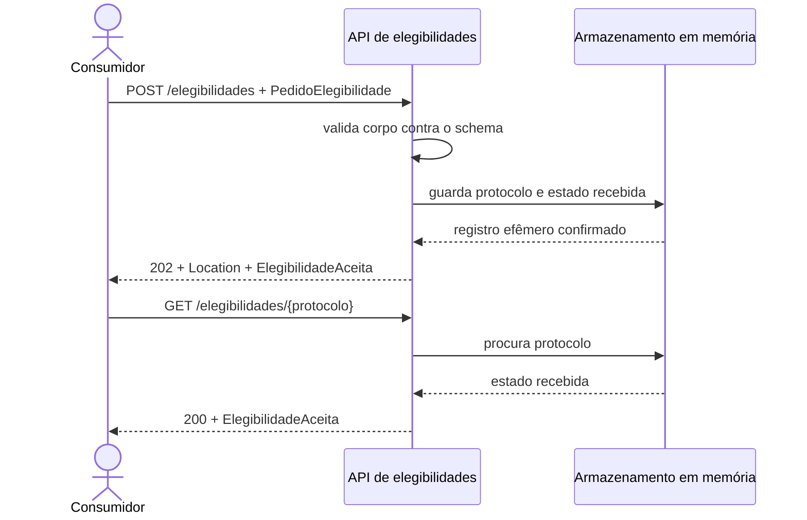
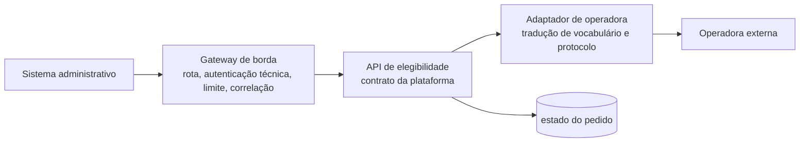

# Exemplo arquitetural: aceitar uma elegibilidade

## O que este exemplo mostra

A equipe administrativa precisa consultar a elegibilidade de um paciente no plano de saúde. A operadora externa é lenta e nem sempre está disponível. Neste incremento a API ainda **não** fala com a operadora: ela só **recebe** o pedido, guarda um protocolo e deixa consultar o estado depois. É o menor passo possível que já exercita um contrato HTTP.

## A sequência completa



**Texto alternativo:** o consumidor envia `POST`, e a API valida, guarda protocolo `recebida` em memória e responde `202` com `Location`. Um `GET` devolve `200` com a representação aceita.

*Figura 5 — Sequência de aceitação e consulta de uma elegibilidade armazenada em memória. Fonte: curso.*

**Leitura textual:** o consumidor envia pedido, e a API valida, guarda estado efêmero e responde `202` com endereço de consulta. O uso do endereço devolve `200` e a representação aceita.

`recebida` não quer dizer "aprovada": significa apenas que a plataforma aceitou o pedido.

O código a seguir está dividido em quatro passos, escrito em **FastAPI** (um framework Python para construir APIs HTTP) com **Pydantic** (uma biblioteca que usa o tipo declarado em cada campo para validar os dados automaticamente). Os trechos abaixo formam uma versão reduzida do serviço, que roda sozinha e está demonstrada no fim do Passo 4. O código completo está no laboratório, em `src/hospital/api/`.

## Passo 1 — O contrato vira classes

O consumidor envia três campos:

```json
{
  "cpf": "12345678901",
  "codigo_operadora": "OPS-001",
  "matricula_plano": "MAT-2026-001"
}
```

Em `models.py`, esse contrato vira classes Pydantic. O tipo de cada campo já funciona como regra de validação: se o corpo da requisição não bater com o tipo esperado, o FastAPI recusa o pedido antes mesmo de a sua lógica rodar.

```python
# models.py
from datetime import datetime
from pydantic import BaseModel, Field

class PedidoElegibilidade(BaseModel):         # o que o consumidor envia
    cpf: str = Field(pattern=r"^\d{11}$")     # 11 dígitos, sintético
    codigo_operadora: str
    matricula_plano: str

class ElegibilidadeAceita(BaseModel):         # o que a API devolve
    protocolo: str
    situacao: str                             # neste incremento, sempre "recebida"
    criado_em: datetime
```

O `cpf` aqui é só um identificador sintético de onze dígitos — nenhuma validação cadastral real é afirmada. O contrato não expõe XML, tabela nem código interno da operadora: `codigo_operadora` e `matricula_plano` já estão na linguagem da plataforma.

## Passo 2 — A rota que aceita e guarda

A rota `POST /elegibilidades` recebe o pedido já validado (pelo tipo `PedidoElegibilidade`), cria um protocolo, guarda em memória e responde `202 Accepted` com o cabeçalho `Location` apontando onde consultar.

```python
# main.py
from uuid import uuid4
from datetime import datetime, timezone
from fastapi import FastAPI, Response, status
from models import ElegibilidadeAceita, PedidoElegibilidade

app = FastAPI(title="API de elegibilidades da plataforma hospitalar")
_elegibilidades: dict[str, ElegibilidadeAceita] = {}   # memória: some ao reiniciar

@app.post("/elegibilidades", status_code=status.HTTP_202_ACCEPTED)
def criar_elegibilidade(pedido: PedidoElegibilidade, response: Response) -> ElegibilidadeAceita:
    aceita = ElegibilidadeAceita(
        protocolo=str(uuid4()),
        situacao="recebida",
        criado_em=datetime.now(timezone.utc),
    )
    _elegibilidades[aceita.protocolo] = aceita
    response.headers["Location"] = f"/elegibilidades/{aceita.protocolo}"
    return aceita
```

É isto que o consumidor observa:

```http
HTTP/1.1 202 Accepted
Location: /elegibilidades/550e8400-e29b-41d4-a716-446655440000
```

```json
{
  "protocolo": "550e8400-e29b-41d4-a716-446655440000",
  "situacao": "recebida",
  "criado_em": "2026-07-17T13:30:00Z"
}
```

O código usa `202` porque a API apenas aceitou o pedido e ainda não tomou nenhuma decisão, situação para a qual `200` e `201` não se aplicam. Guardar os dados num dicionário em memória é uma decisão simples de implementação: funciona enquanto o processo está rodando, mas tudo se perde se ele reiniciar. Esse limite precisa ficar declarado para quem consome a API.

## Passo 3 — A rota que recupera

`GET /elegibilidades/{protocolo}` devolve a mesma representação enquanto o processo está de pé. Protocolo desconhecido vira `404`.

```python
# main.py (continuação do Passo 2)
from fastapi.responses import JSONResponse

@app.get("/elegibilidades/{protocolo}")
def consultar_elegibilidade(protocolo: str):
    encontrada = _elegibilidades.get(protocolo)
    if encontrada is None:                                  # protocolo inexistente
        return JSONResponse(status_code=404, content={
            "codigo": "elegibilidade_nao_encontrada",
            "mensagem": "Protocolo de elegibilidade não encontrado.",
            "detalhes": [],
        })
    return encontrada
```

## Passo 4 — O caminho de erro

Quando falta `cpf`, o Pydantic detecta a violação antes de a rota rodar. Um tratador transforma o erro técnico na representação pública `ErroAPI` — `codigo` para automação, `mensagem` e `detalhes` para pessoas.

```python
# main.py (continuação do Passo 3)
from fastapi.exceptions import RequestValidationError

@app.exception_handler(RequestValidationError)
async def tratar_erro_de_validacao(_request, error) -> JSONResponse:
    detalhes = [
        {"campo": ".".join(map(str, e["loc"])), "mensagem": e["msg"], "tipo": e["type"]}
        for e in error.errors()
    ]
    return JSONResponse(status_code=422, content={
        "codigo": "dados_invalidos",
        "mensagem": "A requisição não atende ao contrato.",
        "detalhes": detalhes,
    })
```

O corpo do erro que o consumidor recebe:

```json
{
  "codigo": "dados_invalidos",
  "mensagem": "A requisição não atende ao contrato.",
  "detalhes": [
    { "campo": "body.cpf", "mensagem": "Field required", "tipo": "missing" }
  ]
}
```

`422 Unprocessable Entity` é o status para um corpo que chegou, mas não cumpre o contrato.

## Execução de ponta a ponta

Para rodar o exemplo, crie uma pasta com três arquivos. O bloco do Passo 1 fica em `models.py`, e os blocos dos Passos 2, 3 e 4 ficam, nessa ordem, em um único `main.py`, porque as rotas e o tratador de erro usam o mesmo objeto `app`. O programa de demonstração abaixo fica em `demo.py`, com outro nome porque `main.py` já pertence ao serviço e o `demo.py` precisa importá-lo. As bibliotecas necessárias são `fastapi`, `pydantic` e `httpx`, as mesmas declaradas em `laboratorios/plataforma-hospitalar/pyproject.toml`, e a instalação é feita com `pip install fastapi pydantic httpx`.

O `demo.py` usa `TestClient` para fazer as chamadas HTTP dentro do próprio processo, sem iniciar um servidor. Ele troca o gerador de UUID e o relógio do `main.py` por valores fixos, para que o protocolo e o horário impressos sejam iguais em cada execução. O programa percorre o caminho feliz (`202` no `POST` e `200` no `GET`) e os erros tratados pela página: protocolo inexistente (`404`), `cpf` ausente e `cpf` fora do padrão de onze dígitos (`422`).

Na pasta dos três arquivos, o comando de execução é `python3 demo.py`.

```python
# demo.py
import json
from datetime import datetime
from fastapi.testclient import TestClient
import main

# Protocolo e horário fixos tornam a saída igual em cada execução.
main.uuid4 = lambda: "550e8400-e29b-41d4-a716-446655440000"

class RelogioFixo:
    @staticmethod
    def now(fuso):
        return datetime(2026, 7, 17, 13, 30, tzinfo=fuso)

main.datetime = RelogioFixo

def mostrar(metodo, rota, resposta):
    print(f"{metodo} {rota} -> {resposta.status_code}")
    if "location" in resposta.headers:
        print(f"Location: {resposta.headers['location']}")
    print(json.dumps(resposta.json(), ensure_ascii=False, indent=2))
    print()

if __name__ == "__main__":
    cliente = TestClient(main.app)
    pedido = {
        "cpf": "12345678901",
        "codigo_operadora": "OPS-001",
        "matricula_plano": "MAT-2026-001",
    }

    # 1. Caminho feliz: o pedido é aceito e guardado em memória.
    resposta = cliente.post("/elegibilidades", json=pedido)
    mostrar("POST", "/elegibilidades", resposta)

    # 2. A consulta usa o endereço devolvido no cabeçalho Location.
    endereco = resposta.headers["location"]
    mostrar("GET", endereco, cliente.get(endereco))

    # 3. Protocolo que a API nunca emitiu devolve 404.
    mostrar("GET", "/elegibilidades/protocolo-inexistente",
            cliente.get("/elegibilidades/protocolo-inexistente"))

    # 4. Pedido sem cpf é recusado antes de a rota rodar.
    sem_cpf = {"codigo_operadora": "OPS-001", "matricula_plano": "MAT-2026-001"}
    mostrar("POST", "/elegibilidades (sem cpf)",
            cliente.post("/elegibilidades", json=sem_cpf))

    # 5. Pedido com cpf fora do padrão de onze dígitos também é recusado.
    cpf_curto = dict(pedido, cpf="123")
    mostrar("POST", "/elegibilidades (cpf com 3 dígitos)",
            cliente.post("/elegibilidades", json=cpf_curto))
```

A execução imprime:

```text
POST /elegibilidades -> 202
Location: /elegibilidades/550e8400-e29b-41d4-a716-446655440000
{
  "protocolo": "550e8400-e29b-41d4-a716-446655440000",
  "situacao": "recebida",
  "criado_em": "2026-07-17T13:30:00Z"
}

GET /elegibilidades/550e8400-e29b-41d4-a716-446655440000 -> 200
{
  "protocolo": "550e8400-e29b-41d4-a716-446655440000",
  "situacao": "recebida",
  "criado_em": "2026-07-17T13:30:00Z"
}

GET /elegibilidades/protocolo-inexistente -> 404
{
  "codigo": "elegibilidade_nao_encontrada",
  "mensagem": "Protocolo de elegibilidade não encontrado.",
  "detalhes": []
}

POST /elegibilidades (sem cpf) -> 422
{
  "codigo": "dados_invalidos",
  "mensagem": "A requisição não atende ao contrato.",
  "detalhes": [
    {
      "campo": "body.cpf",
      "mensagem": "Field required",
      "tipo": "missing"
    }
  ]
}

POST /elegibilidades (cpf com 3 dígitos) -> 422
{
  "codigo": "dados_invalidos",
  "mensagem": "A requisição não atende ao contrato.",
  "detalhes": [
    {
      "campo": "body.cpf",
      "mensagem": "String should match pattern '^\\d{11}$'",
      "tipo": "string_pattern_mismatch"
    }
  ]
}
```

Conforme a versão instalada do Starlette, um aviso de descontinuação sobre o `httpx` pode aparecer antes dessa saída, sem efeito sobre o resultado.

## O contrato explícito e o contrato gerado

Existem duas descrições da mesma API, e o arquivo `contratos/openapi.yaml` é o contrato **explícito**, escrito à mão por uma pessoa. O FastAPI também **gera** sozinho um `/openapi.json`, a partir do código. Os testes comparam os dois — operações, campos, exemplos — e conseguem pegar divergências pontuais, mas não garantem que os dois documentos sejam idênticos em tudo.

Esses testes usam `TestClient(app)`, uma ferramenta que simula requisições HTTP dentro do próprio processo de teste, sem precisar ligar um servidor separado. Assim dá para checar status, cabeçalho e formato da resposta rapidamente.

## O mesmo caso em quatro estilos de API

Os passos anteriores expõem a elegibilidade como recurso REST. Esta seção expõe a mesma capacidade de negócio por gRPC, GraphQL e WebSocket, com programas Python curtos que mostram, na própria saída, o que muda para o consumidor em cada estilo. Os programas de REST e de gRPC recebem o mesmo pedido de elegibilidade e devolvem um protocolo com a situação `recebida`. Os programas de GraphQL e de WebSocket trabalham sobre elegibilidades já registradas, porque o interesse desses dois estilos está na consulta flexível e no aviso de mudança.

O código completo e executável fica no [repositório das ODAs da disciplina](https://github.com/aulas-marco/odas-arquitetura-software), na pasta `codigo/oda-03` para REST e gRPC e na pasta `codigo/oda-04` para GraphQL e WebSocket. Cada pasta tem um `requirements.txt` com as versões das bibliotecas fixadas e um `demo.py` que roda sem servidor externo. A instalação é feita uma vez, num ambiente virtual, com `pip install -r requirements.txt`, e a execução de cada exemplo é feita com `python demo.py` dentro da pasta do estilo.

### Elegibilidade como recurso REST

No exemplo REST, a elegibilidade é um **recurso** com endereço próprio, `/elegibilidades/{protocolo}`. O método HTTP declara a intenção da chamada, o código de status declara o resultado, e o cabeçalho `Location` informa onde o recurso aceito pode ser consultado. A validação dos onze dígitos do `cpf` vem do contrato: o Pydantic recusa o corpo inválido com `422` antes de a rota executar. O `demo.py` da pasta `codigo/oda-03/rest` repete os passos desta página e acrescenta uma medida que serve de base para a comparação com o gRPC:

```text
Corpo do pedido em JSON: 83 bytes
```

### Elegibilidade como operação gRPC

O **gRPC** é um *framework* de chamada remota de procedimento (RPC) criado pelo Google. O contrato é um arquivo `.proto`, escrito na linguagem do **Protocol Buffers**, que declara as operações do serviço e as mensagens trocadas. O consumidor chama uma operação pelo nome, como se chamasse uma função local, e a mensagem viaja em formato binário sobre HTTP/2.

```protobuf
// elegibilidade.proto
syntax = "proto3";

package hospital.elegibilidade.v1;

service Elegibilidades {
  rpc SolicitarElegibilidade (PedidoElegibilidade) returns (ElegibilidadeAceita);
  rpc ConsultarElegibilidade (ConsultaElegibilidade) returns (ElegibilidadeAceita);
}

message PedidoElegibilidade {
  string cpf = 1;
  string codigo_operadora = 2;
  string matricula_plano = 3;
}

message ConsultaElegibilidade {
  string protocolo = 1;
}

message ElegibilidadeAceita {
  string protocolo = 1;
  string situacao = 2;
  string criado_em = 3;
}
```

O número depois de cada campo é o **número do campo**, que identifica o campo dentro da mensagem binária. O nome do campo não viaja na mensagem. Por isso a renomeação de um campo preserva a compatibilidade com consumidores antigos, enquanto a troca do número ou a reutilização de um número removido quebra a leitura das mensagens já em circulação. A versão `v1` no nome do pacote marca a linha de evolução do contrato, no mesmo sentido do versionamento discutido na página de conceitos.

O compilador `protoc` lê o contrato e gera o código Python das duas pontas. O comando abaixo, executado na pasta do `.proto`, gera `elegibilidade_pb2.py`, com as classes das mensagens, e `elegibilidade_pb2_grpc.py`, com o *stub* do cliente e a classe base do servidor. O *stub* é o objeto que o cliente usa para chamar as operações remotas.

```bash
python -m grpc_tools.protoc -I. --python_out=. --grpc_python_out=. elegibilidade.proto
```

O servidor herda da classe gerada e implementa uma função Python para cada operação do contrato:

```python
# servidor.py
class ServicoElegibilidades(pb_grpc.ElegibilidadesServicer):

    def SolicitarElegibilidade(self, pedido, context):
        # O .proto declara apenas o tipo string. A regra dos onze dígitos fica no servidor.
        if not (len(pedido.cpf) == 11 and pedido.cpf.isdigit()):
            context.abort(grpc.StatusCode.INVALID_ARGUMENT, "cpf deve ter onze dígitos")
        aceita = pb.ElegibilidadeAceita(
            protocolo=self._gerar_protocolo(),
            situacao="recebida",
            criado_em=self._agora().strftime("%Y-%m-%dT%H:%M:%SZ"),
        )
        self._elegibilidades[aceita.protocolo] = aceita
        return aceita

    def ConsultarElegibilidade(self, consulta, context):
        encontrada = self._elegibilidades.get(consulta.protocolo)
        if encontrada is None:
            context.abort(grpc.StatusCode.NOT_FOUND, "Protocolo de elegibilidade não encontrado.")
        return encontrada
```

O gRPC não usa os códigos de status do HTTP para o resultado da operação. Ele tem uma tabela própria de status, e o servidor encerra a chamada com `NOT_FOUND` quando o protocolo não existe e com `INVALID_ARGUMENT` quando o pedido viola uma regra. O Protocol Buffers declara o tipo de cada campo, sem recurso para padrões de texto, de modo que a regra dos onze dígitos, que no REST vinha do `Field(pattern=...)` do Pydantic, precisa ser escrita no código do servidor. O `demo.py` da pasta `codigo/oda-03/grpc` sobe o servidor numa porta livre, chama as duas operações pelo *stub* e imprime:

```text
SolicitarElegibilidade -> OK
  protocolo: "550e8400-e29b-41d4-a716-446655440000"
  situacao: "recebida"
  criado_em: "2026-07-17T13:30:00Z"

ConsultarElegibilidade -> OK
  protocolo: "550e8400-e29b-41d4-a716-446655440000"
  situacao: "recebida"
  criado_em: "2026-07-17T13:30:00Z"

ConsultarElegibilidade (protocolo inexistente) -> NOT_FOUND
  detalhe: Protocolo de elegibilidade não encontrado.

SolicitarElegibilidade (cpf com 3 dígitos) -> INVALID_ARGUMENT
  detalhe: cpf deve ter onze dígitos

Corpo do pedido em JSON: 83 bytes
Corpo do pedido em Protocol Buffers: 36 bytes
Primeiros bytes da mensagem binária: b'\n\x0b12345678901\x12\x07O'
```

O mesmo pedido ocupa 83 bytes em JSON e 36 bytes em Protocol Buffers, porque a mensagem binária troca o nome de cada campo por um número e um tamanho. Os dois primeiros bytes, `\n` e `\x0b`, informam que o campo de número 1 vem a seguir com 11 bytes, e o texto `12345678901` aparece logo depois. A mensagem binária também tem custos para a arquitetura, porque ela não é legível num registro de rede sem o `.proto`, e um navegador não chama um serviço gRPC diretamente, o que exige a variante gRPC-Web e um *proxy* na borda. O gRPC oferece ainda operações com fluxo contínuo de mensagens, nas quais o servidor, o cliente ou os dois enviam várias mensagens na mesma chamada, recurso que este exemplo não usa.

### Seleção de campos com GraphQL

O **GraphQL** é uma linguagem de consulta para APIs com um *schema* tipado. O *schema* declara os tipos e os campos disponíveis, e cada consulta enviada pelo consumidor diz quais desses campos ele quer receber. Todas as operações vão ao mesmo endereço, em geral `POST /graphql`, e o corpo da requisição diz se a operação é uma **query**, que lê dados, ou uma **mutation**, que altera dados.

```graphql
# schema.graphql
type Query {
  elegibilidade(protocolo: ID!): Elegibilidade
  elegibilidades: [Elegibilidade!]!
}

type Mutation {
  solicitarElegibilidade(pedido: PedidoElegibilidade!): Elegibilidade!
}

input PedidoElegibilidade {
  cpf: String!
  codigoOperadora: String!
  matriculaPlano: String!
}

type Elegibilidade {
  protocolo: ID!
  situacao: String!
  criadoEm: String!
  matriculaPlano: String!
  operadora: Operadora!
}

type Operadora {
  codigo: String!
  nome: String!
  prazoRespostaHoras: Int!
}
```

O sinal de exclamação marca um campo que nunca vem nulo. O campo `elegibilidade` não tem exclamação, e por isso um protocolo inexistente devolve `null` nesse campo, com status `200` e sem nenhuma entrada na lista de erros da resposta. O valor de cada campo é produzido por um **resolver**, que é a função chamada quando a consulta pede aquele campo. No exemplo, as operadoras ficam num cadastro separado, e o resolver do campo `operadora` consulta esse cadastro:

```python
# api.py
@elegibilidade.field("operadora")
def resolver_operadora(registro, info):
    # Executa uma vez para cada elegibilidade que a consulta devolve.
    print(f"  [resolver] cadastro de operadoras consultado para {registro['codigoOperadora']}")
    return OPERADORAS[registro["codigoOperadora"]]
```

O `demo.py` da pasta `codigo/oda-04/graphql` usa a biblioteca Ariadne e envia seis operações ao mesmo endereço. Os trechos abaixo reproduzem quatro delas:

```text
--- Consulta do aplicativo móvel
POST /graphql -> 200 (50 bytes na resposta)
{
  "data": {
    "elegibilidade": {
      "situacao": "recebida"
    }
  }
}

--- Consulta do painel administrativo
  [resolver] cadastro de operadoras consultado para OPS-001
POST /graphql -> 200 (165 bytes na resposta)

--- Lista com a operadora de cada elegibilidade
  [resolver] cadastro de operadoras consultado para OPS-001
  [resolver] cadastro de operadoras consultado para OPS-002
  [resolver] cadastro de operadoras consultado para OPS-001
POST /graphql -> 200 (205 bytes na resposta)

--- Campo inexistente no schema
POST /graphql -> 400 (125 bytes na resposta)
{
  "errors": [
    {
      "message": "Cannot query field 'senhaDoPaciente' on type 'Elegibilidade'.",
      "locations": [
        {
          "line": 1,
          "column": 50
        }
      ]
    }
  ]
}
```

O aplicativo móvel pediu só a situação e recebeu 50 bytes. O painel administrativo pediu mais campos e os dados da operadora na mesma consulta e recebeu 165 bytes, sem uma segunda chamada. Na consulta do aplicativo o resolver da operadora não executou, porque o campo não foi pedido. Na lista de três elegibilidades o resolver executou três vezes, uma por item. Esse efeito é conhecido como **problema N+1**: uma consulta que traz N itens dispara N consultas adicionais a outra fonte de dados, e a mitigação usual é agrupar as buscas de uma mesma consulta numa só, técnica que a biblioteca DataLoader popularizou. O campo `senhaDoPaciente` não existe no *schema*, e a consulta foi recusada com `400` antes de qualquer resolver executar.

O endereço único tem consequências para a plataforma. Quando todas as consultas usam `POST /graphql`, o cache HTTP baseado no endereço e no método deixa de distinguir uma consulta de outra, e o guia oficial do GraphQL descreve o envio de consultas por `GET` como alternativa para recuperar esse cache. A autorização precisa ser decidida por campo ou por tipo, porque a mesma chamada pode pedir dados de sensibilidades diferentes. E uma consulta com muitos níveis de aninhamento pode custar caro ao servidor, o que exige limite de profundidade ou de custo por consulta.

### Aviso de mudança por WebSocket

O **WebSocket**, definido pela RFC 6455, mantém uma conexão aberta entre cliente e servidor. A conexão começa como uma requisição HTTP com o cabeçalho `Upgrade: websocket`, o servidor responde `101 Switching Protocols`, e a partir daí as duas pontas enviam mensagens a qualquer momento, sem o par requisição e resposta do HTTP. No exemplo, o cliente envia uma mensagem pedindo para acompanhar um protocolo, e o servidor passa a enviar uma mensagem a cada mudança de situação vinda da operadora. O protocolo transporta mensagens de texto ou binárias sem definir o formato delas, e o formato JSON com os campos `tipo`, `protocolo` e `situacao` é uma decisão da aplicação.

```python
# servidor.py
async def publicar(self, protocolo: str, situacao: str):
    """Chamado quando a operadora responde. Envia a mudança às conexões abertas."""
    self._situacoes[protocolo] = situacao
    destinos = list(self._conexoes.get(protocolo, ()))
    print(f"  [servidor] {protocolo} mudou para {situacao}, {len(destinos)} conexão(ões) aberta(s)")
    mensagem = json.dumps({"tipo": "mudanca", "protocolo": protocolo, "situacao": situacao})
    for conexao in destinos:
        try:
            await conexao.send(mensagem)
        except ConnectionClosed:
            pass  # a mensagem não é guardada para quem caiu
```

O `demo.py` da pasta `codigo/oda-04/websocket` usa a biblioteca `websockets` e executa duas cenas, a primeira com um painel e um aplicativo que acompanham a mesma elegibilidade e a segunda com uma mudança de situação ocorrida enquanto nenhum cliente está conectado:

```text
--- Cena 1: painel e aplicativo acompanham ELG-001
  [painel] enviou: {"acao": "acompanhar", "protocolo": "ELG-001"}
  [painel] recebeu: {"tipo": "estado_atual", "protocolo": "ELG-001", "situacao": "recebida"}
  [aplicativo] enviou: {"acao": "acompanhar", "protocolo": "ELG-001"}
  [aplicativo] recebeu: {"tipo": "estado_atual", "protocolo": "ELG-001", "situacao": "recebida"}
  [servidor] ELG-001 mudou para em_analise, 2 conexão(ões) aberta(s)
  [painel] recebeu: {"tipo": "mudanca", "protocolo": "ELG-001", "situacao": "em_analise"}
  [aplicativo] recebeu: {"tipo": "mudanca", "protocolo": "ELG-001", "situacao": "em_analise"}
  [painel] e [aplicativo] fecharam a conexão

--- Cena 2: uma mudança acontece sem nenhuma conexão aberta
  [servidor] ELG-001 mudou para elegivel, 0 conexão(ões) aberta(s)
  [painel] enviou: {"acao": "acompanhar", "protocolo": "ELG-001"}
  [painel] recebeu: {"tipo": "estado_atual", "protocolo": "ELG-001", "situacao": "elegivel"}
  O painel recebeu o estado atual. A mensagem de mudança para elegivel não foi entregue.
```

Na primeira cena, os dois clientes receberam a mudança para `em_analise` sem enviar nova requisição. Na segunda cena, a mudança para `elegivel` aconteceu sem nenhuma conexão aberta, e o WebSocket não guarda mensagens para entrega posterior. O painel só conheceu a situação nova porque o servidor do exemplo envia o estado atual a cada cliente que pede para acompanhar um protocolo, inclusive a quem volta depois de uma queda. Quando o consumidor precisa receber cada transição de situação, a garantia de entrega exige um mecanismo durável de mensageria, tema do Módulo 5. Cada conexão aberta também ocupa memória no servidor que a mantém. Com várias instâncias do serviço, a instância que recebe a resposta da operadora pode não ser a que mantém a conexão do painel, e a mudança precisa circular entre as instâncias por um canal compartilhado. Um cliente lento acumula mensagens pendentes no servidor, que precisa de uma política para esse acúmulo, como limite de fila ou descarte das mensagens mais antigas.

### Comparação dos quatro estilos no caso hospitalar

| Aspecto | REST | gRPC | GraphQL | WebSocket |
| --- | --- | --- | --- | --- |
| Unidade do contrato | recurso `/elegibilidades/{protocolo}` | operação `SolicitarElegibilidade` | campo `elegibilidade` do *schema* | mensagem trocada no canal |
| Documento do contrato | `openapi.yaml` | `elegibilidade.proto` | `schema.graphql` | definido pela aplicação, sem formato no protocolo |
| Endereço | uma URI por recurso | um método por operação | `POST /graphql` para todas as operações | uma conexão aberta por cliente |
| Formato no exemplo | JSON | Protocol Buffers sobre HTTP/2 | JSON | JSON escolhido pela aplicação |
| Quem inicia a troca | cliente | cliente | cliente | as duas pontas, depois da conexão |
| Protocolo inexistente | `404` | `NOT_FOUND` | `null` no campo, com `200` | definido pela aplicação |
| Onze dígitos do `cpf` | regra no contrato, `422` | regra no servidor, `INVALID_ARGUMENT` | regra no resolver | regra na aplicação |
| Consumidor indicado no caso | sistema administrativo e parceiros web | serviços internos da plataforma | telas com necessidades de dados diferentes | painel que acompanha a situação |

A tabela da seção [Além do HTTP](conceitos.md#alem-do-http-estilos-de-apis), na página de conceitos, resume quando cada estilo ajuda e qual cuidado arquitetural cada um exige.

## Gateway e adaptador de operadora

O laboratório roda apenas uma FastAPI, em `http://127.0.0.1:8000`, sem gateway. Mas quando a plataforma cresce e ganha várias capacidades, a porta de entrada (borda pública) e a integração com sistemas externos passam a ter responsabilidades diferentes:



**Texto alternativo:** o sistema administrativo chama o gateway, que encaminha à API, e a API mantém o estado e usa adaptador para chamar a operadora.

*Figura 6 — Uma evolução possível: políticas técnicas na borda, tradução no adaptador e estado na plataforma. Fonte: curso.*

**Leitura textual:** o gateway aplica políticas, o adaptador traduz vocabulário e protocolo da operadora e o estado pertence à API, numa hipótese de evolução sem componente correspondente no laboratório.

O gateway pode autenticar, limitar tráfego e rotear as chamadas. O que ele **não** deve fazer é traduzir `beneficiaryKey` da operadora para `matricula_plano`, nem decidir que um estado desconhecido significa `negada`. Essas traduções são responsabilidade do **adaptador**, onde podem ser testadas e observadas de forma isolada. Assim, o formato SOAP/XML da operadora e suas regras específicas não vazam para o resto da plataforma.
