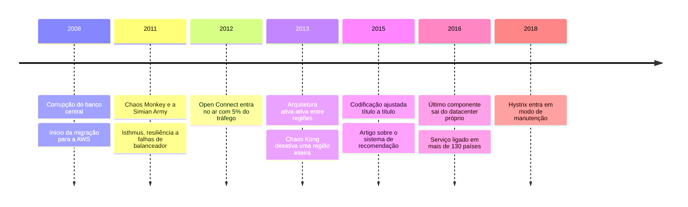
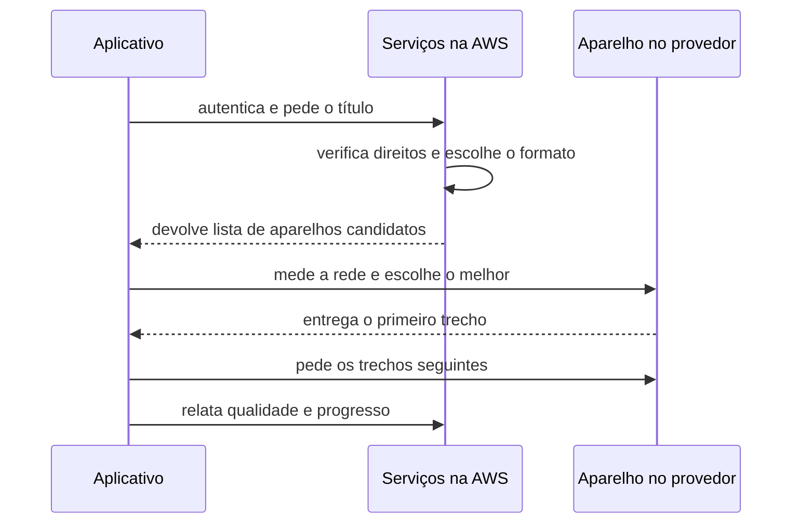

# Casos reais

O caso real deste módulo trata da migração da Netflix para a nuvem pública da Amazon, concluída em 2016. O caso trata também da construção da rede própria de entrega de vídeo chamada Open Connect, iniciada em 2012. As informações vêm das publicações oficiais listadas na seção Fontes, que também identifica a cobertura de imprensa usada como fonte secundária.

Na arquitetura atual, o intervalo entre o comando de reprodução e o primeiro quadro na tela é de cerca de dois segundos. Nesse intervalo, o aplicativo consulta serviços hospedados em três regiões da Amazon e recebe uma lista de servidores candidatos. Em seguida, mede a rede até esses servidores, escolhe um deles e pede o primeiro trecho do vídeo. Na maior parte dos casos, o servidor que entrega o trecho fica dentro da rede do provedor de internet do assinante, num equipamento que a Netflix fornece gratuitamente ao provedor.

## Incidente de agosto de 2008

Em 2008, a Netflix ainda operava em boa parte como locadora de DVDs pelo correio. O anúncio oficial publicado em 2016 descreve o incidente na frase *"We experienced a major database corruption and for three days could not ship DVDs to our members."*

O banco de dados relacional central da empresa, com escala vertical e instalado no datacenter próprio, sofreu uma corrupção que interrompeu o envio de DVDs durante três dias. A falha atingiu a operação inteira, sem limitar-se a uma região ou a um subconjunto de clientes.

A empresa tirou duas conclusões do incidente. A primeira foi que a escala vertical de um banco único não acompanharia o crescimento do negócio. A segunda foi que a compra e a instalação de servidores no ritmo exigido pelo crescimento do *streaming* não deveriam ser responsabilidade da própria Netflix.

## Migração para a AWS entre 2008 e 2016

A migração para a AWS começou em 2008 e terminou em janeiro de 2016, quando os últimos componentes do serviço de *streaming* foram desligados nos datacenters próprios.

O anúncio de 2016 atribui a duração de sete anos à abordagem adotada, descrita como *"a cloud-native approach, rebuilding virtually all of our technology"*. A Netflix reescreveu quase toda a tecnologia, substituiu o banco relacional central por armazenamentos NoSQL sob a propriedade de cada serviço e dividiu o monólito em serviços independentes.

A transferência de máquinas virtuais para um provedor de nuvem muda o proprietário do datacenter e mantém a arquitetura existente. A Netflix atribui à reescrita os resultados que declara no anúncio. O número de assinantes de *streaming* ficou oito vezes maior do que em 2008. A visualização cresceu três ordens de grandeza em oito anos, enquanto a disponibilidade se aproximou de quatro noves. O custo de nuvem por início de reprodução ficou em uma fração do custo do datacenter próprio.

Em 6 de janeiro de 2016, com o serviço distribuído em várias regiões da AWS, a empresa passou a operar em mais de 130 países ao mesmo tempo.

**Texto alternativo:** linha do tempo da Netflix de 2008 a 2018 com a corrupção do banco e o início da migração em 2008. A linha marca as ferramentas de resiliência de 2011 e 2013 e a entrada do Open Connect em 2012. Também marca a codificação por título e o artigo de recomendação em 2015, a conclusão da migração em 2016 e o Hystrix em modo de manutenção em 2018.

*Figura 1 — Decisões arquiteturais da Netflix entre 2008 e 2018. Fonte: curso, a partir das publicações oficiais citadas ao final.*

**Leitura textual da figura:** a migração para a nuvem ocupou quase toda a década e ocorreu em paralelo às demais decisões. As ferramentas de resiliência a falhas surgiram antes da conclusão da migração. A rede própria de entrega começou a operar em 2012, quatro anos antes dessa conclusão. A expansão internacional de 2016 dependeu da operação do serviço em várias regiões ao mesmo tempo.

## Rede de entrega contratada

O *streaming* transfere bytes de vídeo em grande volume, o que o diferencia do tráfego de chamadas de API. Nos primeiros anos, a Netflix contratou as redes de distribuição de conteúdo da Akamai, da Level 3 e da Limelight.

A imprensa especializada de 2012 registrou duas razões para a saída desses fornecedores. A primeira foi a dificuldade dos fornecedores em ampliar a infraestrutura no ritmo de crescimento da demanda da Netflix. A segunda foi o custo de terceirizar a entrega de vídeo, que crescia mais rápido do que a receita num negócio cuja atividade principal é entregar vídeo.

A situação corresponde à decisão arquitetural entre comprar e construir um componente. A Netflix decidiu construir a rede de entrega, porque a distribuição de conteúdo tinha passado a ser uma fonte de vantagem competitiva para a empresa.

## Open Connect a partir de 2012

O Open Connect entrou em operação em 2012 com cerca de 5% do tráfego da Netflix. No programa, a própria Netflix projeta e monta os servidores de entrega, em duas famílias de equipamento.

O aparelho de armazenamento ocupa duas unidades de rack e tem, segundo a documentação oficial, até 120 TB de capacidade e cerca de 200 Gbps de vazão. O consumo é de aproximadamente 400 W, com seis interfaces de 10 Gbps agregadas ou até duas interfaces de 100 Gbps. O aparelho global é menor e mais barato, com até 60 TB, cerca de 80 Gbps e 250 W. Ele foi projetado para provedores menores e mercados emergentes e para operar de quatro a seis anos sem intervenção presencial.

Os equipamentos ficam em dois tipos de local. Uma parte fica em instalações da própria Netflix e em locais de troca de tráfego entre redes, que somam mais de 60 datacenters segundo a empresa. A outra parte fica dentro da rede de mais de mil provedores de acesso parceiros, que recebem os aparelhos gratuitamente.

O provedor reduz o tráfego nos enlaces de trânsito, que têm custo alto, porque o vídeo passa a sair de dentro da sua própria rede. A Netflix obtém latência baixa e deixa de pagar pela entrega a terceiros.

## Preenchimento antecipado dos aparelhos

Um cache convencional é reativo, porque o primeiro usuário que pede um arquivo provoca a busca na origem e os pedidos seguintes aproveitam a cópia. O Open Connect é proativo e carrega o conteúdo antes do pedido. A documentação oficial descreve o preenchimento noturno dos aparelhos e informa que a Netflix pré-carrega cada equipamento novo com o conteúdo adequado à região geográfica de destino, num processo de uma a duas semanas.

Durante a madrugada, a Netflix copia para os aparelhos de cada região os títulos com maior probabilidade de serem assistidos no dia seguinte. Quando o assinante inicia a reprodução, o vídeo já está armazenado no aparelho instalado no provedor.

O preenchimento antecipado depende de uma propriedade do negócio da Netflix, que é a previsibilidade da demanda sobre um catálogo conhecido.

## Codificação por título a partir de 2015

Entre o arquivo entregue pelo estúdio e o arquivo que chega ao aparelho existe uma etapa de transcodificação. Cada título precisa existir em várias resoluções e taxas de bits, com formatos de áudio e legendas compatíveis com aparelhos que vão de televisores recentes a celulares de entrada.

Em dezembro de 2015, a Netflix publicou a substituição da escada fixa de taxas de bits pela codificação por título, chamada em inglês de *per-title encoding*. Essa técnica define as taxas de bits de cada título a partir de uma análise do próprio conteúdo. Uma animação com áreas planas de cor e um filme de ação com granulação e movimento rápido precisam de taxas de bits diferentes para atingir a mesma qualidade percebida. A codificação igual para os dois títulos desperdiça banda no primeiro e reduz a qualidade do segundo.

## Resiliência entre regiões de 2011 a 2016

A resiliência da Netflix costuma ser resumida à ferramenta Chaos Monkey. A evolução registrada nas publicações da empresa teve várias etapas entre 2011 e 2016.

O **Isthmus** foi publicado em 2013 e tratou da falha do balanceador de carga de uma região inteira, com o tráfego de entrada roteado por outra região. Ele cobria um único modo de falha conhecido.

Em dezembro de 2013, a Netflix adotou a **arquitetura ativa-ativa**, com o serviço em execução simultânea em mais de uma região da AWS e cada região capaz de atender os assinantes da outra. Essa arquitetura exigiu replicação do Cassandra entre regiões e invalidação de cache remoto no EVCache quando uma escrita ocorre na outra região. Também exigiu roteamento no Zuul com mudança em tempo de execução.

Com duas regiões atendendo tráfego real, a empresa passou a ensaiar a perda de uma delas. O **Chaos Kong** evacua uma região inteira da AWS com tráfego real e verifica se a outra região absorve a carga.

Os ensaios mostraram que a evacuação de uma região levava cerca de 50 minutos, prazo longo demais para um incidente real. O **Project Nimble** reduziu esse prazo para 8 minutos com uma equipe de duas pessoas durante cerca de seis meses, segundo a publicação da Netflix.

## Chaos Monkey e a dependência do Spinnaker

O Chaos Monkey encerra máquinas em produção de forma aleatória. O repositório oficial justifica a ferramenta com a frase *"Exposing engineers to failures more frequently incentivizes them to build resilient services."*

O mesmo repositório registra a restrição *"You must be managing your apps with Spinnaker to use Chaos Monkey to terminate instances."* A ferramenta depende do Spinnaker, plataforma de entrega contínua da Netflix, o que impede a instalação isolada do Chaos Monkey em outro sistema. Uma equipe que adote o Chaos Monkey sem essa plataforma de entrega e sem as práticas de engenharia associadas reproduz apenas uma parte do método da Netflix.

## Sistema de recomendação em 2015

Em dezembro de 2015, Carlos Gomez-Uribe e Neil Hunt publicaram na *ACM Transactions on Management Information Systems* o artigo que descreve o sistema de recomendação da empresa. Segundo o artigo, a recomendação influencia cerca de 80% das horas assistidas, enquanto a busca responde pelos 20% restantes. Os autores estimam que o efeito combinado de personalização e recomendação economiza mais de um bilhão de dólares por ano.

Um subsistema do qual depende 80% do consumo precisa de requisito de disponibilidade equivalente ao da reprodução de vídeo. Esse requisito leva à separação entre o caminho de leitura e o caminho de treinamento do subsistema de recomendação. O caminho de leitura responde em milissegundos com um modelo já calculado, enquanto o caminho de treinamento é executado fora da requisição do usuário.

## Sequência de eventos ao iniciar um vídeo

O diagrama de sequência reúne os componentes descritos nas seções anteriores na ordem em que participam de uma reprodução.

**Texto alternativo:** diagrama de sequência em que o aplicativo autentica e pede o título aos serviços na AWS, que verificam direitos, escolhem o formato e devolvem uma lista de aparelhos candidatos. O aplicativo mede a rede até os aparelhos e escolhe um deles. Em seguida, recebe o primeiro trecho, pede os trechos seguintes e relata qualidade e progresso aos serviços na nuvem.

*Figura 2 — Caminho de uma reprodução entre a AWS e o Open Connect. Fonte: curso, a partir do anúncio de migração e da documentação do programa Open Connect.*

**Leitura textual da figura:** a decisão e os metadados vêm da nuvem pública, enquanto os bytes do vídeo vêm de um equipamento dentro do provedor de acesso. A nuvem informa de onde buscar o vídeo, enquanto o aplicativo mede e escolhe entre as opções recebidas. Quando um aparelho perde desempenho, o aplicativo troca de aparelho sem consultar a nuvem novamente.

A Netflix desenvolve o aplicativo para mais de dois mil modelos de aparelho, o que permite transferir decisões para o cliente. O aplicativo mede a banda disponível, troca de servidor e reduz a resolução quando a rede piora, decisões que exigem o controle do software cliente.

## Partes do caso que envelheceram

Algumas decisões do caso estão datadas e não devem ser copiadas na forma original. O Hystrix, biblioteca de disjuntor publicada pela Netflix e adotada amplamente no ecossistema Java, está em modo de manutenção desde novembro de 2018. O próprio repositório do Hystrix indica projetos ativos, como o Resilience4j, para novos desenvolvimentos. As ferramentas que a Netflix usava em 2012 ainda aparecem em apresentações como se descrevessem a engenharia atual da empresa.

## Questões para discussão

As questões leem o caso com a lente do arquiteto e pedem a recuperação dos fatos, a explicação dos mecanismos e a comparação das escolhas descritas.

**1.** Segundo o anúncio oficial, o que aconteceu em 2008 e qual operação da empresa ficou parada por três dias?

**2.** Explique a diferença entre a reconstrução da tecnologia declarada pela Netflix na migração para a nuvem e a transferência da tecnologia existente para o novo ambiente, com o efeito de cada abordagem na arquitetura resultante.

**3.** Explique qual propriedade do negócio da Netflix permite que o Open Connect carregue o conteúdo nos aparelhos antes do pedido do assinante e indique um tipo de serviço que não conseguiria fazer o mesmo.

**4.** Compare Isthmus, arquitetura ativa-ativa e Chaos Kong quanto ao modo de falha tratado por cada um.

**5.** Explique o que a dependência do Chaos Monkey em relação ao Spinnaker e o modo de manutenção do Hystrix desde 2018 indicam sobre o reaproveitamento da plataforma de ferramentas de outra empresa.

## Fontes

- Netflix, [Completing the Netflix Cloud Migration](https://about.netflix.com/en/news/completing-the-netflix-cloud-migration), anúncio oficial de fevereiro de 2016. Origem do incidente de 2008, da duração de sete anos, da abordagem *cloud-native* e das métricas de resultado.
- Netflix, [Open Connect](https://openconnect.netflix.com/en/), página oficial do programa com o preenchimento noturno e a pré-carga por região.
- Netflix, [Open Connect Appliances](https://openconnect.netflix.com/en/appliances/), especificações oficiais de capacidade e consumo dos dois modelos de aparelho.
- Netflix Technology Blog, [Isthmus — Resiliency against ELB outages](https://netflixtechblog.com/isthmus-resiliency-against-elb-outages-d9e0623484f3) e [Active-Active for Multi-Regional Resiliency](https://netflixtechblog.com/active-active-for-multi-regional-resiliency-c47719f6685b), as duas etapas da resiliência entre regiões.
- Netflix Technology Blog, [Project Nimble: Region Evacuation Reimagined](https://netflixtechblog.com/project-nimble-region-evacuation-reimagined-d0d0568254d4), redução do tempo de evacuação e tamanho da equipe envolvida.
- Netflix Technology Blog, [Per-Title Encode Optimization](https://netflixtechblog.com/per-title-encode-optimization-7e99442b62a2), publicação de dezembro de 2015 sobre a substituição da escada fixa de taxas de bits.
- Netflix, [Chaos Monkey](https://github.com/Netflix/chaosmonkey) e [Hystrix](https://github.com/Netflix/Hystrix), repositórios oficiais que contêm as duas citações e o aviso de modo de manutenção.
- Carlos A. Gomez-Uribe e Neil Hunt, [The Netflix Recommender System: Algorithms, Business Value, and Innovation](https://dl.acm.org/doi/10.1145/2843948). Artigo publicado em dezembro de 2015 na *ACM Transactions on Management Information Systems*, volume 6, número 4.
- Fonte secundária: cobertura de imprensa de junho de 2012 sobre a entrada do Open Connect e a saída dos fornecedores contratados, publicada por [TechCrunch](https://techcrunch.com/2012/06/04/netflix-open-connect/) e [Forbes](https://www.forbes.com/sites/ericsavitz/2012/06/05/netflix-shifts-traffic-to-its-own-cdn-akamai-limelight-shrs-hit/). Os nomes Akamai, Level 3 e Limelight e a fatia de 5% vêm dessas reportagens.
- Todd Hoff, [Netflix: What Happens When You Press Play?](https://highscalability.com/netflix-what-happens-when-you-press-play/), síntese jornalística útil como panorama da arquitetura a partir de apresentações públicas.
