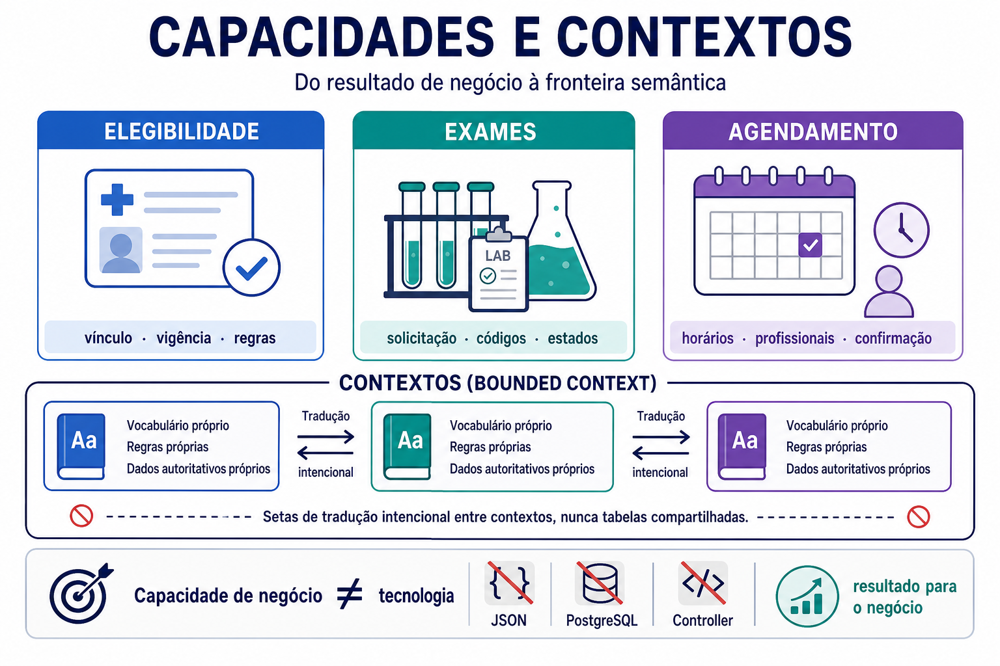
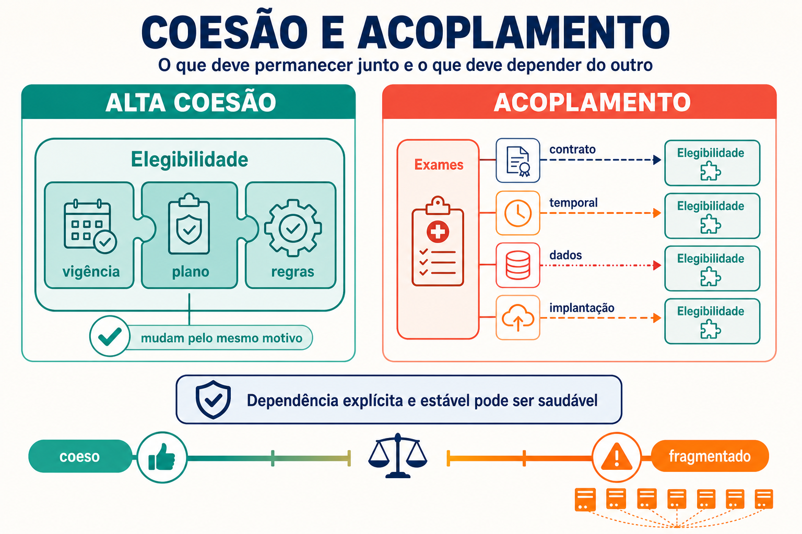
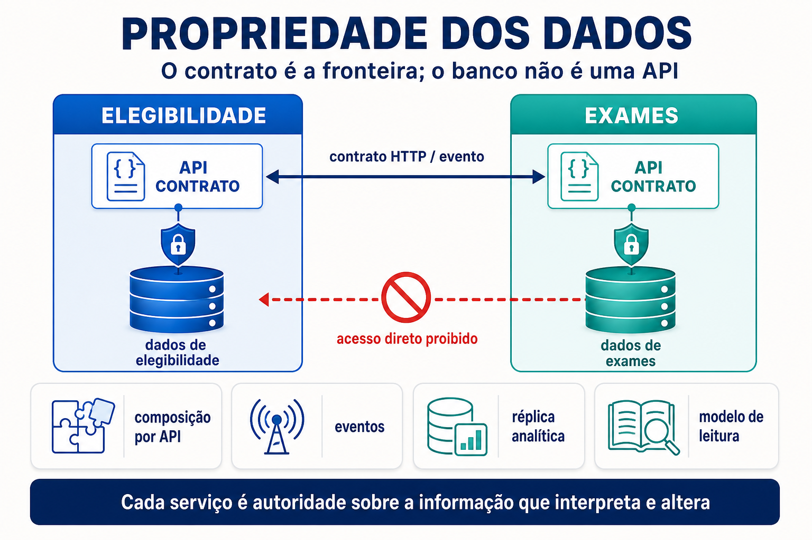

# Conceitos

Dividir um sistema é escolher o que deve permanecer junto e o que pode evoluir separadamente. Pastas, classes e contêineres são mecanismos de implementação, enquanto a justificativa de uma fronteira vem do domínio e dos atributos de qualidade exigidos pelo negócio.

Os exemplos desta página vêm do caso usado ao longo do módulo, a plataforma de uma rede hospitalar fictícia que atende pacientes de planos de saúde. Quando um médico pede um exame, a recepção registra o pedido no serviço de **Exames**. Antes de gravar o pedido, Exames consulta o serviço de **Elegibilidade**, que responde se o paciente tem cobertura do plano naquele momento. A plataforma também tem uma capacidade de **Agendamento**, que reserva o horário dos atendimentos.

## Capacidade de negócio

Uma **capacidade de negócio** é algo que a organização faz para gerar valor, descrito pelo resultado que entrega independentemente da tela, do processo ou da tecnologia usados hoje. O conceito vem da modelagem de arquitetura de negócio. Chris Richardson o usa no padrão de decomposição por capacidade de negócio, em que cada serviço corresponde a uma capacidade da organização.

A capacidade interessa ao arquiteto porque muda pouco ao longo do tempo. Um banco concede crédito há décadas, embora a análise de crédito tenha passado do papel para planilhas e depois para modelos estatísticos. Uma loja virtual continua gerenciando estoque quando troca de sistema ou de banco de dados. Uma fronteira de serviço desenhada sobre uma capacidade tende a mudar menos do que uma fronteira desenhada sobre as telas ou as tabelas do sistema atual.

A tabela ajuda a distinguir uma capacidade de outros elementos com que ela costuma ser confundida.

| Item | É capacidade de negócio? | Motivo |
| --- | --- | --- |
| Conceder crédito, num banco | Sim | Descreve um resultado para o cliente, independente da tecnologia |
| Calcular o escore no modelo estatístico, num banco | Não | Descreve um mecanismo usado pela capacidade de conceder crédito |
| Gerenciar estoque, numa loja virtual | Sim | Descreve o resultado de saber o que pode ser vendido e onde está |
| Departamento financeiro | Não | Descreve uma unidade da organização, que pode executar várias capacidades |
| Digitar os dados do pedido no formulário | Não | Descreve um passo de processo, que muda quando o processo muda |
| Salvar no PostgreSQL | Não | Descreve um mecanismo técnico de armazenamento |
| Verificar elegibilidade, na rede hospitalar | Sim | Descreve o resultado de saber se o paciente tem cobertura do plano |

As capacidades costumam ser organizadas em níveis. Na rede hospitalar, a capacidade ampla de atendimento ao paciente contém as capacidades mais específicas de verificar elegibilidade, solicitar exame e agendar atendimento. O nível útil para discutir serviços é aquele em que cada capacidade tem regras e dados próprios e pode ser explicada a uma pessoa do negócio sem termos técnicos.

Na plataforma hospitalar, verificar elegibilidade e solicitar exame são capacidades distintas. Para decidir se o paciente tem cobertura, Elegibilidade interpreta o vínculo do paciente com a operadora do plano, a vigência do plano e as regras do contrato. Para registrar o pedido do médico, Exames conhece os códigos dos exames, as solicitações e as etapas do fluxo clínico. Exames precisa saber se o paciente tem cobertura e não precisa conhecer as tabelas, os algoritmos ou os documentos que Elegibilidade usa para chegar a essa resposta.

As capacidades ajudam a evitar serviços recortados por camadas técnicas, como um serviço só de controladores ou um serviço só de acesso a banco. Um recorte útil reúne o comportamento, as regras e a informação necessários a um resultado, com um nome que permanece estável mesmo quando o processo muda. Ainda assim, um mapa de capacidades serve à análise estratégica e não define sozinho quais executáveis devem existir, decisão que depende também dos conceitos das próximas seções.

## Bounded context

Numa organização grande, a mesma palavra assume significados diferentes em cada área. Martin Fowler relata o caso de uma empresa de energia elétrica em que a palavra “medidor” tinha três significados conforme a área. Ela podia indicar a ligação entre a rede e um endereço, a ligação entre a rede e um cliente ou o próprio aparelho físico instalado. Numa loja virtual, “produto” significa um item com fotos e descrição para o catálogo e uma unidade com localização no armazém para o estoque. Um modelo único que tente atender a esses significados ao mesmo tempo acumula exceções e contradições, de modo que uma mudança pedida pelo catálogo pode quebrar o comportamento esperado pelo estoque.

Eric Evans propôs o ***bounded context*** no livro *Domain-Driven Design*, de 2003, como resposta a esse problema. Um *bounded context* delimita a parte do sistema em que um modelo e a sua linguagem têm significado único e consistente. Dentro do contexto, a equipe usa uma **linguagem ubíqua**, que é o vocabulário compartilhado por especialistas do negócio e desenvolvedores e que aparece também no código. A passagem de um contexto para outro exige tradução explícita entre os dois modelos.

Na rede hospitalar, a mesma pessoa aparece nos três contextos com nomes e significados diferentes, como mostra a tabela.

| Contexto | Nome usado para a pessoa | Informação de que o contexto precisa | Significado de “situação” |
| --- | --- | --- | --- |
| Elegibilidade | Beneficiário | Plano, vínculo com a operadora e vigência | Vigência cadastral do plano |
| Exames | Paciente | Pedidos de exame, códigos e médico solicitante | Etapa do pedido no fluxo clínico |
| Agendamento | Paciente | Horários, contato e confirmação | Estado da reserva de horário |

Exames não precisa saber como Elegibilidade calcula a vigência do plano. A tradução entre os dois contextos acontece no contrato, em que Exames pergunta se o beneficiário com um identificador tem cobertura e recebe uma resposta simples, sim ou não. Se Elegibilidade passar a considerar uma nova regra da operadora, o modelo de Exames continua igual.

Capacidade e *bounded context* respondem a perguntas diferentes. A capacidade responde ao que a organização faz, enquanto o *bounded context* responde até onde vale um modelo e a sua linguagem. Na rede hospitalar, as duas fronteiras coincidem. Em outros domínios, uma capacidade ampla pode conter vários contextos, assim como um contexto pode atender a várias capacidades pequenas.

Um *bounded context* não é sinônimo de microsserviço, porque ele é antes de tudo uma fronteira semântica. Ele pode ser implementado como módulo de um monólito, como parte coesa de um macrosserviço ou como serviço implantável. Confundir o modelo lógico com a topologia física leva equipes a criar centenas de processos antes de existir necessidade operacional para eles.

Um bom limite permite responder às perguntas da lista abaixo sem consultar outra equipe.

- Qual resultado é produzido e para quem.
- Quais regras devem permanecer verdadeiras.
- Quem pode alterar os dados autoritativos.
- Qual contrato é oferecido aos consumidores.
- Quais mudanças deveriam ocorrer sem coordenação externa.

*Figura 1 — De capacidades de negócio a bounded contexts. Fonte: curso.*

**Leitura textual da figura:** Elegibilidade, Exames e Agendamento são capacidades de negócio representadas pelo seu vocabulário central. Elegibilidade trata de vínculo e vigência do plano segundo as regras da operadora, enquanto Exames trata de solicitações, códigos e estados do fluxo clínico. Agendamento trata de horários e profissionais disponíveis e da confirmação do atendimento ao paciente. Cada capacidade também é um *bounded context* com vocabulário, regras e dados autoritativos próprios, ligado aos vizinhos apenas por tradução intencional e sem tabela compartilhada. Na base, a figura registra que JSON, PostgreSQL e um *controller* são mecanismos técnicos que não constituem o resultado entregue pela organização.

## Coesão

**Coesão** é o grau em que os elementos de uma unidade contribuem para uma responsabilidade relacionada. Regras que mudam pelo mesmo motivo tendem a ficar juntas, como o cálculo de vigência e a interpretação da categoria do plano em Elegibilidade. Colocar nesse mesmo serviço o preparo de uma amostra laboratorial misturaria razões de mudança diferentes.

A alta coesão reduz a quantidade de contexto que uma pessoa precisa conhecer para alterar uma regra e favorece testes significativos. Ela não significa unidade minúscula, porque fragmentar cada função num processo próprio reduz a coesão do fluxo de negócio. Nesse cenário, uma alteração simples passa a exigir contratos, implantações e diagnósticos coordenados entre vários serviços.

As heurísticas úteis incluem o vocabulário compartilhado, as invariantes transacionais e o histórico de mudanças, além da propriedade da equipe e da necessidade de escalar. Nenhuma heurística decide sozinha, porque o histórico pode refletir uma organização antiga, uma transação pode ser redesenhada e a propriedade de uma equipe muda quando a organização se reestrutura.

## Acoplamento

**Acoplamento** é a dependência entre unidades de software. Ele não desaparece quando uma chamada de função é substituída por uma chamada HTTP, porque o acoplamento muda de forma e continua existindo.

- O **acoplamento de contrato** existe quando o consumidor depende dos campos, da semântica e dos códigos de resposta do provedor.
- O **acoplamento temporal** existe quando o consumidor precisa que o provedor esteja disponível no momento da chamada.
- O **acoplamento de dados** existe quando duas unidades dependem da mesma estrutura ou alteram a mesma informação.
- O **acoplamento de implantação** existe quando uma mudança exige publicar várias unidades em conjunto.
- O **acoplamento organizacional** existe quando equipes precisam negociar continuamente para entregar uma capacidade.

Uma dependência explícita e estável pode ser saudável. O problema é o acoplamento que impede a evolução das unidades ou torna as falhas imprevisíveis. No laboratório da [Oficina de ferramentas](oficina-de-ferramentas.md), em que os dois serviços rodam em contêineres, Exames aceita acoplamento temporal com Elegibilidade porque a solicitação espera uma resposta síncrona antes de ser gravada. Em compensação, Exames evita o acoplamento de dados, porque não lê a tabela do outro serviço.

*Figura 2 — Coesão dentro de uma capacidade e acoplamento entre capacidades. Fonte: curso.*

**Leitura textual da figura:** dentro de Elegibilidade, as regras de vigência e de plano têm alta coesão porque mudam pelo mesmo motivo. Entre Exames e Elegibilidade existem quatro setas, que representam o acoplamento de contrato e o temporal, além do acoplamento de dados e do de implantação. A figura termina com uma escala entre os extremos coeso e fragmentado. O risco cresce quando o desenho se aproxima do extremo fragmentado, em que muitos processos pequenos dependem uns dos outros.

## Fronteira lógica e fronteira física

Uma fronteira lógica controla as referências entre módulos, a linguagem de cada modelo e a propriedade dos dados. Uma fronteira física acrescenta a essas garantias um processo próprio, comunicação pela rede e implantação e falha independentes. A Figura 3 representa a progressão mais segura entre a fronteira lógica e a fronteira física de um serviço.

*Figura 3 — Da fronteira lógica à fronteira física. Fonte: curso.*

**Leitura textual da figura:** as regras misturadas do primeiro passo são separadas em módulos com interfaces no segundo passo. Os dados desses módulos recebem um proprietário definido no terceiro passo. Só depois a figura chega à decisão sobre a necessidade de autonomia física. Se a resposta é negativa, a implantação conjunta é mantida. Se a resposta é positiva, um processo próprio é extraído com contrato remoto entre os serviços, cada um com o próprio banco. A frase final registra o critério de que a extração física só vale quando a autonomia obtida compensa o custo operacional.

Extrair um serviço cedo demais adiciona latência e serialização às chamadas entre módulos, além de exigir autenticação entre serviços, descoberta e telemetria. Extrair tarde demais pode manter equipes e ciclos de entrega presos uns aos outros. A arquitetura evolutiva preserva as duas opções com módulos que expõem APIs internas e testes de fronteira, o que torna uma extração futura menos custosa.

## Serviço e microsserviço

Um serviço é uma unidade que oferece capacidades por meio de um contrato e pode viver no mesmo processo do consumidor ou em outro processo. Um **microsserviço** é uma unidade implantável de maneira independente, alinhada a uma responsabilidade de negócio e dona do próprio estado. O prefixo “micro” não define limite de linhas de código ou de pessoas, porque o critério relevante é a autonomia combinada com coesão.

A independência é uma propriedade exigente. Quando cada alteração requer publicação coordenada, vários serviços escrevem no mesmo banco ou um fluxo só funciona quando dez respostas chegam, a topologia é distribuída e a autonomia é baixa. Equipes nessa situação chegam a um monólito distribuído, que acumula os custos da comunicação remota sem obter os benefícios do isolamento.

## Propriedade dos dados

A propriedade dos dados define quem é a autoridade para interpretar e alterar uma informação. **Banco por serviço** significa que somente o serviço proprietário acessa diretamente o seu armazenamento, enquanto os consumidores usam contratos, eventos ou réplicas projetadas para esse fim. O padrão não exige um servidor físico para cada processo, porque bancos, *schemas* ou credenciais separados oferecem graus diferentes de isolamento.

*Figura 4 — Fronteiras, contratos e dados. Fonte: curso.*

**Leitura textual da figura:** Elegibilidade e Exames são capacidades distintas da plataforma hospitalar. Cada uma oferece um contrato de API e mantém o próprio banco protegido. A seta tracejada que ligaria diretamente os dois bancos aparece bloqueada, porque o acesso direto violaria a propriedade dos dados. A única interação permitida passa pelo contrato HTTP ou por evento. Quando uma leitura precisa cruzar as duas capacidades, a figura lista como opções a composição por API e os eventos, além da réplica analítica e do modelo de leitura próprio. A frase final registra que cada serviço é autoridade sobre a informação que interpreta e altera.

Na Oficina de ferramentas, dois PostgreSQL deixam a regra visível, porque a credencial de Exames conhece apenas o banco `exames` e a de Elegibilidade conhece apenas o banco `elegibilidade`. Cada banco fica numa rede interna própria, enquanto os dois processos compartilham somente a rede de aplicação necessária ao HTTP. Por isso, mesmo que Exames descubra o nome `elegibilidade-db`, ele não consegue resolvê-lo pela sua rede. Em ambientes maiores, o isolamento lógico no mesmo cluster equilibra custo e proteção quando as permissões e a responsabilidade são reais.

Compartilhar uma tabela parece conveniente para relatórios e transações e cria um contrato implícito entre os serviços. Uma alteração de coluna pode quebrar consumidores que o proprietário desconhece. Uma escrita externa pode violar invariantes que o proprietário deixou de controlar. Para a leitura integrada, a equipe avalia as alternativas descritas na Figura 4 e deixa explícitas a defasagem e a origem do dado.

## Falha parcial {#chamadas-sincronas-e-falhas-parciais}

Uma **chamada síncrona** é uma chamada em que o consumidor espera a resposta do provedor antes de continuar o próprio trabalho. Ela cria o acoplamento temporal descrito na seção [Acoplamento](#acoplamento), porque a operação do consumidor só termina quando o provedor responde. No laboratório, a disponibilidade percebida por Exames depende da própria aplicação e do próprio banco, da rede e também de Elegibilidade e do banco de Elegibilidade.

Uma **falha parcial** ocorre quando uma parte do sistema distribuído funciona e outra não. Exames pode estar saudável para consultar o próprio banco e incapaz de aceitar uma nova solicitação porque Elegibilidade parou. O status `503 Service Unavailable` com o código `dependencia_indisponivel` torna essa condição observável para o consumidor. Um `500` genérico ou o registro da solicitação como concluída esconderia a natureza da falha.

| Situação de Exames | Verificação de saúde | Nova solicitação | Leitura correta |
| --- | --- | --- | --- |
| Elegibilidade no ar | `200` | `201` | Sistema disponível |
| Elegibilidade parada | `200` | `503 dependencia_indisponivel` | Falha parcial |
| Banco de Exames parado | `503` | `503` | Falha do próprio Exames |

Uma **resposta alternativa**, chamada em inglês de *fallback*, é uma resposta que o consumidor recebe quando a dependência não responde. Ela precisa ser válida para o negócio além de conveniente para a técnica. Na rede hospitalar do caso, registrar o pedido como se o paciente tivesse cobertura seria perigoso, porque o paciente poderia realizar um exame que o plano depois se recusaria a pagar. Por isso, Exames responde `503` com o código `dependencia_indisponivel` enquanto Elegibilidade estiver indisponível.

O prazo de espera, a nova tentativa e o disjuntor limitam o efeito de uma falha parcial e estão descritos com código na seção [Resiliência da chamada síncrona](padroes-e-decisoes.md#chamadas-sincronas-orcamento-de-falha). A [ODA 05](https://aulas-marco.github.io/odas-arquitetura-software/oda-05/) aplica esses mecanismos num laboratório guiado.

## Consistência e partição {#consistencia-e-particao}

Uma **transação local** é uma transação ACID dentro do banco de um único serviço, que confirma ou desfaz todas as alterações juntas. Entre serviços com bancos próprios não existe transação local comum, porque cada serviço confirma a própria transação no próprio banco.

| Termo | Definição |
| --- | --- |
| Consistência forte | Uma leitura reflete sempre a escrita mais recente |
| Consistência eventual | As réplicas podem divergir durante um intervalo aceito pelo domínio e convergem para o mesmo valor quando não há novas escritas |
| Partição | Interrupção da comunicação entre grupos de nós de um sistema distribuído, com mensagens perdidas ou atrasadas |
| Compensação | Ação de negócio que neutraliza o efeito de uma transação local já confirmada, sem apagar o registro dessa transação |

Esses termos são usados pela [ODA 06](https://aulas-marco.github.io/odas-arquitetura-software/oda-06/) e pelas seções [Consistência entre serviços](padroes-e-decisoes.md#consistencia-local-e-consistencia-entre-servicos), [SAGA](padroes-e-decisoes.md#saga) e [CQRS](padroes-e-decisoes.md#cqrs) da página de padrões.
