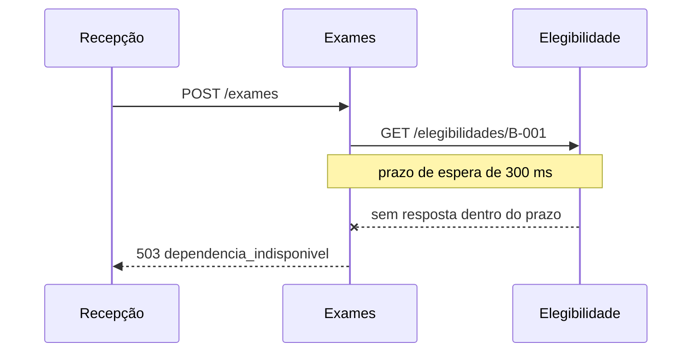
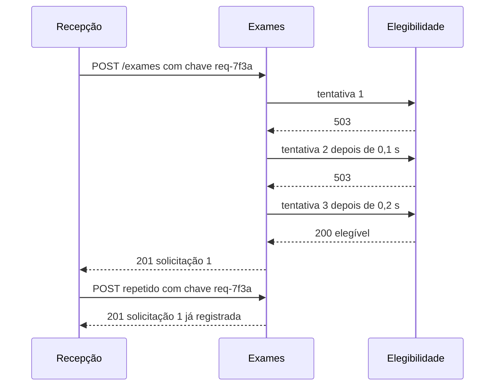
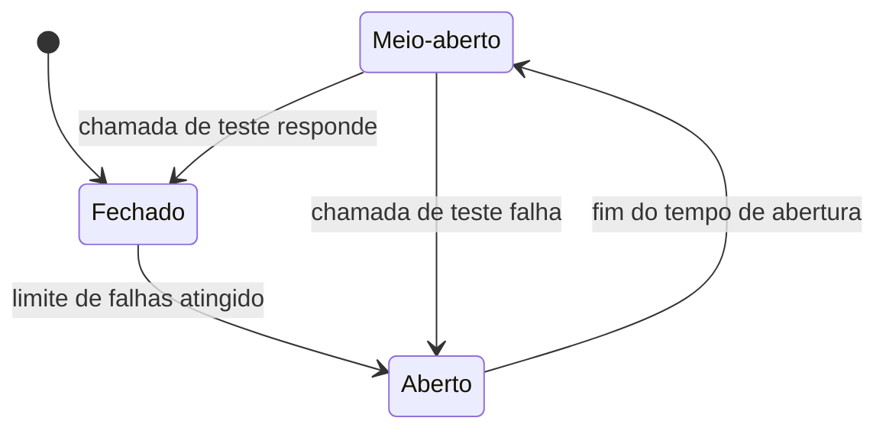
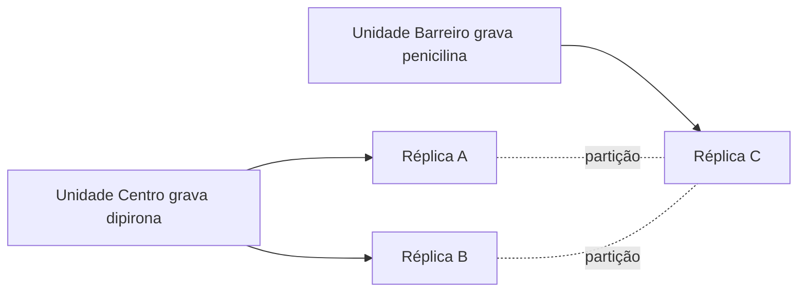
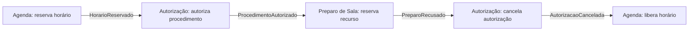
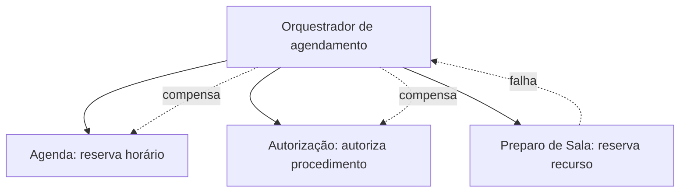
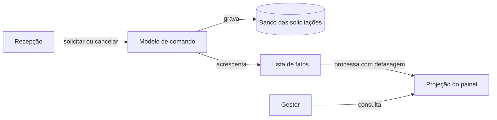

# Padrões e decisões

Esta página reúne os padrões que tratam das consequências da distribuição de um sistema em serviços. Os conceitos de acoplamento temporal e falha parcial e os de transação local e partição estão definidos na página de [Conceitos](conceitos.md). A tabela mostra a organização da página em três blocos, na ordem em que os assuntos aparecem nas atividades do módulo.

| Bloco | Seções | Atividade que o bloco prepara |
| --- | --- | --- |
| Resiliência da chamada síncrona | Orçamento de falha, prazo de espera, nova tentativa, disjuntor e resposta alternativa | [ODA 05](https://aulas-marco.github.io/odas-arquitetura-software/oda-05/) |
| Consistência, SAGA e CQRS | Teorema CAP, resolução de conflitos, SAGA e CQRS | [ODA 06](https://aulas-marco.github.io/odas-arquitetura-software/oda-06/) |
| Unidades de implantação e dados | Monólito modular, macrosserviço e microsserviço, banco por serviço, persistência poliglota, *event sourcing*, chassi e estrangulador | Estudo de caso e exercícios |

Os exemplos usam o caso do módulo, a plataforma de uma rede hospitalar fictícia que atende pacientes de planos de saúde. Quando um médico pede um exame, a recepção registra o pedido no serviço de Exames, que antes de gravar consulta o serviço de Elegibilidade para saber se o paciente tem cobertura do plano. Essa consulta é uma chamada síncrona, porque a recepção só recebe a confirmação do pedido depois da resposta de Elegibilidade.

Os programas citados estão nas pastas `codigo/oda-05` e `codigo/oda-06` do [repositório das ODAs da disciplina](https://github.com/aulas-marco/odas-arquitetura-software). Eles usam apenas a biblioteca padrão do Python. As saídas reproduzidas nesta página vêm de execuções reais desses programas.

## Resiliência da chamada síncrona {#chamadas-sincronas-orcamento-de-falha}

Este bloco prepara a ODA 05. Na rede hospitalar do caso, a recepção só confirma ao paciente o pedido de exame depois que Exames recebe de Elegibilidade a resposta sobre a cobertura do plano. Quando Elegibilidade fica lenta ou para de responder, Exames continua em funcionamento sem conseguir concluir o pedido. Nessa situação, o paciente aguarda no balcão sem saber se o exame foi registrado. Os padrões deste bloco definem quanto tempo Exames espera pela resposta, quando repete a consulta e quando deixa de consultar Elegibilidade até a recuperação dela, sempre com uma resposta clara para a recepção.

| Padrão | Problema tratado | Mecanismo | Custo principal |
| --- | --- | --- | --- |
| Prazo de espera | Espera indefinida por uma dependência lenta ou parada | Limite de tempo para a resposta | Escolher um valor que não recuse respostas normais |
| Nova tentativa | Falha transitória da dependência | Repetição da chamada com espera crescente | Carga extra sobre a dependência e exigência de idempotência |
| Disjuntor | Repetições contra uma dependência instável | Recusa imediata das chamadas depois de um limite de falhas | Pedidos recusados durante o tempo de abertura |
| Resposta alternativa | Necessidade de responder sem a dependência | Resposta substituta definida pelo negócio | Risco de resposta inválida para o domínio |

### Orçamento de falha {#orcamento-de-falha}

O orçamento de falha de uma chamada síncrona é o conjunto de decisões que a equipe documenta antes de adicionar a chamada. Ele define o prazo de espera, a política de repetição e a exigência de idempotência. Ele também define a propagação de identidade, os códigos de erro e a telemetria da chamada. Uma cadeia de cinco serviços chamados em sequência acumula a latência de cada chamada e tem disponibilidade inferior à de cada participante, porque a falha de qualquer um deles interrompe a cadeia.

Na [Oficina de ferramentas](oficina-de-ferramentas.md) deste módulo, que executa Exames e Elegibilidade em contêineres, Exames usa prazo de espera de dois segundos e converte a indisponibilidade de Elegibilidade no status `503`. O serviço não repete a chamada automaticamente, porque a consulta é rápida e um volume grande de repetições durante uma queda poderia atrasar a recuperação de Elegibilidade.

### Prazo de espera e falha parcial {#prazo-de-espera-e-falha-parcial}

O prazo de espera, conhecido como *timeout*, é o tempo máximo que Exames aceita esperar pela resposta de Elegibilidade. Quando o prazo termina sem resposta, Exames trata a chamada como falha e responde `503` com o código `dependencia_indisponivel`, como mostra a Figura 1.



**Texto alternativo:** diagrama de sequência em que Exames consulta Elegibilidade com prazo de espera de 300 milissegundos e devolve 503 à recepção quando a resposta não chega dentro do prazo.

*Figura 1 — Prazo de espera numa chamada síncrona. Fonte: curso.*

**Leitura textual da figura:** a recepção envia `POST /exames` a Exames, que consulta Elegibilidade antes de gravar a solicitação. Uma nota marca o prazo de espera de 300 milissegundos entre Exames e Elegibilidade. Como a resposta de Elegibilidade não chega dentro do prazo, Exames devolve à recepção o status 503 com o código `dependencia_indisponivel`.

No programa da ODA 05, o prazo é passado à função `urlopen` da biblioteca padrão. Recusa de conexão, estouro do prazo e resposta `5xx` de Elegibilidade são convertidos na exceção `ConnectionError`, que o método `solicitar_exame` traduz no status `503`.

```python
# codigo/oda-05/exames.py
def consultar_elegibilidade(self, beneficiario_id):
    url = f"{self.url_elegibilidade}/elegibilidades/{beneficiario_id}"
    try:
        with urllib.request.urlopen(url, timeout=self.prazo) as resposta:
            return resposta.status, json.load(resposta)
    except urllib.error.HTTPError as erro:
        if erro.code >= 500:
            raise ConnectionError(f"Elegibilidade respondeu {erro.code}") from erro
        return erro.code, json.load(erro)
    except (urllib.error.URLError, TimeoutError) as erro:
        raise ConnectionError("Elegibilidade não respondeu dentro do prazo") from erro

def solicitar_exame(self, beneficiario_id, codigo_exame, chave=None):
    # ... verificação da chave de idempotência, mostrada adiante
    try:
        status, corpo = self.politica(lambda: self.consultar_elegibilidade(beneficiario_id))
    except ConnectionError:
        return 503, {"codigo": "dependencia_indisponivel"}
    if status == 404:
        return 422, {"codigo": "beneficiario_desconhecido"}
    if not corpo["elegivel"]:
        return 422, {"codigo": "beneficiario_inelegivel"}
    # ... gravação da solicitação no banco de Exames e resposta 201
```

O comando `python demo_falha_parcial.py`, executado na pasta `codigo/oda-05`, passa por três situações da dependência e imprime a saída abaixo.

```text
Elegibilidade no ar
  POST /exames B-001 -> 201 {'solicitacao_id': 1, 'beneficiario_id': 'B-001', 'codigo_exame': 'HEMOGRAMA'}
  POST /exames B-002 -> 422 {'codigo': 'beneficiario_inelegivel'}
  POST /exames B-999 -> 422 {'codigo': 'beneficiario_desconhecido'}

Elegibilidade fora do ar
  GET /health        -> 200 {'status': 'ok', 'servico': 'exames'}
  POST /exames B-001 -> 503 {'codigo': 'dependencia_indisponivel'}
  solicitações gravadas em Exames: 1

Elegibilidade lenta com resposta em 1 s e prazo de 300 ms em Exames
  POST /exames B-001 -> 503 {'codigo': 'dependencia_indisponivel'}
  Exames desistiu antes de 500 ms: sim
```

Com Elegibilidade fora do ar, o `GET /health` de Exames continua respondendo `200` enquanto a solicitação nova recebe `503`, o que caracteriza a falha parcial. Com Elegibilidade lenta, o prazo de 300 milissegundos faz Exames desistir antes da chegada da resposta, de modo que a espera da recepção passa a depender do prazo escolhido por Exames.

### Nova tentativa com espera exponencial e chave de idempotência

A nova tentativa, conhecida como *retry*, repete a chamada quando a falha parece transitória. A espera entre as tentativas dobra a cada falha. A técnica de espera exponencial, em inglês *exponential backoff*, reduz a frequência das repetições contra um serviço em recuperação. A chave de idempotência é um identificador que o consumidor gera uma vez para cada intenção e repete em cada envio, de modo que Exames reconhece um pedido repetido e devolve a solicitação já registrada.



**Texto alternativo:** diagrama de sequência com três tentativas de Exames contra Elegibilidade, das quais só a terceira recebe resposta 200. Em seguida, a recepção repete o pedido com a mesma chave de idempotência e recebe a solicitação já registrada.

*Figura 2 — Nova tentativa com espera exponencial e chave de idempotência. Fonte: curso.*

**Leitura textual da figura:** a recepção envia um pedido com a chave `req-7f3a`. Exames espera um décimo de segundo antes da segunda tentativa e dois décimos antes da terceira, que recebe a resposta 200. Exames grava a solicitação 1 e responde 201. Quando a recepção repete o pedido com a mesma chave, Exames devolve a solicitação 1 sem gravar uma segunda solicitação.

```python
# codigo/oda-05/resiliencia.py
def com_novas_tentativas(tentativas, espera_inicial, dormir, relatar=print):
    def politica(chamada):
        espera = espera_inicial
        for numero in range(1, tentativas + 1):
            try:
                resultado = chamada()
                relatar(f"  tentativa {numero}: respondeu {resultado[0]}")
                return resultado
            except ConnectionError as erro:
                relatar(f"  tentativa {numero}: falhou ({erro})")
                if numero == tentativas:
                    raise
                dormir(espera)
                espera *= 2  # espera exponencial: 0,1 s, depois 0,2 s, depois 0,4 s
    return politica
```

```python
# codigo/oda-05/exames.py
def solicitar_exame(self, beneficiario_id, codigo_exame, chave=None):
    if chave in self._por_chave:  # pedido repetido: devolve o que já foi registrado
        return 201, self._por_chave[chave]
    # ... consulta a Elegibilidade e regras de negócio, mostradas acima
    solicitacao = {"solicitacao_id": len(self.solicitacoes) + 1,
                   "beneficiario_id": beneficiario_id, "codigo_exame": codigo_exame}
    self.solicitacoes.append(solicitacao)
    if chave is not None:
        self._por_chave[chave] = solicitacao
    return 201, solicitacao
```

No programa `demo_novas_tentativas.py`, Elegibilidade responde `503` nas duas primeiras chamadas e volta ao normal na terceira. A segunda parte do programa descarta a primeira resposta de um `POST` para simular a perda na rede e repete o pedido.

```text
Sem nova tentativa
  POST /exames B-001 -> 503

Com até três tentativas
  tentativa 1: falhou (Elegibilidade respondeu 503)
  tentativa 2: falhou (Elegibilidade respondeu 503)
  tentativa 3: respondeu 200
  POST /exames B-001 -> 201
  chamadas que chegaram a Elegibilidade: 3

Recepção repete o POST sem chave de idempotência
  solicitações gravadas: 2

Recepção repete o POST com a chave de idempotência req-7f3a
  segunda resposta -> 201 {'solicitacao_id': 1, 'beneficiario_id': 'B-001', 'codigo_exame': 'RAIO-X'}
  solicitações gravadas: 1
```

Sem chave de idempotência, a repetição do `POST` grava duas solicitações para o mesmo raio-x do mesmo beneficiário. Com a chave `req-7f3a`, a segunda resposta devolve a solicitação de número 1 e o banco de Exames permanece com um único registro. Cada nova tentativa é uma requisição a mais para um serviço que já está com dificuldade, por isso o número de tentativas e a espera entre elas fazem parte do orçamento de falha.

### Disjuntor

O disjuntor, conhecido como *circuit breaker*, foi descrito por Michael Nygard em 2007 no livro *Release It!*. Ele conta as falhas seguidas de uma dependência e passa a recusar as chamadas sem usar a rede quando a contagem atinge um limite configurado. A Figura 3 mostra os três estados do disjuntor e as transições entre eles.



**Texto alternativo:** diagrama de estados do disjuntor com os estados fechado, aberto e meio-aberto e as transições entre eles.

*Figura 3 — Estados do disjuntor. Fonte: curso.*

**Leitura textual da figura:** o disjuntor começa no estado fechado, em que as chamadas seguem para a rede. Quando o limite de falhas é atingido, ele passa ao estado aberto e recusa as chamadas sem usar a rede. Ao fim do tempo de abertura, passa ao estado meio-aberto e libera uma chamada de teste. Se a chamada de teste responde, o disjuntor volta ao estado fechado. Se a chamada de teste falha, o disjuntor volta ao estado aberto e recomeça a contagem do tempo de abertura.

```python
# codigo/oda-05/resiliencia.py
class Disjuntor:
    def __init__(self, limite_falhas, tempo_aberto, relogio):
        self.limite_falhas = limite_falhas
        self.tempo_aberto = tempo_aberto
        self.relogio = relogio
        self.estado = "fechado"
        self.falhas = 0
        self.aberto_em = None

    def __call__(self, chamada):
        if self.estado == "aberto":
            if self.relogio() - self.aberto_em < self.tempo_aberto:
                raise ConnectionError("disjuntor aberto, chamada recusada sem usar a rede")
            self.estado = "meio_aberto"  # o prazo passou: uma chamada de teste é liberada
        try:
            resultado = chamada()
        except ConnectionError:
            self.falhas += 1
            if self.estado == "meio_aberto" or self.falhas >= self.limite_falhas:
                self.estado, self.aberto_em = "aberto", self.relogio()
            raise
        self.estado, self.falhas = "fechado", 0
        return resultado
```

O programa `demo_disjuntor.py` configura o limite de três falhas e o tempo de abertura de 30 segundos, com um relógio simulado que avança 30 segundos sem espera real.

```text
Elegibilidade fora do ar, limite de 3 falhas
  pedido 1: 503, usou a rede: sim, disjuntor fechado
  pedido 2: 503, usou a rede: sim, disjuntor fechado
  pedido 3: 503, usou a rede: sim, disjuntor aberto
  pedido 4: 503, usou a rede: não, disjuntor aberto
  pedido 5: 503, usou a rede: não, disjuntor aberto
  tentativas de conexão: 3 de 5 pedidos

30 s depois, Elegibilidade de volta
  pedido 6: 201, chamada de teste liberada, disjuntor fechado
  chamadas que chegaram a Elegibilidade: 1
```

Os pedidos 4 e 5 recebem `503` sem tentativa de conexão, de modo que a recepção não espera o prazo de 300 milissegundos e Elegibilidade não recebe carga enquanto se recupera. Depois de 30 segundos simulados, o sexto pedido passa como chamada de teste do estado meio-aberto, Elegibilidade responde e o disjuntor volta ao estado fechado.

### Resposta alternativa

A resposta alternativa, conhecida como *fallback*, substitui a resposta da dependência quando ela não está disponível. Na rede hospitalar do caso, registrar o pedido como se o paciente tivesse cobertura seria uma resposta alternativa inválida, porque o paciente poderia realizar um exame que o plano depois se recusaria a pagar. Por isso, Exames continua respondendo `503` mesmo com o disjuntor aberto. A atividade [Decidir a resposta à indisponibilidade da autorização](exercicios.md#decidir-a-resposta-a-indisponibilidade-da-autorizacao) compara quatro respostas possíveis a uma indisponibilidade semelhante.

## Consistência entre serviços {#consistencia-local-e-consistencia-entre-servicos}

Este bloco e as seções SAGA e CQRS preparam a ODA 06. Na rede hospitalar do caso, cada serviço guarda os próprios dados, como os horários na Agenda e os pedidos de exame em Exames. Quando uma operação altera dados de mais de um serviço, como o agendamento de um exame que exige autorização da operadora, nenhum banco consegue confirmar ou desfazer todas as alterações de uma vez. Entre serviços com bancos próprios não existe *rollback* automático de todas as decisões, porque cada serviço confirma a própria transação no próprio banco. O desenho precisa definir em que momento o usuário considera o fluxo aceito, quais estados intermediários são legítimos e como as divergências são detectadas e reparadas.

**Consistência eventual não significa** ausência de regras. A convergência das réplicas na consistência eventual depende de identidade dos registros e de ordem quando ela for necessária, além de idempotência, repetição e reconciliação.

### Teorema CAP {#cap-sem-o-triangulo-simplista}

O teorema CAP foi formulado por Eric Brewer em 2000 e demonstrado por Seth Gilbert e Nancy Lynch em 2002 para um armazenamento distribuído sujeito a partição de comunicação. Durante uma partição, o sistema precisa escolher entre recusar ou atrasar operações para preservar a consistência e continuar respondendo com a possibilidade de divergência entre réplicas. Por isso, **CAP se torna uma decisão durante uma partição** e não serve como classificação permanente em que um produto escolhe duas das três letras.

| Comportamento durante a partição | Propriedade preservada | Custo |
| --- | --- | --- |
| Recusar ou atrasar operações do lado sem quórum | Consistência | Parte das requisições falha durante a partição |
| Continuar aceitando escritas nos dois lados | Disponibilidade | Réplicas divergem e precisam de regra de resolução |

#### Comportamento de armazenamentos durante uma partição {#o-que-os-armazenamentos-conhecidos-fazem-durante-uma-particao}

| Armazenamento | Comportamento durante a partição | Custo |
| --- | --- | --- |
| Google Spanner | Recusa ou atrasa operações do lado que não forma quórum e ordena transações com relógios sincronizados chamados TrueTime | Algumas requisições falham durante a partição |
| Amazon DynamoDB | Aceita escritas e reconcilia depois, com leitura fortemente consistente disponível como opção explícita | Divergência temporária e conflitos entre versões |
| Apache Cassandra | Continua atendendo, com o nível de consistência configurado em cada operação | A promessa muda de chamada para chamada |
| MongoDB | Permite configurar a garantia, da escrita confirmada por maioria à leitura em réplica secundária | A garantia depende da configuração de cada implantação |

A tabela não recomenda nenhum dos produtos. O comportamento escolhido pelo fornecedor passa a ser uma restrição do desenho de quem adota o produto.

### Resolução de conflitos depois da partição {#quando-a-escolha-foi-continuar-respondendo}

Quando o sistema continua aceitando escritas durante a partição, duas réplicas podem receber alterações concorrentes sobre a mesma informação. Depois que a comunicação volta, uma regra de resolução decide qual alteração prevalece ou como as duas se combinam.

| Estratégia | Funcionamento | Limite |
| --- | --- | --- |
| Última escrita vence, em inglês *last write wins* | Escolhe a alteração com o carimbo de tempo mais recente | Descarta a outra alteração sem aviso e depende de relógios de máquinas diferentes |
| Tipos de dados que convergem por construção, conhecidos pela sigla CRDT | Usa estruturas em que a ordem das operações não altera o resultado | Não julga qual versão de uma regra de negócio está correta |
| Função de mesclagem do domínio | Aplica uma regra explícita da aplicação | É a mais trabalhosa e a única capaz de acertar quando o critério é clínico ou contratual |

#### Exemplo de partição com três réplicas em Python {#particao-simulada-com-tres-replicas}

Na rede hospitalar, a lista de alergias de um paciente fica replicada nos servidores das unidades, de modo que cada unidade consulta a lista mesmo sem comunicação com as demais. O programa `codigo/oda-06/particao/demo_particao.py` simula três réplicas dessa lista. Durante a partição, a unidade Centro grava dipirona no lado da maioria e a unidade Barreiro grava penicilina no lado da minoria, como mostra a Figura 4.



**Texto alternativo:** três réplicas separadas por uma partição, com as réplicas A e B recebendo a escrita da unidade Centro e a réplica C recebendo a escrita da unidade Barreiro.

*Figura 4 — Escritas concorrentes durante uma partição. Fonte: curso.*

**Leitura textual da figura:** a unidade Centro grava dipirona nas réplicas A e B, que formam a maioria. A unidade Barreiro grava penicilina na réplica C, que fica sozinha do outro lado da partição. Linhas tracejadas marcam a partição entre a réplica C e as réplicas A e B.

```python
# codigo/oda-06/particao/demo_particao.py
def escrever(lado, total_replicas, alergias, carimbo, exigir_quorum):
    if exigir_quorum and len(lado) <= total_replicas // 2:
        nomes = "+".join(r.nome for r in lado)
        return f"recusada em {nomes}: {len(lado)} de {total_replicas} réplicas, sem quórum"
    for replica in lado:
        replica.alergias = list(alergias)
        replica.carimbo = carimbo
    return f"aceita em {'+'.join(r.nome for r in lado)}"


def ultima_escrita_vence(replicas):
    vencedora = max(replicas, key=lambda r: r.carimbo)
    return vencedora.alergias


def mesclar_alergias(replicas):
    # Regra do domínio: nenhuma alergia registrada em qualquer unidade é descartada.
    return sorted({a for r in replicas for a in r.alergias})
```

```text
== 1. Recusar sem quórum
Centro grava dipirona: aceita em A+B
Barreiro grava penicilina: recusada em C: 1 de 3 réplicas, sem quórum
Durante a partição: A=['látex', 'dipirona'] C=['látex']

== 2. Aceitar e aplicar última escrita vence
Centro grava dipirona: aceita em A+B
Barreiro grava penicilina: aceita em C
Durante a partição: A=['látex', 'dipirona'] C=['látex', 'penicilina']
Depois da partição: ['látex', 'penicilina']

== 3. Aceitar e mesclar pela regra do domínio
Centro grava dipirona: aceita em A+B
Barreiro grava penicilina: aceita em C
Durante a partição: A=['látex', 'dipirona'] C=['látex', 'penicilina']
Depois da partição: ['dipirona', 'látex', 'penicilina']
```

No primeiro cenário, a réplica C está sozinha no seu lado da partição e recusa a escrita por falta de quórum. No segundo, a regra da última escrita vence escolhe a lista da réplica C pelo carimbo 11, de modo que a dipirona registrada no Centro é descartada sem aviso. No terceiro, a função de mesclagem mantém dipirona e penicilina na lista final, porque a regra do domínio não descarta nenhuma alergia registrada.

## SAGA

Na rede hospitalar, agendar um exame de imagem envolve três serviços com bancos próprios. A **Agenda** reserva o horário do equipamento, a **Autorização** obtém da operadora a autorização do procedimento e o **Preparo de Sala** reserva a sala, o material e a equipe de apoio. Se o Preparo de Sala recusar a reserva, o horário e a autorização já confirmados precisam ser desfeitos por ações de negócio, situação tratada pelo padrão SAGA.

Uma **SAGA** coordena uma sequência de transações locais em serviços diferentes, em que cada etapa confirma o próprio estado no banco do seu serviço. Quando uma etapa posterior falha, ações compensatórias definidas pelo negócio neutralizam o efeito das etapas já confirmadas. O termo foi proposto por Hector Garcia-Molina e Kenneth Salem em 1987 para transações de longa duração em bancos de dados.

| Aspecto | Descrição |
| --- | --- |
| Problema tratado | Mudança que atravessa mais de um proprietário de dados sem transação comum |
| Mecanismo | Sequência de transações locais com compensação em ordem inversa quando uma etapa falha |
| Custo principal | Compensações escritas e testadas para cada passo, estados intermediários visíveis e diagnóstico entre serviços |
| Quando usar | Quando os dados não podem ser reunidos num único serviço com transação local |

**SAGA não é uma transação ACID distribuída**, porque uma compensação não apaga o passado e também pode falhar. Outros participantes podem ter observado o estado intermediário, enquanto mensagens podem chegar duplicadas. Por isso, o desenho de uma SAGA declara os estados possíveis e os comandos idempotentes, além do caminho de intervenção operacional e da trilha de auditoria.

### Elementos de uma SAGA {#os-tres-elementos-que-toda-saga-declara}

| Elemento | Definição | Erro frequente |
| --- | --- | --- |
| Passos | Cada transação local, executada e confirmada por um serviço no próprio banco | Tratar o passo como parte de uma transação maior que alguém ainda poderia abortar |
| Operações compensatórias | A ação de negócio que neutraliza o efeito de um passo já confirmado | Escrever "desfazer" sem definir o significado de desfazer naquele domínio |
| Coordenação | O mecanismo que decide o passo seguinte e o tratamento da falha, por meio de eventos ou de um orquestrador | Deixar a sequência implícita no código de cada serviço |

### Coreografia e orquestração

Na **coreografia**, cada serviço executa o seu passo e publica um evento ao qual os serviços seguintes reagem, sem componente central.



**Texto alternativo:** fluxo coreografado em que Agenda, Autorização e Preparo de Sala reagem a eventos publicados uns pelos outros, incluindo a compensação depois da recusa do preparo.

*Figura 5 — SAGA coreografada do agendamento de exame. Fonte: curso.*

**Leitura textual da figura:** a Agenda reserva o horário e publica `HorarioReservado`, ao qual a Autorização reage autorizando o procedimento. O evento `ProcedimentoAutorizado` leva o Preparo de Sala a tentar reservar o recurso necessário ao exame. Quando o preparo é recusado, o evento `PreparoRecusado` leva a Autorização a cancelar a autorização. O evento `AutorizacaoCancelada` leva a Agenda a liberar o horário.

Na **orquestração**, um componente conhece a sequência inteira, chama cada serviço na ordem definida e aciona as compensações dos passos já confirmados em ordem inversa quando um passo falha.



**Texto alternativo:** orquestrador que chama Agenda, Autorização e Preparo de Sala e compensa a Autorização e a Agenda depois da falha do preparo.

*Figura 6 — SAGA orquestrada do agendamento de exame. Fonte: curso.*

**Leitura textual da figura:** o orquestrador chama a Agenda, a Autorização e o Preparo de Sala. A falha do Preparo de Sala volta ao orquestrador, que aciona a compensação da Autorização e depois a compensação da Agenda.

| Critério | Coreografia | Orquestração |
| --- | --- | --- |
| Lugar da sequência | Distribuída pelas assinaturas de eventos | Concentrada no orquestrador |
| Estado de um agendamento | Nenhum lugar único mostra o estado | O orquestrador registra o estado e a trilha de auditoria |
| Risco típico | Ciclos de eventos criados sem perceber | Um componente que precisa ser mantido e implantado e que se torna dependência de todos os passos |
| Situação favorável | Fluxos curtos e estáveis | Fluxos com muitas ramificações e necessidade de suporte operacional |

### Custos da SAGA {#o-que-a-saga-cobra}

| Ganho | Custo correspondente |
| --- | --- |
| Cada serviço mantém o próprio banco e a própria autoridade, sem transação distribuída | É preciso escrever e testar uma compensação de negócio para cada passo, sabendo que ela também pode falhar |
| O fluxo continua avançando mesmo com um participante lento | Existe uma janela em que o estado intermediário é legítimo e pode ser observado por outros participantes |
| Passos evoluem e escalam de forma independente | Diagnosticar um fluxo travado exige identificador propagado e trilha de auditoria entre serviços |

Na rede hospitalar, a SAGA se justifica porque a reserva de horário, a autorização do procedimento e o preparo da sala pertencem a proprietários de dados diferentes. A consolidação dos passos num único serviço com transação local, adotada no estudo de caso, é mais barata e deve ser avaliada antes da SAGA.

### Exemplo de SAGA orquestrada em Python {#orquestracao-do-agendamento-de-exame-em-python}

O programa da pasta `codigo/oda-06/saga` implementa a orquestração do agendamento com Agenda, Autorização e Preparo de Sala como participantes. Cada participante guarda o próprio estado num dicionário privado que representa o banco do serviço. O orquestrador declara a sequência num único lugar e registra cada evento numa trilha de auditoria com o identificador do agendamento.

```python
# codigo/oda-06/saga/orquestrador.py
class OrquestradorAgendamento:
    def __init__(self, passos):
        self.passos = passos  # sequência declarada num lugar só
        self.trilha = []  # trilha de auditoria: uma linha por evento

    def _registrar(self, agendamento_id, texto):
        self.trilha.append(f"[{agendamento_id}] {texto}")

    def executar(self, agendamento_id):
        concluidos = []
        for passo in self.passos:
            comando_id = f"{agendamento_id}:{passo.nome}:executar"
            try:
                resultado = passo.executar(comando_id, agendamento_id)
            except FalhaNoPasso as falha:
                self._registrar(agendamento_id, f"falha: {falha}")
                return self._compensar(agendamento_id, concluidos)
            self._registrar(agendamento_id, f"{passo.nome}: {resultado}")
            concluidos.append(passo)
        self._registrar(agendamento_id, "situação final: concluida")
        return "concluida"

    def _compensar(self, agendamento_id, concluidos):
        for passo in reversed(concluidos):  # ordem inversa à da execução
            comando_id = f"{agendamento_id}:{passo.nome}:compensar"
            try:
                resultado = passo.compensar(comando_id, agendamento_id)
            except FalhaNoPasso as falha:
                self._registrar(agendamento_id, f"falha na compensação: {falha}")
                self._registrar(agendamento_id, "situação final: requer_intervencao")
                return "requer_intervencao"
            self._registrar(agendamento_id, f"{passo.nome}: {resultado}")
        self._registrar(agendamento_id, "situação final: compensada")
        return "compensada"
```

Cada comando carrega um identificador formado pelo agendamento, pelo participante e pela operação, como `AG-104:Agenda:executar`. O participante guarda os identificadores já aplicados e responde `comando_repetido_sem_efeito` quando recebe um deles outra vez, o que torna o comando idempotente.

```python
# codigo/oda-06/saga/participantes.py
def _aplicar(self, comando_id, operacao, agendamento_id, situacao):
    if comando_id in self._processados:
        return "comando_repetido_sem_efeito"
    if operacao in self._falhar_em:
        raise FalhaNoPasso(f"{self.nome} não conseguiu {operacao}")
    self._banco[agendamento_id] = situacao  # transação local confirmada
    self._processados.add(comando_id)
    return situacao
```

O comando `python demo.py`, executado na pasta `codigo/oda-06/saga`, percorre quatro cenários. A saída abaixo mostra os cenários 2 a 4.

```text
== 2. Falha no Preparo de Sala
[AG-102] Agenda: horario_reservado
[AG-102] Autorização: procedimento_autorizado
[AG-102] falha: Preparo de Sala não conseguiu reservar sala
[AG-102] Autorização: autorizacao_cancelada
[AG-102] Agenda: horario_liberado
[AG-102] situação final: compensada
Bancos locais:
  Agenda: horario_liberado
  Autorização: autorizacao_cancelada
  Preparo de Sala: sem registro

== 3. Falha na compensação
[AG-103] Agenda: horario_reservado
[AG-103] Autorização: procedimento_autorizado
[AG-103] falha: Preparo de Sala não conseguiu reservar sala
[AG-103] falha na compensação: Autorização não conseguiu cancelar autorização
[AG-103] situação final: requer_intervencao
Bancos locais:
  Agenda: horario_reservado
  Autorização: procedimento_autorizado
  Preparo de Sala: sem registro

== 4. Comandos repetidos
[AG-104] Agenda: horario_reservado
[AG-104] Autorização: procedimento_autorizado
[AG-104] Preparo de Sala: sala_reservada
[AG-104] situação final: concluida
[AG-104] -- orquestrador reiniciado, comandos reenviados --
[AG-104] Agenda: comando_repetido_sem_efeito
[AG-104] Autorização: comando_repetido_sem_efeito
[AG-104] Preparo de Sala: comando_repetido_sem_efeito
[AG-104] situação final: concluida
Bancos locais:
  Agenda: horario_reservado
  Autorização: procedimento_autorizado
  Preparo de Sala: sala_reservada
```

| Cenário | Comportamento observado | Conceito ilustrado |
| --- | --- | --- |
| 2 | O orquestrador compensa a Autorização e depois a Agenda | Compensação em ordem inversa, com situações novas que não apagam as anteriores |
| 3 | A compensação da Autorização falha e a SAGA para com `requer_intervencao` | Compensação que falha e exige intervenção operacional |
| 4 | Os comandos reenviados respondem `comando_repetido_sem_efeito` | Idempotência dos comandos |

## CQRS

Na rede hospitalar, a recepção registra e cancela pedidos de exame ao longo do dia, enquanto o gestor da rede consulta num painel quantos pedidos estão ativos em cada unidade. A escrita precisa validar cada pedido, enquanto a leitura precisa de uma contagem pronta por unidade.

O padrão **CQRS**, sigla de *Command Query Responsibility Segregation*, foi descrito por Greg Young e separa o modelo de comando do modelo de consulta quando os dois têm necessidades diferentes. **CQRS não exige dois bancos** nem mensageria ou *event sourcing*, porque a separação pode começar em objetos e interfaces dentro do mesmo processo.

| Aspecto | Descrição |
| --- | --- |
| Problema tratado | Assimetria entre a escrita, que preserva invariantes, e a leitura, que precisa de dados prontos para a consulta |
| Mecanismo | Modelo de comando que valida e grava, e projeção de leitura alimentada pelas mudanças aceitas |
| Custo principal | Atualização, defasagem, reconstrução e monitoramento da projeção |
| Quando usar | Quando a assimetria entre leitura e escrita, a complexidade dos modelos ou a escala justificam a duplicação |

Por isso, **não aplique CQRS por padrão**. CQRS e SAGA resolvem problemas diferentes, porque a SAGA coordena uma mudança distribuída e o CQRS separa as responsabilidades de leitura e de escrita.



**Texto alternativo:** fluxo do CQRS em que a recepção envia comandos ao modelo de comando, que grava no banco e acrescenta fatos a uma lista consumida pela projeção do painel consultada pelo gestor.

*Figura 7 — Modelo de comando e projeção de leitura das solicitações de exame. Fonte: curso.*

**Leitura textual da figura:** a recepção envia os comandos de solicitar e de cancelar ao modelo de comando. O modelo de comando grava cada mudança aceita no banco das solicitações e acrescenta um fato à lista de fatos. A projeção do painel processa a lista com defasagem e é a única fonte consultada pelo gestor.

### Exemplo de CQRS em Python {#comando-e-projecao-no-mesmo-processo}

O programa da pasta `codigo/oda-06/cqrs` implementa a Figura 7 num único processo, sem segundo banco e sem mensageria. A classe `SolicitacoesDeExame` é o modelo de comando, enquanto a classe `PainelGerencial` é a projeção que conta as solicitações ativas por unidade.

```python
# codigo/oda-06/cqrs/comandos.py
def cancelar(self, solicitacao_id):
    atual = self._banco.get(solicitacao_id)
    if atual is None or atual["situacao"] != "solicitada":
        raise ComandoRecusado(f"{solicitacao_id} não pode ser cancelada")
    atual["situacao"] = "cancelada"
    self.fatos.append({"tipo": "ExameCancelado", "id": solicitacao_id, "unidade": atual["unidade"]})
```

```python
# codigo/oda-06/cqrs/projecao.py
class PainelGerencial:
    def __init__(self):
        self.ativas_por_unidade = {}  # modelo de leitura, pronto para a consulta
        self.posicao = 0  # quantos fatos já foram aplicados

    def processar(self, fatos, limite=None):
        fim = len(fatos) if limite is None else min(limite, len(fatos))
        for fato in fatos[self.posicao:fim]:
            unidade = fato["unidade"]
            atual = self.ativas_por_unidade.get(unidade, 0)
            if fato["tipo"] == "ExameSolicitado":
                self.ativas_por_unidade[unidade] = atual + 1
            elif fato["tipo"] == "ExameCancelado":
                self.ativas_por_unidade[unidade] = atual - 1
        self.posicao = max(self.posicao, fim)

    def reconstruir(self, fatos):
        self.ativas_por_unidade = {}  # descarta a projeção e aplica todos os fatos de novo
        self.posicao = 0
        self.processar(fatos)

    def consultar(self, total_de_fatos):
        defasagem = total_de_fatos - self.posicao
        return dict(sorted(self.ativas_por_unidade.items())), defasagem
```

```text
Comando recusado: EX-2 não pode ser cancelada
Fatos publicados:
  1. ExameSolicitado EX-1 (Centro)
  2. ExameSolicitado EX-2 (Centro)
  3. ExameSolicitado EX-3 (Barreiro)
  4. ExameCancelado EX-2 (Centro)

Consulta com atraso: {'Centro': 2} | fatos aplicados 2 de 4 | defasagem 2
Consulta convergida: {'Barreiro': 1, 'Centro': 1} | fatos aplicados 4 de 4 | defasagem 0
Projeção corrompida: {'Centro': 99} | fatos aplicados 4 de 4 | defasagem 0
Projeção reconstruída: {'Barreiro': 1, 'Centro': 1} | fatos aplicados 4 de 4 | defasagem 0
```

Na consulta com atraso, a projeção aplicou dois dos quatro fatos e informa defasagem 2, de modo que o painel mostra duas solicitações ativas no Centro enquanto o modelo de comando já registra uma. A posição do último fato aplicado torna a defasagem mensurável e permite reconstruir a projeção a partir da lista de fatos. A lista de fatos só alimenta a projeção e o estado continua no modelo de comando, por isso o exemplo aplica CQRS sem aplicar *event sourcing*.

## Monólito modular, macrosserviços e microsserviços

Este bloco e os seguintes apoiam o estudo de caso e os exercícios do módulo, que discutem quantos processos a rede hospitalar deve manter para as capacidades de Elegibilidade, Exames e Autorização. Monólito modular, macrosserviço e microsserviço são formas diferentes de empacotar limites lógicos em unidades de implantação.

| Aspecto | Monólito modular | Macrosserviço | Microsserviço |
| --- | --- | --- | --- |
| Definição | Uma unidade de implantação com módulos de interfaces controladas | Unidade implantável maior que reúne capacidades fortemente relacionadas | Unidade implantável independente, alinhada a uma responsabilidade e dona do próprio estado |
| Implantação | uma para o sistema | uma por conjunto amplo | uma por limite menor |
| Chamada dominante | local | local e remota | remota entre limites |
| Transação | local com maior alcance | local dentro do conjunto | local por proprietário |
| Autonomia | lógica | por área ampla | física e organizacional |
| Risco típico | erosão dos módulos | unidade crescer sem revisão | monólito distribuído |

A distribuição física se justifica quando há necessidade de implantação independente ou de escala diferente entre capacidades. Também se justifica por isolamento regulatório, por tecnologia especializada ou por equipes com propriedade real sobre a capacidade. Sem nenhuma dessas forças, a fronteira interna de um monólito modular preserva o isolamento lógico com menor custo operacional.

## Banco por serviço {#banco-por-servico-como-protecao-da-autoridade}

| Aspecto | Descrição |
| --- | --- |
| Problema tratado | Serviços que leem e alteram as tabelas uns dos outros e perdem o controle das próprias invariantes |
| Mecanismo | Somente o serviço proprietário acessa o próprio banco, com credenciais distintas, permissões mínimas e testes arquiteturais |
| Custo principal | Consultas que atravessam serviços passam a exigir composição por API, cópia por eventos, plataforma analítica ou modelo materializado |
| Variações | *Schemas* separados no mesmo servidor, bancos separados ou instâncias separadas, com isolamento e custo crescendo na mesma direção |

O laboratório da oficina usa dois contêineres PostgreSQL com *schemas* homônimos, de modo que qualquer acesso indevido de um serviço ao banco do outro fica evidente. O acesso direto ao banco de outro serviço cria um contrato implícito que o proprietário dos dados não controla.

## Persistência poliglota {#persistencia-como-decisao-de-fronteira}

**Persistência poliglota** é a escolha de mecanismos de armazenamento diferentes quando a forma do dado e os seus acessos justificam essa escolha, como uma base relacional para regras transacionais e um mecanismo de busca para documentos. O padrão não significa dar um banco novo a cada serviço, porque cada mecanismo adicional exige *backup*, segurança e observabilidade próprios. Na Oficina de ferramentas, os dois PostgreSQL de Elegibilidade e de Exames demonstram propriedade de dados e não demonstram persistência poliglota.

## Event sourcing {#event-sourcing-quando-os-fatos-sao-o-registro-necessario}

No **event sourcing**, o estado atual de uma entidade é reconstruído a partir de fatos imutáveis do domínio, como “solicitação recebida” e “autorização concedida”. O padrão é útil quando a história, a auditoria e a reprodução de decisões são requisitos centrais do produto. O custo inclui o versionamento dos eventos, a reconstrução das projeções e o tratamento de privacidade sobre fatos que não podem ser apagados. Para a solicitação de exame deste módulo, uma tabela transacional atende ao requisito com menos componentes, porque o histórico de decisões não é parte essencial do produto.

## Chassi arquitetural e padrão estrangulador {#chassi-e-estrangulador-evoluir-sem-reescrever-no-escuro}

| Padrão | Mecanismo | Risco |
| --- | --- | --- |
| Chassi arquitetural | Bibliotecas e modelos de projeto que entregam a cada serviço novo configuração, observabilidade e autenticação | A equipe do chassi passa a limitar o ritmo das demais quando cada mudança de serviço exige alterar o chassi |
| Estrangulador, em inglês *strangler fig* | Encaminhamento gradual de partes de uma interface antiga para uma implementação nova, com o contrato preservado | Dois sistemas divergentes em operação por tempo indeterminado quando falta uma fonte de verdade única e uma data para desligar o caminho antigo |

## Registro de decisão

Uma decisão defensável registra o contexto, as alternativas e as forças consideradas, além da consequência aceita e do sinal que levaria à revisão. Um registro para o caso hospitalar seria “manter Elegibilidade e Exames em processos distintos porque possuem propriedade de dados e ritmos de mudança diferentes, aceitar a chamada síncrona porque a decisão é necessária antes da escrita e revisar a decisão se a indisponibilidade conjunta ou o volume ultrapassarem as metas”. Esse registro permite que outra pessoa avalie a decisão, o que não acontece com a justificativa “usar microsserviços porque escala”.
