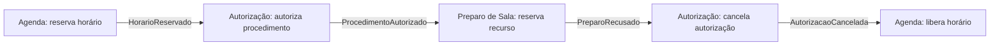
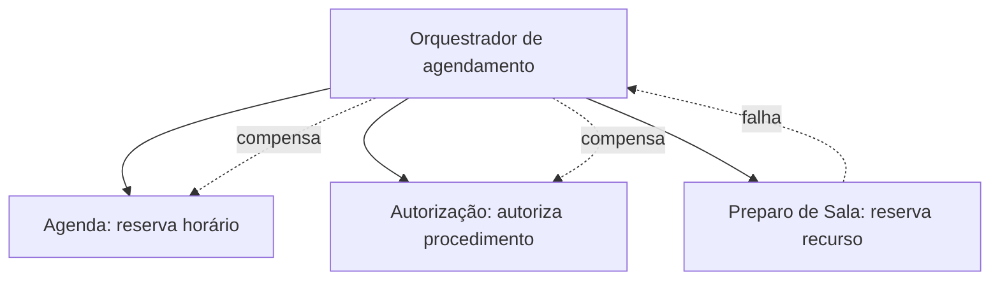

# Padrões e decisões sobre o grau de distribuição

Arquitetura de serviços não define uma progressão em que microsserviços representam o estágio final de maturidade. Monólito modular, macrosserviço e microsserviço são formas diferentes de empacotar limites lógicos em unidades de implantação. A escolha entre elas deve ligar as forças do contexto a consequências que a equipe consegue verificar em testes, métricas e incidentes.

## Monólito modular, macrosserviços e microsserviços

Um **monólito modular** possui uma única unidade de implantação e separa o código em módulos com interfaces e dependências controladas. Uma transação local pode atravessar módulos sob regras explícitas, o que simplifica a operação e a depuração. Em contrapartida, o monólito modular exige disciplina para impedir referências arbitrárias entre módulos e um banco de dados sem proprietário definido.

Um **macrosserviço** é uma unidade implantável maior que reúne capacidades fortemente relacionadas, em geral uma área de negócio mantida por uma equipe e organizada em módulos internos. O termo descreve a posição intermediária entre o sistema inteiro numa unidade e dezenas de serviços com uma responsabilidade cada. O macrosserviço reduz as chamadas de rede e a coordenação operacional, ao custo de cada implantação afetar uma superfície maior de código.

Um **microsserviço** busca autonomia de implantação, de operação e de dados para uma responsabilidade coesa. O estilo favorece escalabilidade seletiva, isolamento de mudanças e propriedade clara por equipe quando esses benefícios existem no contexto. Em troca, o estilo exige automação de entrega e contratos versionados, além de observabilidade e de capacidade de resposta a incidentes e a falhas parciais.

| Aspecto | Monólito modular | Macrosserviço | Microsserviço |
| --- | --- | --- | --- |
| Implantação | uma para o sistema | uma por conjunto amplo | uma por limite menor |
| Chamada dominante | local | local e remota | remota entre limites |
| Transação | local com maior alcance | local dentro do conjunto | local por proprietário |
| Operação | menor variedade | intermediária | maior variedade |
| Autonomia | lógica | por área ampla | física e organizacional |
| Risco típico | erosão dos módulos | unidade crescer sem revisão | monólito distribuído |

A distribuição física se justifica quando há necessidade de implantação independente ou de escala diferente entre capacidades. Também se justifica por isolamento regulatório, por tecnologia especializada ou por equipes com propriedade real sobre a capacidade. Sem nenhuma dessas forças, a fronteira interna de um monólito modular preserva o isolamento lógico com menor custo operacional.

## Banco por serviço como proteção da autoridade

O padrão banco por serviço protege as invariantes e a evolução de cada serviço, que decide sozinho o *schema*, as migrações e as regras de escrita dos próprios dados. Nenhum outro serviço executa `SELECT`, `JOIN` ou `UPDATE` diretamente sobre esse banco. A proteção se materializa em credenciais distintas por serviço, em permissões mínimas e em testes arquiteturais que falham quando a fronteira é violada.

A expressão “por serviço” descreve a propriedade dos dados e não exige uma máquina dedicada a cada serviço. As opções vão de *schemas* separados no mesmo PostgreSQL a bancos separados no mesmo servidor ou a instâncias separadas, com isolamento e custo operacional crescendo na mesma direção. O laboratório da oficina usa dois contêineres PostgreSQL com *schemas* homônimos, de modo que qualquer acesso indevido de um serviço ao banco do outro fica evidente.

Uma consulta que atravessa limites de serviço pode ser resolvida por composição síncrona, por cópia orientada a eventos, por plataforma analítica ou por modelo materializado. Cada alternativa equilibra de modo diferente o frescor do dado, a disponibilidade, a complexidade e o custo. O acesso direto ao banco de outro serviço não entra nessa lista, porque cria um contrato implícito que o proprietário dos dados não controla.

Quando as necessidades de acesso diferem de modo comprovado, a persistência poliglota permite que cada proprietário use a tecnologia de armazenamento adequada aos seus dados. A pergunta a responder é qual mecanismo mantém as invariantes e a operação compreensíveis para a equipe. Começar com uma tecnologia conhecida e registrar o sinal que levaria à revisão costuma ser mais reversível do que multiplicar bancos sem uma necessidade mensurável.

## Consistência local e consistência entre serviços

Dentro de um serviço, uma transação ACID preserva as invariantes locais e desfaz todas as alterações quando uma delas falha. Entre serviços não existe *rollback* automático de todas as decisões, porque cada serviço confirma a própria transação no próprio banco. O desenho precisa definir em que momento o usuário considera o fluxo aceito, quais estados intermediários são legítimos e como as divergências são detectadas e reparadas.

A consistência forte é necessária quando uma leitura precisa refletir a escrita mais recente. A consistência eventual admite uma janela de defasagem que o domínio aceita, que a operação consegue observar e que termina com as réplicas convergindo para o mesmo valor. **Consistência eventual não significa** ausência de regras. A convergência depende de identidade dos registros e de ordem quando ela for necessária, além de idempotência, repetição e reconciliação.

## CAP sem o triângulo simplista

O teorema CAP foi formulado por Eric Brewer em 2000 e demonstrado por Seth Gilbert e Nancy Lynch em 2002 para um armazenamento distribuído sujeito a partição de comunicação. Nesse modelo, consistência significa que os nós apresentam uma visão única e atual do dado. Disponibilidade significa que cada nó que não falhou responde a cada requisição que recebe. Tolerância à partição significa que o sistema continua operando quando mensagens entre grupos de nós se perdem ou atrasam. Em uma rede sujeita a partições, o sistema precisa decidir entre recusar ou atrasar operações para preservar a consistência e responder com a possibilidade de divergência entre réplicas.

Por isso, **CAP se torna uma decisão durante uma partição** e não serve como classificação permanente em que um produto escolhe duas das três letras. Fora da partição, a relação entre latência e consistência continua gerando decisões, que são descritas por outros modelos. O teorema também não justifica qualquer dado desatualizado numa integração, porque a equipe precisa especificar o mecanismo de convergência e o prazo prometido ao consumidor.

A leitura que manda escolher duas das três letras trata a tolerância à partição como opcional. Num sistema distribuído real, a partição é um evento da rede que vai ocorrer em algum momento, de modo que a equipe não tem como descartá-la do desenho. A combinação de consistência com disponibilidade descreve, portanto, um sistema que não é distribuído ou que deixa de responder quando o enlace cai. A escolha real da equipe é o comportamento do sistema durante a partição, que a tabela seguinte mostra para quatro armazenamentos conhecidos.

### O que os armazenamentos conhecidos fazem durante uma partição

A pergunta útil sobre um armazenamento distribuído é o que ele faz quando os nós deixam de se comunicar entre si.

| Armazenamento | Comportamento durante a partição | O que isso custa |
| --- | --- | --- |
| Google Spanner | Recusa ou atrasa operações do lado que não consegue formar quórum, para preservar uma visão única e ordenada. Usa relógios sincronizados globalmente, chamados TrueTime, para ordenar transações com garantia temporal | Parte da disponibilidade, porque algumas requisições falham durante a partição para não responder com dado incerto |
| Amazon DynamoDB | Aceita escritas e reconcilia depois. A consistência eventual é o comportamento padrão, com leitura fortemente consistente disponível como opção explícita | Divergência temporária e necessidade de resolver conflitos entre versões concorrentes |
| Apache Cassandra | Continua atendendo, com o nível de consistência ajustável por operação e o quórum configurado em cada chamada | A promessa muda de chamada para chamada, e a equipe precisa saber qual delas pediu |
| MongoDB | Permite configurar a garantia, da escrita confirmada por maioria à leitura em réplica secundária possivelmente atrasada | A garantia efetiva depende da configuração escolhida em cada implantação |

As linhas da tabela não são recomendações. Elas mostram que cada fornecedor resolveu de forma diferente o comportamento do armazenamento quando a rede falha. A resposta do fornecedor passa a ser uma restrição do desenho de quem adota o produto. O padrão banco por serviço traz a mesma decisão para o desenho mesmo sem nenhum banco replicado globalmente, porque dados relacionados que vivem em serviços diferentes levam tempo para se alinhar.

### Quando a escolha foi continuar respondendo

Quando o sistema continua aceitando escritas durante a partição, duas réplicas podem receber alterações concorrentes sobre a mesma informação. Depois que a comunicação volta, uma regra de resolução decide qual alteração prevalece ou como as duas se combinam.

- A estratégia **última escrita vence**, em inglês *last write wins*, escolhe a atualização com o carimbo de tempo mais recente. Ela é a mais simples de implementar e descarta a outra alteração sem aviso, além de depender de relógios de máquinas diferentes, que não são confiáveis para ordenar eventos.
- Os **tipos de dados que convergem por construção**, conhecidos pela sigla CRDT de *conflict-free replicated data types*, são estruturas em que a ordem de aplicação das operações não altera o resultado final. Eles servem para contadores, conjuntos e listas e não resolvem uma regra de negócio que precise julgar qual versão está correta.
- A **função de mesclagem do domínio** aplica uma regra explícita da aplicação, como preferir a alteração registrada na unidade em que o paciente foi atendido. Ela é a estratégia mais trabalhosa e a única capaz de acertar quando o critério de escolha é clínico ou contratual.

A consistência eventual é uma promessa com prazo que depende das regras descritas na seção sobre consistência entre serviços. Sem essas regras de convergência, as réplicas divergem e nenhum mecanismo as leva de volta ao mesmo valor.

No estudo de caso deste módulo, a equipe decidiu a elegibilidade sem nenhuma dessas estratégias, porque reuniu as regras fortemente relacionadas num único macrosserviço e recuperou uma transação local com consistência forte dentro do processo. A consistência eventual ficou restrita à projeção do painel gerencial, em que a defasagem é aceitável e observável.

#### Partição simulada com três réplicas

O programa `codigo/oda-06/particao/demo_particao.py` do [repositório das ODAs da disciplina](https://github.com/aulas-marco/odas-arquitetura-software) simula três réplicas que guardam a lista de alergias de um paciente. Durante a partição, que separa as réplicas A e B da réplica C, a unidade Centro grava dipirona no lado da maioria e a unidade Barreiro grava penicilina no lado da minoria. O programa usa apenas a biblioteca padrão do Python e fixa os carimbos de tempo, de modo que a saída é a mesma em cada execução.

```python
# codigo/oda-06/particao/demo_particao.py
def escrever(lado, total_replicas, alergias, carimbo, exigir_quorum):
    if exigir_quorum and len(lado) <= total_replicas // 2:
        nomes = "+".join(r.nome for r in lado)
        return f"recusada em {nomes}: {len(lado)} de {total_replicas} réplicas, sem quórum"
    for replica in lado:
        replica.alergias = list(alergias)
        replica.carimbo = carimbo
    return f"aceita em {'+'.join(r.nome for r in lado)}"


def ultima_escrita_vence(replicas):
    vencedora = max(replicas, key=lambda r: r.carimbo)
    return vencedora.alergias


def mesclar_alergias(replicas):
    # Regra do domínio: nenhuma alergia registrada em qualquer unidade é descartada.
    return sorted({a for r in replicas for a in r.alergias})
```

O comando `python demo_particao.py`, executado na pasta `codigo/oda-06/particao`, compara os três comportamentos e imprime a saída abaixo.

```text
== 1. Recusar sem quórum
Centro grava dipirona: aceita em A+B
Barreiro grava penicilina: recusada em C: 1 de 3 réplicas, sem quórum
Durante a partição: A=['látex', 'dipirona'] C=['látex']

== 2. Aceitar e aplicar última escrita vence
Centro grava dipirona: aceita em A+B
Barreiro grava penicilina: aceita em C
Durante a partição: A=['látex', 'dipirona'] C=['látex', 'penicilina']
Depois da partição: ['látex', 'penicilina']

== 3. Aceitar e mesclar pela regra do domínio
Centro grava dipirona: aceita em A+B
Barreiro grava penicilina: aceita em C
Durante a partição: A=['látex', 'dipirona'] C=['látex', 'penicilina']
Depois da partição: ['dipirona', 'látex', 'penicilina']
```

No primeiro cenário, a réplica C está sozinha no seu lado da partição e recusa a escrita por falta de quórum, comportamento equivalente ao do Spanner na tabela anterior. No segundo cenário, as duas escritas são aceitas e a regra da última escrita vence escolhe a lista da réplica C pelo carimbo 11, de modo que a dipirona registrada no Centro é descartada sem aviso. No terceiro cenário, a função de mesclagem aplica a regra do domínio segundo a qual nenhuma alergia registrada é descartada, o que mantém dipirona e penicilina na lista final.

## SAGA

Uma **SAGA** coordena uma sequência de transações locais em serviços diferentes, em que cada etapa confirma o próprio estado no banco do seu serviço. Quando uma etapa posterior falha, ações compensatórias definidas pelo negócio tentam neutralizar o efeito das etapas já confirmadas. A coordenação pode ser coreografada por eventos ou orquestrada por um componente que conhece a sequência inteira. O termo foi proposto por Hector Garcia-Molina e Kenneth Salem em 1987 para transações de longa duração em bancos de dados.

**SAGA não é uma transação ACID distribuída**, porque uma compensação não apaga o passado e também pode falhar. Cancelar uma solicitação de exame não equivale a ela nunca ter existido, já que outros participantes podem ter observado o estado intermediário e mensagens podem chegar duplicadas. Por isso, o desenho de uma SAGA declara os estados possíveis e a política de repetição de comandos idempotentes. Ele também declara o caminho de intervenção operacional e a trilha de auditoria usada para investigar fluxos interrompidos.

### Elementos que toda SAGA declara {#os-tres-elementos-que-toda-saga-declara}

Uma SAGA se descreve por passos, operações compensatórias e coordenação. A ausência de qualquer um desses elementos é o defeito mais comum das primeiras implementações, conforme a coluna de erros frequentes da tabela.

| Elemento | O que é | Erro frequente |
| --- | --- | --- |
| Passos | Cada transação local, executada e confirmada por um serviço no próprio banco | Tratar o passo como parte de uma transação maior que alguém ainda poderia abortar |
| Operações compensatórias | A ação de negócio que neutraliza o efeito de um passo já confirmado | Escrever "desfazer" sem definir o que desfazer significa naquele domínio |
| Coordenação | O mecanismo que decide qual passo vem depois e o que fazer na falha, por meio de eventos ou de um orquestrador | Deixar a sequência implícita no código de cada serviço, sem lugar único que a descreva |

### Coreografia e orquestração

Na **coreografia**, cada serviço executa o seu passo e publica um evento ao qual os serviços seguintes reagem. Não existe componente central, de modo que a sequência resulta das assinaturas de eventos de cada serviço.



Na **orquestração**, um componente conhece a sequência inteira e chama cada serviço na ordem definida. Quando um passo falha, esse componente aciona as compensações dos passos já confirmados em ordem inversa.



A coreografia distribui a lógica e dispensa um componente central. Por outro lado, nenhum lugar único do sistema mostra em que estado está um agendamento, o que dificulta o suporte e facilita a criação acidental de ciclos de eventos entre serviços. A orquestração concentra a sequência num lugar auditável, ao custo de um componente que precisa ser mantido e implantado e que se torna dependência de todos os passos. Fluxos curtos e estáveis toleram a coreografia, enquanto fluxos com muitas ramificações e com necessidade de suporte operacional costumam pedir orquestração.

### O que a SAGA cobra

| Ganho | Custo correspondente |
| --- | --- |
| Cada serviço mantém o próprio banco e a própria autoridade, sem transação distribuída | É preciso escrever e testar uma compensação de negócio para cada passo, sabendo que ela também pode falhar |
| O fluxo continua avançando mesmo com um participante lento | Existe uma janela em que o estado intermediário é legítimo e pode ser observado por outros participantes |
| Passos evoluem e escalam de forma independente | Diagnosticar um fluxo travado exige correlação entre serviços, porque sem identificador propagado e trilha de auditoria a investigação depende de logs dispersos |

No caso hospitalar, uma SAGA pode coordenar a reserva de horário na Agenda, a autorização do procedimento e o preparo da sala. O laboratório da oficina não precisa de SAGA, porque Exames consulta Elegibilidade antes de gravar localmente e só existe uma escrita no fluxo. A SAGA se justifica quando a mudança atravessa mais de um proprietário de dados e não há como reunir esses dados num só serviço. A consolidação dos passos num único serviço com transação local, adotada no estudo de caso, é mais barata e deve ser avaliada antes da SAGA.

### Orquestração do agendamento de exame em Python

O programa da pasta `codigo/oda-06/saga` do [repositório das ODAs da disciplina](https://github.com/aulas-marco/odas-arquitetura-software) implementa a orquestração desse agendamento com Agenda, Autorização e Preparo de Sala como participantes. Cada participante guarda o próprio estado num dicionário privado que representa o banco do serviço, sem acesso ao banco dos outros participantes. O orquestrador declara a sequência dos passos num único lugar e registra cada evento numa trilha de auditoria.

```python
# codigo/oda-06/saga/orquestrador.py
class OrquestradorAgendamento:
    def __init__(self, passos):
        self.passos = passos  # sequência declarada num lugar só
        self.trilha = []  # trilha de auditoria: uma linha por evento

    def _registrar(self, agendamento_id, texto):
        self.trilha.append(f"[{agendamento_id}] {texto}")

    def executar(self, agendamento_id):
        concluidos = []
        for passo in self.passos:
            comando_id = f"{agendamento_id}:{passo.nome}:executar"
            try:
                resultado = passo.executar(comando_id, agendamento_id)
            except FalhaNoPasso as falha:
                self._registrar(agendamento_id, f"falha: {falha}")
                return self._compensar(agendamento_id, concluidos)
            self._registrar(agendamento_id, f"{passo.nome}: {resultado}")
            concluidos.append(passo)
        self._registrar(agendamento_id, "situação final: concluida")
        return "concluida"

    def _compensar(self, agendamento_id, concluidos):
        for passo in reversed(concluidos):  # ordem inversa à da execução
            comando_id = f"{agendamento_id}:{passo.nome}:compensar"
            try:
                resultado = passo.compensar(comando_id, agendamento_id)
            except FalhaNoPasso as falha:
                self._registrar(agendamento_id, f"falha na compensação: {falha}")
                self._registrar(agendamento_id, "situação final: requer_intervencao")
                return "requer_intervencao"
            self._registrar(agendamento_id, f"{passo.nome}: {resultado}")
        self._registrar(agendamento_id, "situação final: compensada")
        return "compensada"
```

Cada comando carrega um identificador formado pelo agendamento, pelo participante e pela operação, como `AG-104:Agenda:executar`. O participante guarda os identificadores já aplicados e responde `comando_repetido_sem_efeito` quando recebe um deles outra vez, o que torna o comando idempotente.

```python
# codigo/oda-06/saga/participantes.py
def _aplicar(self, comando_id, operacao, agendamento_id, situacao):
    if comando_id in self._processados:
        return "comando_repetido_sem_efeito"
    if operacao in self._falhar_em:
        raise FalhaNoPasso(f"{self.nome} não conseguiu {operacao}")
    self._banco[agendamento_id] = situacao  # transação local confirmada
    self._processados.add(comando_id)
    return situacao
```

O comando `python demo.py`, executado na pasta `codigo/oda-06/saga`, percorre quatro cenários. A saída abaixo mostra os cenários 2 a 4, em que a SAGA compensa os passos, pede intervenção e recebe comandos repetidos.

```text
== 2. Falha no Preparo de Sala
[AG-102] Agenda: horario_reservado
[AG-102] Autorização: procedimento_autorizado
[AG-102] falha: Preparo de Sala não conseguiu reservar sala
[AG-102] Autorização: autorizacao_cancelada
[AG-102] Agenda: horario_liberado
[AG-102] situação final: compensada
Bancos locais:
  Agenda: horario_liberado
  Autorização: autorizacao_cancelada
  Preparo de Sala: sem registro

== 3. Falha na compensação
[AG-103] Agenda: horario_reservado
[AG-103] Autorização: procedimento_autorizado
[AG-103] falha: Preparo de Sala não conseguiu reservar sala
[AG-103] falha na compensação: Autorização não conseguiu cancelar autorização
[AG-103] situação final: requer_intervencao
Bancos locais:
  Agenda: horario_reservado
  Autorização: procedimento_autorizado
  Preparo de Sala: sem registro

== 4. Comandos repetidos
[AG-104] Agenda: horario_reservado
[AG-104] Autorização: procedimento_autorizado
[AG-104] Preparo de Sala: sala_reservada
[AG-104] situação final: concluida
[AG-104] -- orquestrador reiniciado, comandos reenviados --
[AG-104] Agenda: comando_repetido_sem_efeito
[AG-104] Autorização: comando_repetido_sem_efeito
[AG-104] Preparo de Sala: comando_repetido_sem_efeito
[AG-104] situação final: concluida
Bancos locais:
  Agenda: horario_reservado
  Autorização: procedimento_autorizado
  Preparo de Sala: sala_reservada
```

No cenário 2, o Preparo de Sala recusa a reserva e o orquestrador compensa os dois passos já confirmados em ordem inversa, primeiro a Autorização e depois a Agenda. Os bancos locais terminam com `horario_liberado` e `autorizacao_cancelada`, situações de negócio novas que registram o cancelamento sem apagar a reserva e a autorização anteriores.

No cenário 3, a própria compensação da Autorização falha. O orquestrador interrompe as compensações e grava a situação `requer_intervencao`, porque a Agenda mantém um horário reservado e a Autorização mantém um procedimento autorizado para um exame que não vai acontecer. Essa divergência entre os bancos locais precisa de tratamento por uma pessoa da operação, que localiza o agendamento pela trilha de auditoria.

No cenário 4, o orquestrador reinicia e reenvia os mesmos comandos do agendamento AG-104. Os participantes reconhecem os identificadores já aplicados e respondem `comando_repetido_sem_efeito`, de modo que nenhum passo é aplicado duas vezes. A [ODA 06](https://aulas-marco.github.io/odas-arquitetura-software/oda-06/) usa este programa no laboratório sobre os quatro cenários da SAGA.

## CQRS

O padrão **CQRS**, sigla de *Command Query Responsibility Segregation*, foi descrito por Greg Young e separa o modelo de comando do modelo de consulta quando os dois têm necessidades diferentes. Os comandos expressam uma intenção e preservam as invariantes, enquanto as consultas leem projeções organizadas para a leitura. **CQRS não exige dois bancos** nem mensageria ou *event sourcing*, porque a separação pode começar em objetos e interfaces dentro do mesmo processo.

Um modelo de leitura materializado reduz composições remotas e atende consultas de alto volume. Ele também cria trabalho de atualização e de monitoramento, além de defasagem entre os modelos e necessidade de reconstrução. Por isso, **não aplique CQRS por padrão**. O padrão se justifica quando a assimetria entre leitura e escrita, a complexidade dos modelos ou a escala justificam o custo da duplicação e da sua governança.

CQRS e SAGA resolvem problemas diferentes, porque a SAGA coordena uma mudança distribuída e o CQRS separa as responsabilidades de leitura e de escrita. Os dois padrões podem coexistir num mesmo sistema sem que um dependa do outro.

### Comando e projeção no mesmo processo

O programa da pasta `codigo/oda-06/cqrs` do [repositório das ODAs da disciplina](https://github.com/aulas-marco/odas-arquitetura-software) separa o modelo de comando do modelo de consulta nas solicitações de exame, sem segundo banco e sem mensageria. A classe `SolicitacoesDeExame` recebe as intenções `solicitar` e `cancelar`, verifica as invariantes e acrescenta um fato a uma lista a cada mudança aceita. A classe `PainelGerencial` consome essa lista e mantém a contagem de solicitações ativas por unidade, que é a forma de dado pronta para a consulta do painel.

```python
# codigo/oda-06/cqrs/comandos.py
def cancelar(self, solicitacao_id):
    atual = self._banco.get(solicitacao_id)
    if atual is None or atual["situacao"] != "solicitada":
        raise ComandoRecusado(f"{solicitacao_id} não pode ser cancelada")
    atual["situacao"] = "cancelada"
    self.fatos.append({"tipo": "ExameCancelado", "id": solicitacao_id, "unidade": atual["unidade"]})
```

```python
# codigo/oda-06/cqrs/projecao.py
class PainelGerencial:
    def __init__(self):
        self.ativas_por_unidade = {}  # modelo de leitura, pronto para a consulta
        self.posicao = 0  # quantos fatos já foram aplicados

    def processar(self, fatos, limite=None):
        fim = len(fatos) if limite is None else min(limite, len(fatos))
        for fato in fatos[self.posicao:fim]:
            unidade = fato["unidade"]
            atual = self.ativas_por_unidade.get(unidade, 0)
            if fato["tipo"] == "ExameSolicitado":
                self.ativas_por_unidade[unidade] = atual + 1
            elif fato["tipo"] == "ExameCancelado":
                self.ativas_por_unidade[unidade] = atual - 1
        self.posicao = max(self.posicao, fim)

    def reconstruir(self, fatos):
        self.ativas_por_unidade = {}  # descarta a projeção e aplica todos os fatos de novo
        self.posicao = 0
        self.processar(fatos)

    def consultar(self, total_de_fatos):
        defasagem = total_de_fatos - self.posicao
        return dict(sorted(self.ativas_por_unidade.items())), defasagem
```

O comando `python demo.py`, executado na pasta `codigo/oda-06/cqrs`, envia quatro comandos aceitos e um comando recusado. Em seguida, o programa consulta o painel antes e depois de processar os fatos e reconstrói a projeção a partir da lista.

```text
Comando recusado: EX-2 não pode ser cancelada
Fatos publicados:
  1. ExameSolicitado EX-1 (Centro)
  2. ExameSolicitado EX-2 (Centro)
  3. ExameSolicitado EX-3 (Barreiro)
  4. ExameCancelado EX-2 (Centro)

Consulta com atraso: {'Centro': 2} | fatos aplicados 2 de 4 | defasagem 2
Consulta convergida: {'Barreiro': 1, 'Centro': 1} | fatos aplicados 4 de 4 | defasagem 0
Projeção corrompida: {'Centro': 99} | fatos aplicados 4 de 4 | defasagem 0
Projeção reconstruída: {'Barreiro': 1, 'Centro': 1} | fatos aplicados 4 de 4 | defasagem 0
```

O segundo cancelamento de EX-2 é recusado pelo modelo de comando, porque a invariante só permite cancelar uma solicitação que está na situação `solicitada`. Na consulta com atraso, a projeção aplicou dois dos quatro fatos e informa defasagem 2, de modo que o painel mostra duas solicitações ativas no Centro enquanto o modelo de comando já registra uma. A posição do último fato aplicado torna essa defasagem mensurável e permite reconstruir a projeção a partir da lista de fatos, como mostra a última linha depois da corrupção simulada do painel.

A lista de fatos deste exemplo só alimenta a projeção, enquanto o estado das solicitações continua no dicionário do modelo de comando. Por essa razão, o exemplo aplica CQRS sem aplicar *event sourcing*, padrão descrito na seção seguinte. A [ODA 06](https://aulas-marco.github.io/odas-arquitetura-software/oda-06/) usa este programa no laboratório sobre defasagem e reconstrução da projeção.

## Event sourcing como registro de fatos {#event-sourcing-quando-os-fatos-sao-o-registro-necessario}

No **event sourcing**, o estado atual de uma entidade é reconstruído a partir de fatos imutáveis do domínio, como “solicitação recebida” e “autorização concedida”. O padrão é útil quando a história, a auditoria e a reprodução de decisões são requisitos centrais do produto. Publicar eventos para integração é uma prática diferente, porque um serviço pode emitir eventos e guardar o próprio estado numa tabela transacional.

O custo inclui o versionamento dos eventos, a reconstrução das projeções e o tratamento de privacidade sobre fatos que não podem ser apagados. Correções também entram como fatos novos, porque um fato já publicado não é alterado. Para a solicitação de exame deste módulo, uma tabela transacional é mais direta. O *event sourcing* só entraria no caso hospitalar se o histórico de decisões fosse parte essencial do produto e a equipe conseguisse operar as consequências descritas nesta seção.

## Chassi arquitetural e padrão estrangulador {#chassi-e-estrangulador-evoluir-sem-reescrever-no-escuro}

Um **chassi arquitetural** é um conjunto de bibliotecas e modelos de projeto que entrega a cada serviço novo as capacidades transversais repetidas, como configuração, observabilidade e autenticação. O chassi oferece padrões e bibliotecas e não concentra a regra de negócio dos serviços. Quando cada mudança de serviço precisa de uma alteração no chassi, a equipe que mantém o chassi passa a limitar o ritmo de entrega das demais equipes.

O padrão **estrangulador**, em inglês *strangler fig*, encaminha aos poucos partes de uma interface antiga para uma implementação nova e preserva o contrato enquanto os consumidores migram. Ele reduz o risco da substituição quando cada etapa mantém uma única fonte de verdade e define a data e a evidência para remover o caminho antigo. Sem essas definições, o roteador mantém dois sistemas divergentes em operação por tempo indeterminado.

## Orçamento de falha das chamadas síncronas {#chamadas-sincronas-orcamento-de-falha}

O orçamento de falha de uma chamada síncrona é o conjunto de decisões que a equipe documenta antes de adicionar a chamada. Ele define o prazo de espera, a política de repetição e a exigência de idempotência. Ele também define a propagação de identidade, os códigos de erro e a telemetria da chamada. Uma cadeia de cinco serviços chamados em sequência acumula a latência de cada chamada e tem disponibilidade inferior à de cada participante, porque a falha de qualquer um deles interrompe a cadeia. A execução paralela de chamadas independentes reduz o tempo total em alguns casos, sem eliminar a dependência de cada participante.

No laboratório da oficina, Exames usa prazo de espera de dois segundos e converte a indisponibilidade de Elegibilidade no status `503`. O serviço não repete a chamada automaticamente, porque a consulta é rápida e um volume grande de repetições durante uma queda poderia atrasar a recuperação de Elegibilidade. O contrato de Exames distingue beneficiário desconhecido, beneficiário inelegível, resposta inválida e dependência fora do ar.

Os programas desta seção estão na pasta `codigo/oda-05` do [repositório das ODAs da disciplina](https://github.com/aulas-marco/odas-arquitetura-software) e usam apenas a biblioteca padrão do Python. Nesses programas, Elegibilidade roda como servidor HTTP numa porta livre do computador e Exames consulta esse servidor pela rede antes de gravar a solicitação. A [ODA 05](https://aulas-marco.github.io/odas-arquitetura-software/oda-05/) percorre os mesmos programas num laboratório guiado de 12 minutos.

### Prazo de espera e falha parcial

O prazo de espera, conhecido como *timeout*, é o tempo máximo que Exames aceita esperar pela resposta de Elegibilidade. No programa, o prazo é passado à função `urlopen` da biblioteca padrão. Recusa de conexão, estouro do prazo e resposta `5xx` de Elegibilidade são convertidos na exceção `ConnectionError`, que o método `solicitar_exame` traduz no status `503` com o código `dependencia_indisponivel`.

```python
# codigo/oda-05/exames.py
def consultar_elegibilidade(self, beneficiario_id):
    url = f"{self.url_elegibilidade}/elegibilidades/{beneficiario_id}"
    try:
        with urllib.request.urlopen(url, timeout=self.prazo) as resposta:
            return resposta.status, json.load(resposta)
    except urllib.error.HTTPError as erro:
        if erro.code >= 500:
            raise ConnectionError(f"Elegibilidade respondeu {erro.code}") from erro
        return erro.code, json.load(erro)
    except (urllib.error.URLError, TimeoutError) as erro:
        raise ConnectionError("Elegibilidade não respondeu dentro do prazo") from erro

def solicitar_exame(self, beneficiario_id, codigo_exame, chave=None):
    # ... verificação da chave de idempotência, mostrada adiante
    try:
        status, corpo = self.politica(lambda: self.consultar_elegibilidade(beneficiario_id))
    except ConnectionError:
        return 503, {"codigo": "dependencia_indisponivel"}
    if status == 404:
        return 422, {"codigo": "beneficiario_desconhecido"}
    if not corpo["elegivel"]:
        return 422, {"codigo": "beneficiario_inelegivel"}
    # ... gravação da solicitação no banco de Exames e resposta 201
```

O comando `python demo_falha_parcial.py`, executado na pasta `codigo/oda-05`, passa por três situações da dependência e imprime a saída abaixo.

```text
Elegibilidade no ar
  POST /exames B-001 -> 201 {'solicitacao_id': 1, 'beneficiario_id': 'B-001', 'codigo_exame': 'HEMOGRAMA'}
  POST /exames B-002 -> 422 {'codigo': 'beneficiario_inelegivel'}
  POST /exames B-999 -> 422 {'codigo': 'beneficiario_desconhecido'}

Elegibilidade fora do ar
  GET /health        -> 200 {'status': 'ok', 'servico': 'exames'}
  POST /exames B-001 -> 503 {'codigo': 'dependencia_indisponivel'}
  solicitações gravadas em Exames: 1

Elegibilidade lenta com resposta em 1 s e prazo de 300 ms em Exames
  POST /exames B-001 -> 503 {'codigo': 'dependencia_indisponivel'}
  Exames desistiu antes de 500 ms: sim
```

Com Elegibilidade fora do ar, o `GET /health` de Exames continua respondendo `200` enquanto a solicitação nova recebe `503`, que é a falha parcial descrita na página de [Conceitos](conceitos.md#chamadas-sincronas-e-falhas-parciais). A contagem de uma solicitação gravada corresponde ao pedido de B-001 aceito na primeira situação, o que confirma que o pedido recusado com `503` não deixou registro no banco de Exames. Com Elegibilidade lenta, o prazo de 300 milissegundos faz Exames desistir antes da chegada da resposta, de modo que a espera da recepção passa a depender do prazo escolhido por Exames.

### Nova tentativa com espera exponencial e chave de idempotência

A nova tentativa, conhecida como *retry*, repete a chamada quando a falha parece transitória. A política `com_novas_tentativas` recebe a chamada como função, tenta até o número configurado de vezes e dobra a espera depois de cada falha. Essa espera crescente recebe o nome de espera exponencial, em inglês *exponential backoff*, porque reduz a frequência das repetições contra um serviço que tenta se recuperar.

```python
# codigo/oda-05/resiliencia.py
def com_novas_tentativas(tentativas, espera_inicial, dormir, relatar=print):
    def politica(chamada):
        espera = espera_inicial
        for numero in range(1, tentativas + 1):
            try:
                resultado = chamada()
                relatar(f"  tentativa {numero}: respondeu {resultado[0]}")
                return resultado
            except ConnectionError as erro:
                relatar(f"  tentativa {numero}: falhou ({erro})")
                if numero == tentativas:
                    raise
                dormir(espera)
                espera *= 2  # espera exponencial: 0,1 s, depois 0,2 s, depois 0,4 s
    return politica
```

Cada nova tentativa é uma requisição a mais para um serviço que já está com dificuldade. Quando muitos consumidores repetem ao mesmo tempo, a carga extra pode atrasar a recuperação da dependência. Por esse motivo, o número de tentativas e a espera entre elas fazem parte do orçamento de falha da chamada.

A repetição também pode partir do consumidor de Exames. Se a resposta de um `POST /exames` se perde na rede, a recepção não sabe se a solicitação foi gravada e envia o mesmo pedido outra vez. A chave de idempotência é um identificador que o consumidor gera uma vez para cada intenção e repete em cada envio, de modo que Exames reconhece o pedido repetido e devolve a solicitação já registrada.

```python
# codigo/oda-05/exames.py
def solicitar_exame(self, beneficiario_id, codigo_exame, chave=None):
    if chave in self._por_chave:  # pedido repetido: devolve o que já foi registrado
        return 201, self._por_chave[chave]
    # ... consulta a Elegibilidade e regras de negócio, mostradas acima
    solicitacao = {"solicitacao_id": len(self.solicitacoes) + 1,
                   "beneficiario_id": beneficiario_id, "codigo_exame": codigo_exame}
    self.solicitacoes.append(solicitacao)
    if chave is not None:
        self._por_chave[chave] = solicitacao
    return 201, solicitacao
```

No programa `demo_novas_tentativas.py`, Elegibilidade responde `503` nas duas primeiras chamadas e volta ao normal na terceira. A segunda parte do programa descarta a primeira resposta de um `POST` para simular a perda na rede e repete o pedido.

```text
Sem nova tentativa
  POST /exames B-001 -> 503

Com até três tentativas
  tentativa 1: falhou (Elegibilidade respondeu 503)
  tentativa 2: falhou (Elegibilidade respondeu 503)
  tentativa 3: respondeu 200
  POST /exames B-001 -> 201
  chamadas que chegaram a Elegibilidade: 3

Recepção repete o POST sem chave de idempotência
  solicitações gravadas: 2

Recepção repete o POST com a chave de idempotência req-7f3a
  segunda resposta -> 201 {'solicitacao_id': 1, 'beneficiario_id': 'B-001', 'codigo_exame': 'RAIO-X'}
  solicitações gravadas: 1
```

Sem política de nova tentativa, a primeira resposta `503` de Elegibilidade chega à recepção como `503` de Exames. Com até três tentativas, a terceira chamada encontra Elegibilidade de volta e a solicitação é registrada depois de três requisições pela rede. Sem chave de idempotência, a repetição do `POST` grava duas solicitações para o mesmo raio-x do mesmo beneficiário. Com a chave `req-7f3a`, a segunda resposta devolve a solicitação de número 1 e o banco de Exames permanece com um único registro.

### Disjuntor

O disjuntor, conhecido como *circuit breaker*, foi descrito por Michael Nygard em 2007 no livro *Release It!*. Ele conta as falhas seguidas de uma dependência e passa a recusar as chamadas sem usar a rede quando a contagem atinge um limite configurado.

| Estado | Comportamento | Transição |
| --- | --- | --- |
| Fechado | Cada chamada segue para a rede e cada falha seguida incrementa o contador | Passa a aberto quando o contador atinge o limite de falhas |
| Aberto | Cada chamada é recusada imediatamente, sem tentativa de conexão | Passa a meio-aberto quando termina o tempo de abertura |
| Meio-aberto | Uma única chamada de teste é liberada para a rede | Volta a fechado se a chamada de teste responde e volta a aberto se ela falha |

```python
# codigo/oda-05/resiliencia.py
class Disjuntor:
    def __init__(self, limite_falhas, tempo_aberto, relogio):
        self.limite_falhas = limite_falhas
        self.tempo_aberto = tempo_aberto
        self.relogio = relogio
        self.estado = "fechado"
        self.falhas = 0
        self.aberto_em = None

    def __call__(self, chamada):
        if self.estado == "aberto":
            if self.relogio() - self.aberto_em < self.tempo_aberto:
                raise ConnectionError("disjuntor aberto, chamada recusada sem usar a rede")
            self.estado = "meio_aberto"  # o prazo passou: uma chamada de teste é liberada
        try:
            resultado = chamada()
        except ConnectionError:
            self.falhas += 1
            if self.estado == "meio_aberto" or self.falhas >= self.limite_falhas:
                self.estado, self.aberto_em = "aberto", self.relogio()
            raise
        self.estado, self.falhas = "fechado", 0
        return resultado
```

O programa `demo_disjuntor.py` configura o limite de três falhas e o tempo de abertura de 30 segundos. O relógio é simulado, de modo que a demonstração avança 30 segundos sem esperar esse tempo.

```text
Elegibilidade fora do ar, limite de 3 falhas
  pedido 1: 503, usou a rede: sim, disjuntor fechado
  pedido 2: 503, usou a rede: sim, disjuntor fechado
  pedido 3: 503, usou a rede: sim, disjuntor aberto
  pedido 4: 503, usou a rede: não, disjuntor aberto
  pedido 5: 503, usou a rede: não, disjuntor aberto
  tentativas de conexão: 3 de 5 pedidos

30 s depois, Elegibilidade de volta
  pedido 6: 201, chamada de teste liberada, disjuntor fechado
  chamadas que chegaram a Elegibilidade: 1
```

No terceiro pedido, o contador alcança o limite de três falhas e o disjuntor passa ao estado aberto. Os pedidos 4 e 5 recebem `503` sem tentativa de conexão, de modo que a recepção não espera o prazo de 300 milissegundos e Elegibilidade não recebe carga enquanto se recupera. Depois que o relógio simulado avança 30 segundos, o sexto pedido passa como chamada de teste do estado meio-aberto, Elegibilidade responde e o disjuntor volta ao estado fechado.

O disjuntor aberto não muda a decisão de negócio do caso clínico. Exames continua respondendo `503` porque a resposta alternativa de presumir elegibilidade positiva, chamada de *fallback*, seria inválida para o domínio clínico. A atividade [Decidir a resposta à indisponibilidade da autorização](exercicios.md#decidir-a-resposta-a-indisponibilidade-da-autorizacao) compara quatro respostas possíveis a essa indisponibilidade.

## Registro de decisão

Uma decisão defensável registra o contexto, as alternativas e as forças consideradas, além da consequência aceita e do sinal que levaria à revisão. Um registro para o caso hospitalar seria “manter Elegibilidade e Exames em processos distintos porque possuem propriedade de dados e ritmos de mudança diferentes, aceitar a chamada síncrona porque a decisão é necessária antes da escrita e revisar a decisão se a indisponibilidade conjunta ou o volume ultrapassarem as metas”. Esse registro permite que outra pessoa avalie a decisão, o que não acontece com a justificativa “usar microsserviços porque escala”.
